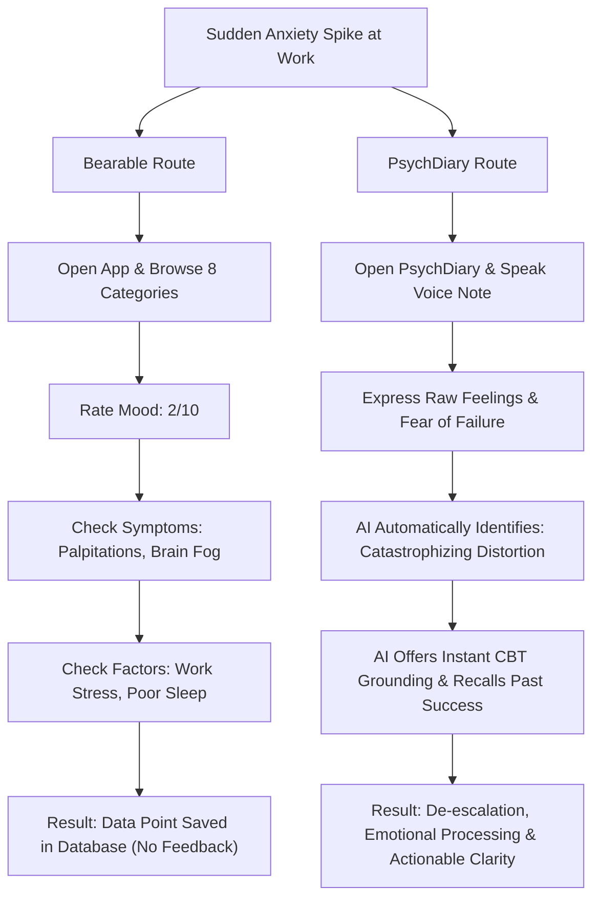
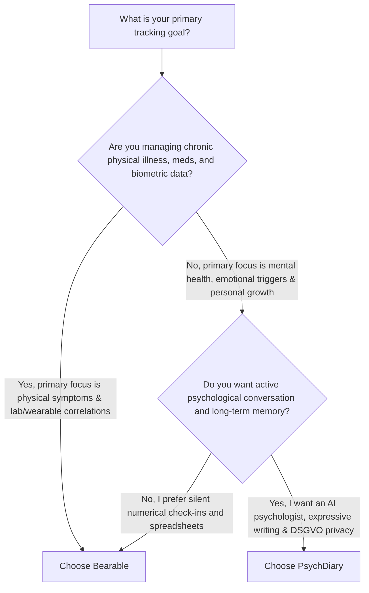

When individuals decide to monitor their mental health and emotional well-being, they frequently encounter two completely different product paradigms: **quantitative symptom tracking** and **AI-powered reflective journaling**.

On one side is **Bearable**, widely regarded as one of the most comprehensive mobile trackers for chronic illness, neurodivergent conditions (such as ADHD), fatigue, medication regimens, and physical symptom correlations. Bearable allows users to log granular ratings across mood, energy levels, physical symptoms, sleep quality, and daily factors through extensive checklists, numerical scales, and visual sliders.

On the other side is **PsychDiary**, an intelligent AI mental health journal designed as a dedicated 24/7 digital psychologist companion. Rather than requiring users to manually tap dozens of checkboxes and calibrate rating scales every morning and evening, PsychDiary invites users to express their unfiltered thoughts naturally through text or voice dictation. Powered by clinical psychological frameworks, PsychDiary **automatically identifies underlying emotional sentiment, detects root psychological triggers, and retains long-term memory across therapy themes, relational dynamics, and cognitive breakthroughs**.

If you are evaluating whether to track your mental health with Bearable or invest your daily reflection in PsychDiary, this comprehensive comparison explores the clinical philosophies, tracking burdens, data privacy safeguards, and real-world outcomes of both tools.

---

  <h4 class="text-dark font-weight-bold mb-2">⚡ TL;DR Verdict: Granular Symptom Logging or Cognitive Breakthroughs?</h4>
  
<strong>Choose Bearable</strong> if your primary objective is tracking physical health comorbidities (such as chronic pain, ME/CFS, fibromyalgia, POTS, or migraines), logging precise medication dosages, importing wearable biometrics from Apple Health or Google Fit, and analyzing statistical factor correlations across complex physical symptoms.

  
<strong>Choose PsychDiary</strong> if your focus is psychological healing, unpacking anxiety and depression, identifying cognitive distortions, understanding the emotional root causes behind your stress without manual tagging, conversing with a 24/7 AI psychologist that remembers your history, and safeguarding your innermost thoughts under strict German DSGVO / GDPR privacy laws.

---

## Side-by-Side Comparison: Bearable vs. PsychDiary

To help clarify how each platform approaches emotional wellness, here is a detailed architectural comparison across core technical, clinical, and usability dimensions:

| Feature / Capability | Bearable | PsychDiary |
| :--- | :--- | :--- |
| **Primary Focus** | Multi-system symptom, chronic illness & lifestyle correlation tracking | Deep cognitive reflection, psychological insight & 24/7 AI companion |
| **Input Methodology** | Numerical sliders, checkboxes, custom rating categories & tags | Freeform natural language writing or voice dictation |
| **Daily Time Commitment** | 5 to 20 minutes (depending on category depth and symptom detail) | 2 to 5 minutes (seamless, conversational, and intuitive) |
| **Trigger Identification** | Manual tag attribution & statistical correlation graphs | **Automatic trigger detection & emotional valence extraction via NLP** |
| **Interactive AI Companion** | None (Passive data logging instrument) | **24/7 Digital Psychologist** delivering CBT reframing & ACT guidance |
| **Long-Term Memory Architecture** | Numerical database metrics & longitudinal graphing | **Proprietary 4-Tier Neural Memory** (Synthesized summaries, facts & semantic recall) |
| **Therapeutic Framework** | Observational biometric & symptom correlation | Evidence-based Cognitive Behavioral Therapy (CBT) & Expressive Writing |
| **Biometric Integration** | Direct sync with Apple Health, Google Fit, Garmin & Oura | Focused purely on emotional and cognitive psychological depth |
| **Data Privacy & Server Hosting** | UK/AWS cloud infrastructure with standard data encryption | **100% German DSGVO / GDPR Compliance** (German servers, zero AI training) |
| **Cross-Platform Parity** | Mobile-only native applications (iOS & Android) | **Full Web browser application, native iOS, and native Android** |
| **Therapy Session Utility** | Exportable PDF correlation charts and symptom trend logs | **Structured weekly clinical summaries bridging the 167-hour therapy gap** |

---

## Where Bearable Wins: Fair Concessions

In line with objective product analysis and Google Review Quality Guidelines, it is essential to highlight where Bearable excels. Bearable was founded by James Sowerby to navigate his own chronic health struggles, and the app has developed exceptional features for specialized use cases:

### 1. Unmatched Granularity for Chronic Illness and Comorbidities
If you live with conditions such as Long COVID, ME/CFS (Myalgic Encephalomyelitis/Chronic Fatigue Syndrome), Ehlers-Danlos Syndrome, postural orthostatic tachycardia syndrome (POTS), or autoimmune flares, Bearable is extraordinary. It allows users to track dozens of distinct physical symptoms simultaneously—from joint inflammation and brain fog to gastrointestinal issues—on standardized severity scales (Mild, Moderate, Severe, Unbearable). PsychDiary is intentionally built for cognitive and psychological reflection, not physical symptom taxonomy.

### 2. Comprehensive Medication and Supplement Tracking
Bearable includes a robust medication and supplement management module. Users can schedule specific dosages, record compliance timestamps, log PRN ("as needed") medications like acute migraine abortives or anti-anxiety prescriptions, and observe how dosage adjustments correlate with symptom severity over weeks or months.

### 3. Biometric & Wearable Device Integration
Bearable integrates directly with Apple Health, Google Fit, and connected wearables. It automatically pulls in resting heart rate, sleep stages, daily step counts, and active energy expenditure. For users who want to see whether a dip in heart rate variability (HRV) precedes a depressive episode or fatigue crash, Bearable provides the data pipeline to visualize those relationships.

### 4. Customizable Category Grids for Quantitative Thinkers
For engineers, data scientists, and individuals on the neurodivergent spectrum who derive comfort from quantitative spreadsheets and statistical dashboards, Bearable’s interface offers deep customization. You can configure custom categories, create unique tags, and organize your daily dashboard according to your exact structural preferences.

---

## Where PsychDiary Wins: Beyond Checklists to True Psychological Transformation

While Bearable excels as a quantitative health spreadsheet, emotional life rarely fits into checkboxes. Human distress is layered, narrative, and contextual. Here is where PsychDiary delivers an unmatched psychological experience:

### 1. Eliminating "Tracker Fatigue" Through Natural Reflection
The biggest pitfall of comprehensive trackers like Bearable is **tracker fatigue**. Opening an app that presents 14 different expandable submenus (Mood, Energy, Sleep, Symptoms, Factors, Meds, Grattitude, Notes) when you are exhausted, anxious, or suffering from executive dysfunction often leads to guilt and abandoned routines. Users often spend 15 minutes checking boxes, only to realize they never actually expressed how they felt.

With PsychDiary, you open the screen and simply speak or write:
> *"I woke up feeling completely drained. My boss questioned my report in front of the regional directors, and I felt that familiar tightness in my chest. I spent the entire afternoon convinced I am going to be fired, even though my performance review last month was stellar."*

In 60 seconds, you have unburdened your mind. You do not need to hunt through menus to find "Work Conflict," "Imposter Syndrome," "Chest Tightness," or "Tiredness." PsychDiary processes your narrative organically.

### 2. Automatic Root-Cause & Hidden Trigger Detection
In Bearable, if you want to know what triggers your low mood, you must proactively anticipate the factor and manually assign the tag. If you did not create a tag for *"Unspoken resentment regarding household chores"* or *"Comparing myself to LinkedIn peers,"* Bearable will never capture that data.

PsychDiary utilizes cutting-edge natural language processing designed specifically for psychological analysis:
- It **identifies cognitive distortions** (such as catastrophizing, mind reading, and black-and-white thinking).
- It **extracts emotional valence and primary triggers** automatically from raw prose.
- It highlights subtle somatic patterns connected to relational stress, revealing dynamics that user-defined checklists routinely miss.

### 3. A 24/7 Digital Psychologist with 4-Tier Long-Term Memory
Bearable is completely non-interactive. It acts as a passive repository: you input numbers, and it stores numbers. It cannot respond to your grief, validate your progress, or challenge your self-critical inner critic.

PsychDiary incorporates a specialized AI companion trained in **Cognitive Behavioral Therapy (CBT)**, **Acceptance and Commitment Therapy (ACT)**, and **Mindfulness-Based Stress Reduction (MBSR)**. Crucially, it operates on a [proprietary 4-tier memory architecture](/blog/ai-memory-explained-mental-health/):
1. **Immediate Contextual Memory**: Remembers the nuances of your current conversation thread.
2. **Episodic Summary Memory**: Condenses past entries into synthesized clinical milestones.
3. **Core Psychological Profile**: Stores enduring psychological facts (e.g., your family history, core values, recurring triggers, career ambitions).
4. **Semantic Retrieval**: Surfaces relevant past breakthroughs when you face a similar emotional roadblock months later.

When you tell PsychDiary you are anxious about an upcoming confrontation, it can gently remind you:
> *"Last November, before your conversation with Mark, you experienced this exact anticipatory anxiety. You wrote that setting that boundary felt terrifying, but your entry two days later noted that Mark respected your terms. What coping tool from that experience can we apply today?"*

A static correlation matrix cannot provide that level of emotional validation and cognitive continuity.

### 4. German DSGVO / GDPR Privacy: The Sovereign Security Standard
Mental health reflections constitute the most sensitive category of personal data that exists. Many commercial apps hosted in jurisdictions like the US or UK rely on commercial cloud services governed by broad data terms, where health information may be pseudonymized and shared with third-party analytics vendors or advertising brokers.

PsychDiary was built in Germany from the ground up to respect the European Union's General Data Protection Regulation (DSGVO / GDPR). To understand the critical importance of server jurisdiction, read our detailed guide on [why German hosting and DSGVO compliance protect your therapy notes](/blog/therapy-notes-privacy-gdpr-mental-health/):
- **Zero Foundation Model Training**: Your deeply personal journal entries are **never** used to train commercial AI models.
- **Physical German Server Hosting**: All data is stored in hardened, ISO 27001-certified German data centers.
- **Strict Data Sovereignty**: Your data is protected by European privacy rights, shielded from arbitrary cross-border data scraping.

### 5. Bridging the 167-Hour Weekly Therapy Gap
For individuals engaged in formal psychotherapy, sessions typically last 50 minutes once a week. The remaining **167 hours** of the week represent the critical window where maladaptive schemas manifest in real time.

While Bearable can export complex multi-page symptom graphs that busy therapists rarely have time to decipher during a 50-minute clinical hour, PsychDiary is engineered specifically to [bridge the 167-hour therapy gap](/blog/ai-psychologist-between-therapy-sessions/). It generates structured, clinician-friendly weekly digests that highlight:
- Key recurring emotional triggers.
- Identified cognitive distortions and progress in reframing them.
- Follow-through on behavioral homework assignments.
- Core emotional themes for discussion in your next session.

### 6. Full Desktop and Web Browser Parity
Bearable is restricted to mobile screens (iPhone and Android). Many people find typing deeply vulnerable psychological reflections on a cramped smartphone touchscreen frustrating. PsychDiary provides a full-featured desktop web application alongside native iOS and Android apps, giving you the freedom to type comfortably on an ergonomic mechanical keyboard during evening journaling sessions.

---

## Practical Scenario: Managing an Acute Anxiety Spiral

To illustrate the difference in user experience, consider how someone experiencing severe workplace anxiety interacts with both applications:

### In Bearable:
1. You feel an acute wave of panic after receiving an unexpected calendar invitation from your executive team.
2. You open Bearable, select Mood (2/10), toggle "Anxiety: High," toggle "Heart Palpitations," check "Work," check "Uncertainty."
3. You save the log.
4. **The Result**: You have recorded that you were anxious. However, your heart rate is still elevated, your catastrophic thoughts remain unchallenged, and you are left alone to manage the impending panic.

### In PsychDiary:
1. You open PsychDiary and tap the microphone: *"My VP just scheduled an urgent one-on-one for tomorrow morning with no agenda. My chest is pounding, and I'm convinced I'm about to get laid off. I can't concentrate on anything."*
2. **PsychDiary’s Immediate Psychological Response**:
   - **Validation & Physiological Grounding**: Reassures you that physiological panic is an understandable adrenaline response and offers a quick 4-7-8 breathing cadence.
   - **Cognitive Reframing (CBT)**: Identifies the *Catastrophizing* and *Fortune Telling* distortions. Gently questions: *"What objective evidence do you possess right now that indicates a layoff, versus other possibilities such as a project reassignment or standard strategic sync?"*
   - **Contextual Memory Anchor**: Recalls an entry from two months ago when an impromptu meeting resulted in praise for your quarterly output.
3. **The Result**: Within three minutes, your cognitive distortion is neutralized, your physiological arousal decreases, and you regain focus to complete your workday.

---

## Who Should Choose Which?

### Choose Bearable If:
- You live with complex physical health conditions (ME/CFS, POTS, fibromyalgia, endometriosis, migraines) and need to track physiological symptom severity.
- You want to monitor exact medication schedules, supplement stacks, and side effects against wearable metrics like sleep duration and heart rate variability.
- You prefer visual checklists, numerical sliders, and statistical correlation graphs over writing narrative paragraphs.
- You strictly use your smartphone for health tracking and do not require a desktop browser interface.

### Choose PsychDiary If:
- Your core struggles revolve around anxiety, depression, burnout, relationship conflict, imposter syndrome, or self-esteem.
- You experience tracker fatigue and want an intuitive journaling experience that takes minutes without managing hundreds of tags.
- You want an intelligent AI psychologist that engages in supportive dialogue, challenges negative thought loops, and remembers your life story.
- You want to bridge the weekly gap between therapy sessions with automated clinical summaries.
- You demand strict German DSGVO / GDPR privacy guarantees ensuring your innermost thoughts are never commercialized or used for AI foundation training.
- You appreciate the flexibility of typing entries on your laptop or speaking voice notes on your mobile device.

---

## Conclusion

Bearable is an exemplary health tracker for anyone managing physical illness, chronic pain, and biometric correlations. Its ability to quantify bodily distress is second to none.

However, when emotional struggles, self-doubt, and interpersonal tensions arise, reducing your lived experience to a number on a slider leaves the mind unheard. Mental health requires expression, compassionate dialogue, and cognitive reframing.

PsychDiary transforms daily journaling into a therapeutic partnership. With automated trigger detection, four-tier neural memory, and uncompromising European privacy standards, it provides the psychological clarity you deserve.

**[Start your journey with PsychDiary today](https://psychdiaryapp.com/)** and experience the difference of an AI journal that truly understands your mind.

---

## Scientific Foundations & Clinical Citations

- **Beck, A. T. (1979)**: *Cognitive Therapy of Depression*. Guilford Press. Demonstrates how identifying and reframing automatic thoughts and cognitive distortions alleviates depressive affect.
- **Pennebaker, J. W., & Beall, S. K. (1986)**: *Confronting a traumatic event: toward an understanding of inhibition and disease*. Journal of Abnormal Psychology, 95(3), 274-281. Establishes the profound physiological and immunological benefits of narrative expressive writing.
- **Emmons, R. A., & McCullough, M. E. (2003)**: *Counting blessings versus burdens: An experimental investigation of gratitude and subjective well-being in daily life*. Journal of Personality and Social Psychology, 84(2), 377-389.
- **Linehan, M. M. (1993)**: *Cognitive-Behavioral Treatment of Borderline Personality Disorder*. Demonstrates the clinical efficacy of combining emotional validation with targeted behavioral regulation.

---

## Medical Disclaimer

> *Medical Disclaimer: PsychDiary is an AI-powered emotional reflection companion and mental wellness platform designed to enhance self-awareness and emotional regulation. It is not a licensed medical provider, diagnostic instrument, or replacement for clinical psychotherapy or medical treatment. If you are experiencing a severe mental health crisis, suicidal ideation, or acute psychiatric distress, please contact your local emergency services immediately or dial 988 (US/Canada) or 112/116 123 (Europe).*

---

## Frequently Asked Questions

### Can I use PsychDiary alongside Bearable?
Yes. Many users who manage chronic health conditions utilize Bearable for their physical biometrics, medication logs, and pain scales, while using PsychDiary for their emotional processing, cognitive reframing, and therapeutic journaling.

### How does PsychDiary detect emotional triggers without manual tags?
PsychDiary uses advanced natural language processing trained on psychological modalities. When you write about your day, the AI automatically extracts themes (such as workplace boundaries, interpersonal conflict, or perfectionism) and correlates them with your emotional sentiment, eliminating the need to manually configure tags.

### Does PsychDiary store my health data under German DSGVO privacy laws?
Yes. PsychDiary is engineered in Germany with strict European data sovereignty. Your entries reside in secure, ISO 27001-certified German data centers and are never used to train public foundation models or shared with third-party advertisers.

### Does PsychDiary support desktop browsers?
Yes. Unlike Bearable, which is mobile-only, PsychDiary offers complete cross-platform parity across native web browsers, iOS, and Android, allowing you to journal on whatever device is most convenient.

