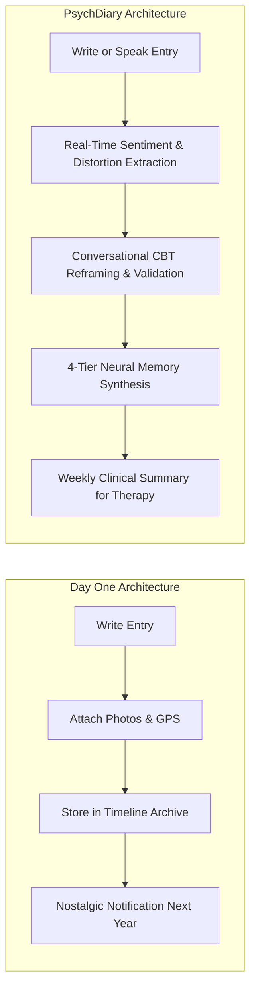
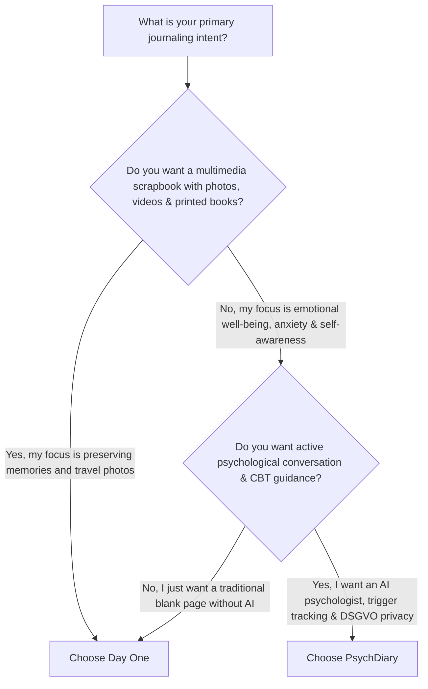

For over a decade, digital journaling has been defined by two distinct aspirations: **preserving life's memories** and **transforming emotional well-being**.

At the forefront of traditional memory preservation stands **Day One**, an Apple Design Award-winning application owned by Automattic (the makers of WordPress). Day One is celebrated as the gold standard for multimedia life-logging, offering elegant typography, rich photo and video attachments, geolocation tagging, weather metadata, calendar timelines, and physical printed books of your memories.

On the other side of the digital journaling revolution is **PsychDiary**, an AI-powered mental health platform engineered to act as a 24/7 digital psychologist companion. While Day One serves as a passive digital scrapbook where memories are cataloged for future nostalgia, PsychDiary is an active therapeutic instrument. It **automatically uncovers underlying emotional triggers, guides you through evidence-based Cognitive Behavioral Therapy (CBT) reframing, and retains multi-layered psychological memory across years of personal growth**.

If you are deciding whether Day One’s classic archival features or PsychDiary’s active psychological guidance best serves your daily routine, this in-depth comparative review explores the key distinctions in therapeutic depth, privacy architecture, and emotional outcomes.

---

  <h4 class="text-dark font-weight-bold mb-2">⚡ TL;DR Verdict: Passive Memory Archive or Active Emotional Healing?</h4>
  
<strong>Choose Day One</strong> if your primary goal is chronicling your life journey with multimedia (photos, videos, audio recordings, geotags), enjoying "On This Day" nostalgic retrospectives, printing high-quality physical hardcover memory books, and staying deeply immersed in the Apple ecosystem.

  
<strong>Choose PsychDiary</strong> if you turn to journaling to overcome anxiety, process depression, resolve relationship friction, understand why certain events trigger emotional overwhelm, converse with an empathetic 24/7 AI psychologist, bridge the gap between therapy sessions, and protect your data under strict German DSGVO / GDPR privacy laws.

---

## Side-by-Side Comparison: Day One vs. PsychDiary

To help you understand the architectural and practical differences between a digital life-logger and a clinical AI companion, examine the following comparison matrix:

| Feature / Capability | Day One Journal | PsychDiary |
| :--- | :--- | :--- |
| **Core Product Philosophy** | Passive multimedia archiving & digital life scrapbook | Active psychological transformation & 24/7 digital psychologist |
| **Input Modalities** | Rich text, Markdown, photos, videos, audio voice memos, PDFs | Conversational natural text writing & seamless voice dictation |
| **Interactive AI Feedback** | None (Static personal diary without conversational AI) | **Active 24/7 AI Companion** providing clinical CBT & ACT reframing |
| **Trigger & Sentiment Analysis** | None (Manual searching and user-assigned tags only) | **Automated emotional valence and root-cause trigger detection** |
| **Memory Recall Mechanism** | Chronological calendar, search filters & "On This Day" retrospectives | **4-Tier Neural Memory** (Synthesized milestones, core facts & semantic recall) |
| **Physical Artifacts** | Hardcover and softcover printed book publishing | Pure digital focus on psychological progress and clinical continuity |
| **Ecosystem & Platform Parity** | Strongly optimized for Apple (iOS/macOS/watchOS); basic Android/Web | **Identical feature parity across Web, iOS, and Android** |
| **Therapy Session Integration** | Basic PDF entry exports | **Weekly structured clinical digests bridging the 167-hour therapy gap** |
| **Data Privacy & Server Hosting** | Proprietary E2EE sync on AWS infrastructure (US-based) | **100% German DSGVO / GDPR Compliance** (German servers, zero AI training) |
| **Cognitive Distortion Detection** | Not supported | **Automatic identification of catastrophic thinking, mind reading, etc.** |

---

## Where Day One Wins: Fair Concessions

To adhere to balanced evaluation standards under Google Review Quality Guidelines, it is important to acknowledge why Day One remains an exceptional application for millions of diarists worldwide:

### 1. Rich Multimedia Archiving & Digital Scrapbooking
Day One has perfected the aesthetic art of digital life-logging. A single entry can combine high-resolution photos, 4K video clips, recorded audio snippets, Apple Health step totals, current ambient temperature, and exact GPS coordinates on an interactive world map. If you are documenting an international sabbatical, your child’s developmental milestones, or daily culinary adventures, Day One is unmatched. PsychDiary is focused on cognitive and emotional processing, intentionally avoiding heavy photo or video albums.

### 2. Apple Ecosystem Polish & System Integrations
Day One offers deep integration with Apple hardware and software. It features native watchOS audio recording, rich iOS lock screen widgets, Siri Shortcuts, and Mac menu bar quick-entry popups. For committed Apple users who value tight system integrations, Day One feels like a native extension of macOS and iOS.

### 3. Nostalgic "On This Day" Retrospectives
One of Day One’s most beloved features is its "On This Day" prompt. Every morning, the app notifies you of what you wrote exactly one, three, or seven years ago today. This creates an emotional nostalgic loop that reinforces the long-term habit of capturing daily milestones.

### 4. Physical Hardcover Book Printing
Day One provides a built-in printing service that formats your digital journals into beautifully bound, full-color hardcover books. For parents, travelers, and family historians who want an enduring physical heirloom on their bookshelf, this is a unique and valuable capability.

### 5. Zero-Knowledge End-to-End Encryption (E2EE)
Day One utilizes client-side zero-knowledge encryption keys for its synchronization service. Even Automattic engineers cannot decrypt the stored contents of your journal if you enable this security layer, offering reassurance to users who prioritize cryptographic client-side locks for personal archives.

---

## Where PsychDiary Wins: From Passive Cataloging to Active Emotional Clarity

While Day One is fantastic for preserving what happened in the outside world, it offers very little guidance for what is occurring in your **inner psychological world**. Writing down your pain in a blank notebook or a static app often leaves you trapped in the same unhelpful ruminations. Here is where PsychDiary transforms the journaling experience:

### 1. Passive Archiving vs. Active Cognitive Processing
Consider the fundamental difference between archiving a crisis and resolving it:
- In **Day One**, you write: *"I feel like an utter failure. My pitch was rejected by the executive committee, and I couldn't stop shaking. I am clearly not cut out for this job."* The app timestamps your entry, records the rainy weather, and archives your distress. Next year, it will remind you of that terrible afternoon.
- In **PsychDiary**, you write that exact same entry. Immediately, your **24/7 Digital Psychologist** steps in. It validates your emotional vulnerability, highlights the cognitive distortion (*All-or-Nothing Thinking* and *Overgeneralization*), and guides you through an evidence-based reframing exercise:
  > *"It is completely natural to feel shaken after pouring weeks of effort into a pitch. But notice how your mind jumped from 'this pitch was rejected' to 'I am an utter failure.' Let's separate the outcome of this single presentation from your professional competence. What specific feedback did the committee give that we can use as a strategic adjustment?"*

With PsychDiary, you don't merely document a setback—you cognitively metabolize it and walk away with psychological resilience.

### 2. Automatic Sentiment and Hidden Trigger Detection
In traditional journals like Day One, uncovering why you felt depressed or anxious over the past six months requires tedious manual searching, filtering tags, or reading through hundreds of raw entries.

PsychDiary analyzes your entries automatically in the background using clinical natural language processing:
- It tracks your emotional valence over time.
- It highlights hidden, recurring triggers (such as chronic boundary violations with family, perfectionism before deadlines, or caffeine-induced anxiety surges).
- It synthesizes these trends into easy-to-read clinical insights, revealing emotional patterns you might never have noticed on your own.

### 3. 4-Tier Neural Memory: A Companion That Truly Remembers
Day One searches your history through keywords and dates. It does not understand who you are, how your relationships have evolved, or what coping strategies worked for you in the past.

PsychDiary is built upon a [proprietary 4-tier neural memory system](/blog/ai-memory-explained-mental-health/):
1. **Immediate Contextual Memory**: Maintains continuity during ongoing conversational reflections.
2. **Episodic Summary Memory**: Automatically synthesizes weekly emotional themes into longitudinal narratives.
3. **Core Psychological Profile**: Safely records enduring values, family relationship dynamics, professional goals, and identified behavioral patterns.
4. **Semantic Retrieval**: Intelligently surfaces past therapeutic breakthroughs when you encounter similar emotional difficulties months later.

When you journal about setting a difficult boundary with your partner, PsychDiary remembers the conversation you had three months ago about assertiveness, providing continuous, personalized psychological support.

### 4. German DSGVO / GDPR Privacy: The Sovereign European Standard
When choosing a mental health journal, the legal and physical jurisdiction of your data is paramount. Day One is owned by a US corporation subject to US regulatory and surveillance frameworks. 

PsychDiary is engineered in Germany and hosted in high-security, ISO 27001-certified German data centers under the European Union’s **General Data Protection Regulation (DSGVO / GDPR)**. Learn more in our comprehensive breakdown of [why German data sovereignty matters for therapy notes](/blog/therapy-notes-privacy-gdpr-mental-health/):
- **Zero AI Model Training**: Your personal reflections are strictly private and are **never** utilized to train external or public AI models.
- **Strict Data Sovereignty**: German privacy laws enforce the world's most rigorous protections against commercial surveillance and unauthorized third-party sharing.
- **Enterprise-Grade Encryption**: Full encryption in transit and at rest safeguards every sentence you entrust to the platform.

### 5. Bridging the 167-Hour Therapy Gap
If you see a licensed psychotherapist, you know the frustration of arriving at your weekly 50-minute appointment only to draw a blank when asked, *"How was your week?"* The other **167 hours** of the week are when emotions actually happen.

Day One allows you to export a massive PDF of unstructured diary pages, which no therapist has time to read. PsychDiary is engineered specifically to [bridge the 167-hour weekly therapy gap](/blog/ai-psychologist-between-therapy-sessions/). It synthesizes your week into a structured clinical summary detailing:
- Primary emotional triggers encountered.
- Cognitive distortions recognized and reframed.
- Progress on homework or behavioral activation goals.
- Key discussion prompts for your upcoming therapy session.

### 6. True Cross-Platform Parity (Web, iOS, Android)
While Day One has long prioritized the Apple ecosystem—leaving Android and Web users with significantly delayed features and limited interfaces—PsychDiary was designed from the beginning as an open, accessible platform. Whether you are typing at your desktop browser on Windows, writing on an iPad, or dictating a voice note on an Android phone, your experience is smooth, responsive, and identical across all devices.

---

## Practical Comparison: The Architecture of an Entry

---

## Who Should Choose Which?

### Choose Day One If:
- You want to build a rich multimedia family chronicle or travelogue filled with photos, videos, and ambient audio clips.
- You love the idea of printing physical hardcover books of your journal entries at the end of the year.
- You are heavily invested in the Apple ecosystem (Mac, iPhone, iPad, Apple Watch) and value native OS integrations.
- You prefer a traditional, passive diary where the software acts as a silent digital repository.

### Choose PsychDiary If:
- You turn to journaling as a coping mechanism for stress, anxiety, burnout, depressive feelings, or life transitions.
- You find staring at a blank page intimidating and want an empathetic AI psychologist to guide your reflection.
- You want to identify recurring emotional triggers and cognitive distortions automatically without manual tagging.
- You are in therapy (or on a waiting list) and need an evidence-based tool to bridge the 167-hour weekly gap.
- You prioritize German DSGVO / GDPR privacy protections and demand that your health thoughts never train AI models.
- You work across multiple operating systems (Windows, Mac, Linux, Android, iOS) and require seamless web browser access.

---

## Conclusion

Day One remains an exceptional tool for documenting life’s milestones, travel memories, and family histories. If your goal is to build an archival time capsule of where you traveled and what you saw, it is an industry leader.

However, if your goal is personal growth, emotional healing, and mental wellness, simply recording your thoughts is not enough. You need an environment that listens, challenges negative mental loops, and guides you toward cognitive clarity.

PsychDiary merges the time-tested benefits of expressive writing with the intelligence of an empathetic 24/7 digital psychologist—safeguarded by world-class German privacy.

**[Start your free journey with PsychDiary today](https://psychdiaryapp.com/)** and transform your daily journaling into a pathway for genuine emotional resilience.

---

## Scientific Foundations & Clinical Citations

- **Beck, A. T. (1979)**: *Cognitive Therapy of Depression*. Guilford Press. Establishes the clinical framework for identifying cognitive distortions to relieve emotional distress.
- **Pennebaker, J. W., & Beall, S. K. (1986)**: *Confronting a traumatic event: toward an understanding of inhibition and disease*. Journal of Abnormal Psychology, 95(3), 274-281. Demonstrates the immunological and psychological benefits of structured expressive writing over passive note-taking.
- **Emmons, R. A., & McCullough, M. E. (2003)**: *Counting blessings versus burdens: An experimental investigation of gratitude and subjective well-being in daily life*. Journal of Personality and Social Psychology, 84(2), 377-389.
- **Gross, J. J. (2002)**: *Emotion regulation: Affective, cognitive, and social consequences*. Psychophysiology, 39(3), 281-291. Highlights the superiority of cognitive reappraisal over emotional suppression or passive rumination.

---

## Medical Disclaimer

> *Medical Disclaimer: PsychDiary is an AI-powered emotional reflection companion and mental wellness platform designed to enhance self-awareness and emotional regulation. It is not a licensed medical provider, diagnostic instrument, or replacement for clinical psychotherapy or medical treatment. If you are experiencing an acute mental health crisis, suicidal thoughts, or psychiatric distress, please contact your local emergency services immediately or dial 988 (US/Canada) or 112/116 123 (Europe).*

---

## Frequently Asked Questions

### Can I migrate my old entries from Day One into PsychDiary?
Yes. You can export your plain text or markdown journal entries from Day One and import them into PsychDiary. Once imported, PsychDiary's AI can analyze past themes to build your foundational psychological profile.

### Why doesn't Day One offer conversational AI feedback?
Day One was founded as a traditional, passive memory chronicle focused on digital archiving and personal scrapbooking. Its product architecture is not designed as an active conversational therapeutic companion.

### Is PsychDiary compliant with German DSGVO (GDPR) data privacy laws?
Yes. PsychDiary is engineered in Germany with strict European data sovereignty. Your entries are stored in secure, ISO 27001-certified German data centers, protected by stringent European privacy laws, and never used to train public foundation models.

### Does PsychDiary work well on desktop web browsers?
Yes, absolutely. PsychDiary provides full feature parity across web browsers on Mac, Windows, and Linux, as well as native iOS and Android apps, allowing you to journal comfortably on your desktop keyboard.

