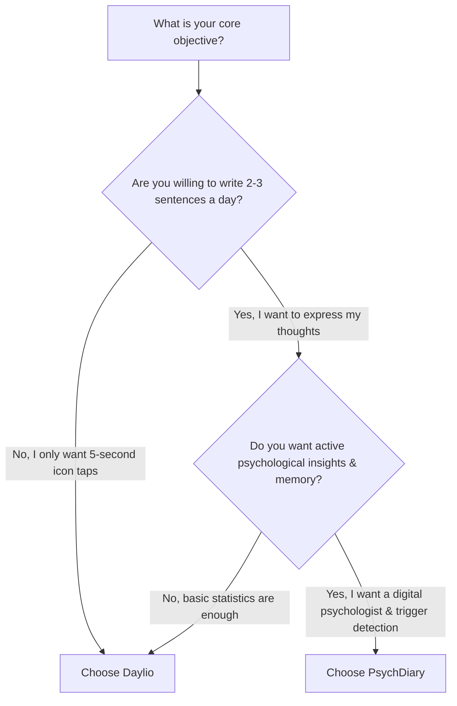

When it comes to tracking daily mental health, two distinct philosophies have emerged over the last decade: **micro-mood tracking** and **AI-powered reflective journaling**.

On one end of the spectrum is **Daylio**, the undisputed pioneer of icon-based micro-tracking. Daylio allows users to log their mood in less than ten seconds by selecting an emoji and tapping activity icons like "work," "gaming," or "gym."

On the other end is **PsychDiary**, a next-generation AI journal designed as a 24/7 digital psychologist companion. Instead of forcing you to reduce complex emotional nuance into five static smiley faces, PsychDiary lets you write or speak naturally, using advanced natural language processing to **automatically detect emotional sentiment, diagnose root triggers, and remember your personal story across months and years**.

If you are trying to decide whether to download Daylio or commit to PsychDiary, this side-by-side comparison reveals the key trade-offs in clinical effectiveness, cognitive depth, and data privacy.

---

  <h4 class="text-dark font-weight-bold mb-2">⚡ TL;DR Verdict: Micro-Tracking or AI Deep Dive?</h4>
  
<strong>Choose Daylio</strong> if you have severe journaling fatigue, want to track habits in under 5 seconds a day without writing a single sentence, and prefer a colorful, offline-first icon tracker with customizable mood scales.

  
<strong>Choose PsychDiary</strong> if you want meaningful emotional growth, active cognitive reframing, automatic trigger detection that uncovers why you feel stressed, a companion that actually remembers your past therapy themes, and enterprise-grade German DSGVO/GDPR privacy protection.

---

## Side-by-Side Comparison: Daylio vs. PsychDiary

Here is an architectural comparison of Daylio’s micro-entry model versus PsychDiary’s deep psychological reflection engine:

| Feature / Capability | Daylio | PsychDiary |
| :--- | :--- | :--- |
| **Tracking Philosophy** | Micro-tracking (5-second icon & emoji tapping) | Deep reflective journaling with AI psychological analysis |
| **Entry Input Format** | 5 mood ratings + customizable activity icons | Freeform natural text or voice dictation |
| **Trigger Identification** | Manual correlation (User must remember to tap tags) | **Automatic trigger detection & sentiment breakdown** |
| **Interactive AI Companion** | None (Passive logging tool) | **24/7 Digital Psychologist** offering empathetic reflection & CBT reframing |
| **AI Memory Architecture** | N/A (Statistical aggregation only) | **4-Layer Multi-Memory** (Short-term context, auto-summaries, permanent facts, semantic recall) |
| **Therapeutic Depth** | Descriptive correlation (e.g., "Gym correlates with Good Mood") | Diagnostic & cognitive (Identifies cognitive distortions, emotional cycles, root causes) |
| **Data Privacy & Hosting** | Local device storage with Google Drive / iCloud backup | **100% German DSGVO / GDPR Compliance** (German servers, zero AI training) |
| **Cross-Platform Access** | Mobile apps (iOS & Android) | **Full Web browser application, iOS, and Android** |
| **Offline Functionality** | Fully offline capable | Offline entry drafting with cloud AI synchronization |
| **Therapy Companion Utility** | Exportable monthly mood chart PDFs | **Structured weekly summaries designed to bridge the 167-hour therapy gap** |

---

## Where Daylio Wins: Fair Concessions

To adhere to balanced product evaluation standards, we recognize the distinct advantages that have made Daylio a beloved app for millions of users:

### 1. Zero Friction (The 5-Second Check-In)
Daylio’s greatest triumph is accessibility. Staring at an empty page when you are physically exhausted or deeply depressed can feel insurmountable. Daylio solves this by making logging frictionless: tap a mood (Rad, Good, Meh, Fugly, Awful), tap two activity icons, and you are done. If habit formation is your single biggest hurdle, Daylio’s micro-format makes maintaining a 100-day streak effortless.

### 2. Complete Icon Customization & Gamification
Daylio allows users to build an extensive personalized taxonomy. You can create custom categories for medications, social interactions, weather, work projects, and hobbies, complete with customized iconography and color palettes.

### 3. Local-First Offline Operation
Daylio functions completely offline without requiring an account or server connection. For users who reside in areas with unstable internet connectivity or who prefer their data to remain strictly on their physical handset (with optional encrypted Google Drive or iCloud backups), Daylio’s local-first architecture is a notable benefit.

---

## Where PsychDiary Wins: Beyond Surface-Level Moods

While Daylio makes tracking fast, its fundamental limitation is that **it tracks symptoms, not causes**. Here is why PsychDiary delivers far greater psychological transformation:

### 1. The Clinical Power of Expressive Writing
Decades of psychological research pioneered by Dr. James Pennebaker at the University of Texas demonstrate that **expressive writing**—putting complex feelings into words—produces profound physiological and psychological benefits, including reduced cortisol levels, strengthened immune function, and decreased depressive symptoms.

Tapping an icon that says "Work" and a frowning face does not process the emotion. It merely logs that distress occurred.

PsychDiary provides an open canvas where you articulate *why* work felt suffocating. Did an ambiguous email trigger imposter syndrome? Did a team meeting make you feel unvalued? PsychDiary allows you to express your lived experience and receive immediate, empathetic cognitive guidance.

### 2. Automatic Sentiment and Hidden Trigger Detection
With Daylio, if you forget to create an icon for "Conflict with mother-in-law" or fail to tap it on a busy Tuesday, Daylio will never know it happened.

**PsychDiary analyzes your unstructured prose automatically**:
- You write: *"Had a terrible headache after dinner. Mom called again asking when I'm visiting for Easter, and my chest felt tight all evening."*
- PsychDiary automatically classifies your mood valence, isolates "Family Obligations" and "Unset Boundaries" as negative triggers, and identifies "Somatic Tension (Chest tightness)" as a physical stress indicator.

You never have to maintain an unwieldy library of hundreds of custom tags; the AI identifies your patterns automatically.

### 3. An Interactive 24/7 Digital Psychologist with True Memory
Daylio is a mute digital logbook. It cannot talk back, it cannot ask clarifying questions, and it cannot guide you through an acute anxiety spike.

PsychDiary features an interactive digital psychologist grounded in **Cognitive Behavioral Therapy (CBT)** and **Acceptance and Commitment Therapy (ACT)**. More importantly, it possesses a proprietary [4-tier persistent memory architecture](/blog/ai-memory-explained-mental-health/):
- When you mention feeling anxious about your presentation next Thursday, PsychDiary remembers that public speaking has been a recurring trigger for you since October.
- It can refer back to past entries to remind you: *"Remember when you felt this exact same dread before the team retrospective last month? You rated that entry a 9/10 in anxiety, but your post-meeting entry noted that everyone applauded your proposal."*

Daylio’s charts can show you that you felt "Meh" last month, but it cannot contextualize why or show how you overcame it.

### 4. German DSGVO / GDPR Privacy: Absolute Medical-Grade Discretion
Mental health data requires the highest confidentiality standard in software. PsychDiary was engineered in Germany to adhere to the world’s strictest privacy law: the **European Union DSGVO (GDPR)** (read our comprehensive analysis of [why German data protection matters for mental health apps](/blog/therapy-notes-privacy-gdpr-mental-health/)):
- All data resides on hardened, secure servers inside Germany.
- Your deeply personal diary entries are **never used to train commercial AI foundation models**.
- PsychDiary enforces end-to-end data encryption in transit and at rest.

### 5. Bridging the 167-Hour Gap Between Therapy Sessions
If you work with a licensed therapist, you spend roughly 1 hour in session each week. The remaining **167 hours** are when emotional triggers occur in real time.

Daylio provides your therapist with a color-coded bar chart. While interesting, it tells the clinician very little about your internal thought patterns. PsychDiary is specifically built to [bridge the 167-hour weekly therapy gap](/blog/ai-psychologist-between-therapy-sessions/), creating **structured psychological summaries** highlighting recurring cognitive distortions (e.g., all-or-nothing thinking, emotional reasoning), specific relational conflicts, and progress on homework assignments—giving your therapist actionable clinical data.

---

## Detailed Comparison: Superficial Correlation vs. Root Cause

To understand the practical difference, consider how both applications handle a stressful Tuesday:

### The Daylio Experience:
1. You open the app.
2. You select: **Mood: Awful** ☹️.
3. You tap icons: **Work** 💼, **Family** 👨‍👩‍👧, **Bad Sleep** 💤.
4. Total time spent: 8 seconds.
5. **The Outcome**: At the end of the month, your chart shows that "Work" and "Family" correlate with bad moods. But you gain zero insight into how to change the underlying dynamics.

### The PsychDiary Experience:
1. You open the app and type or dictate: *"Work was completely overwhelming today because my manager changed the project deadline without telling me. I felt like screaming, but instead I just shut down. When I came home, my partner asked me what was wrong and I snapped at them."*
2. **PsychDiary’s Immediate Output**:
   - **Mood Valence**: Highly Negative (Stress / Overwhelm / Guilt).
   - **Primary Triggers**: Boundary violation / Lack of workplace control / Displaced frustration onto partner.
   - **Cognitive Reframing**: The AI validates your feeling of frustration, guides you through a brief grounding exercise, and gently points out the displaced anger toward your partner, prompting you with a constructive phrase you can use to repair the conversation tonight.
3. **The Outcome**: You resolve the interpersonal friction before bedtime and build tangible emotional regulation skills for tomorrow.

---

## Who Should Choose Which?

### Choose Daylio If:
- You have tried journaling repeatedly and consistently abandoned it after three days.
- You want an ultra-fast, 5-second tracking routine to monitor basic lifestyle habits like water intake, exercise, and sleep.
- You want complete local-first offline storage without creating an account.

### Choose PsychDiary If:
- You want to understand the **root causes** behind your emotional fluctuations, not just count them.
- You want **automatic sentiment and trigger extraction** without the hassle of building hundreds of custom tags.
- You want an AI companion with persistent memory that tracks your psychological growth over years.
- You are in therapy and want an evidence-based tool to bridge the 167-hour weekly gap.
- You value European data sovereignty and German DSGVO privacy standards.

---

## Conclusion

Daylio is a magnificent tool for habit logging and high-level mood charting. But when life gets complicated, five smiling icons cannot unpack grief, career burnout, or relationship conflict.

PsychDiary combines the therapeutic depth of expressive journaling with the intelligence of a 24/7 digital psychologist—backed by ironclad German privacy and multi-layered memory.

**[Start your free journey with PsychDiary today](https://psychdiaryapp.com/)** and discover what your entries are truly telling you.

---

## Scientific Foundations & Clinical Citations

- **Pennebaker, J. W., & Beall, S. K. (1986)**: *Confronting a traumatic event: toward an understanding of inhibition and disease*. Journal of Abnormal Psychology, 95(3), 274-281.
- **Emmons, R. A., & McCullough, M. E. (2003)**: *Counting blessings versus burdens: An experimental investigation of gratitude and subjective well-being in daily life*. Journal of Personality and Social Psychology, 84(2), 377-389.
- **Da Jiang et al. (2022)**: *Gratitude and daily stress: A 14-day longitudinal intervention predicting positive affect and stress buffering*. Stress and Health, 38(4), 712-723.

---

## Medical Disclaimer

> *Medical Disclaimer: PsychDiary is an AI-powered emotional reflection companion and mental wellness tool designed to foster self-awareness and emotional regulation. It is not a licensed medical provider, diagnostic instrument, or replacement for clinical psychotherapy. If you are experiencing a mental health crisis, suicidal thoughts, or severe psychiatric distress, please contact your local emergency services or call/text 988 (US/Canada) or 112/116 123 (Europe).*

---

## Frequently Asked Questions

### Can I transition from Daylio to PsychDiary easily?
Yes. If you have been using Daylio to log moods, you will find PsychDiary’s transition effortless. Instead of tapping icons, you can simply write or dictate a brief sentence about your day. PsychDiary’s AI handles the categorization and sentiment scoring automatically.

### Does PsychDiary require manual tag creation like Daylio?
No. Unlike Daylio, where you must manually create and select activity icons (e.g., Work, School, Partner), PsychDiary uses advanced natural language processing to extract positive highlights, challenges, and emotional triggers directly from your natural writing.

### Is PsychDiary compliant with German DSGVO (GDPR) data privacy laws?
Yes, absolutely. PsychDiary is engineered with a privacy-first architecture, hosted on secure servers in Germany, and complies fully with European Union DSGVO / GDPR regulations. Your data is encrypted and is never used to train public AI models.

### Does PsychDiary work on desktop computers?
Yes. PsychDiary offers full cross-platform parity across native web browsers, iOS, and Android, allowing you to write on your laptop keyboard or reflect on your smartphone with instant cloud synchronization.

