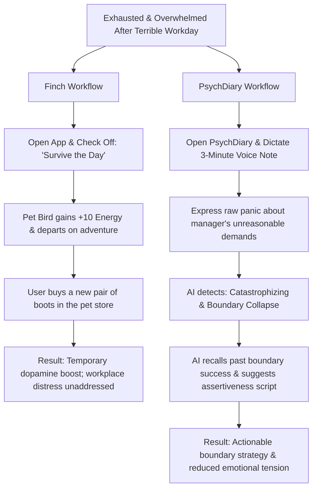
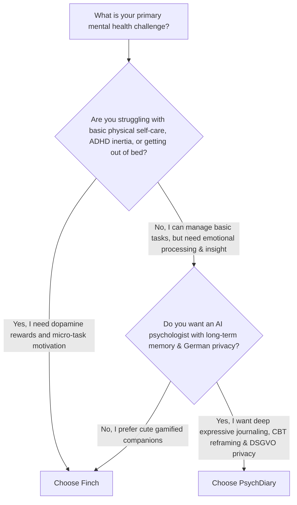

In the landscape of modern mental health applications, two wildly different methodologies have captivated users seeking emotional well-being: **gamified self-care pets** and **AI-powered reflective journaling**.

On one side is **Finch: Self-Care Pet**, a viral sensation designed around raising a virtual companion bird. By completing micro-habits—such as getting out of bed, drinking a glass of water, or surviving the workday—users earn energy stones and rainbow gems to dress up their pet, decorate a digital treehouse, and send their companion on global adventures. Finch has won the hearts of millions, particularly within the neurodivergent and ADHD communities, by turning self-care into a compassionate, dopamine-rewarded game.

On the other side is **PsychDiary**, a sophisticated digital mental health journal built as an intelligent 24/7 digital psychologist companion. PsychDiary does not use game mechanics, virtual currencies, or cartoon outfits. Instead, it harnesses the proven clinical power of expressive writing and evidence-based Cognitive Behavioral Therapy (CBT). It **automatically detects emotional sentiment, identifies root psychological triggers, provides nuanced cognitive reframing, retains multi-layered long-term memory, and safeguards user data under strict German DSGVO / GDPR privacy laws**.

If you are trying to decide whether Finch’s gamified virtual pet or PsychDiary’s deep psychological reflection is the right choice for your mental health journey, this comprehensive comparison explores the trade-offs between dopamine-driven habit initiation and deep cognitive healing.

---

  <h4 class="text-dark font-weight-bold mb-2">⚡ TL;DR Verdict: Gamified Habit Pet or Deep Psychological Transformation?</h4>
  
<strong>Choose Finch</strong> if you struggle with severe executive dysfunction, ADHD paralysis, or debilitating depressive inertia where basic self-care tasks (brushing teeth, getting out of bed, drinking water) feel impossible, and you respond positively to cute gamification, virtual pet outfits, and dopamine rewards.

  
<strong>Choose PsychDiary</strong> if you want to understand the psychological root causes behind your anxiety, process complex relational conflicts, reframe cognitive distortions with a 24/7 digital psychologist, maintain a 4-tier longitudinal memory of your mental health journey, bridge the gap between weekly therapy sessions, and protect your most private thoughts under rigorous German DSGVO / GDPR standards.

---

## Side-by-Side Comparison: Finch vs. PsychDiary

To clarify the structural differences between a gamified habit-builder and an AI psychological journal, examine this side-by-side feature matrix:

| Feature / Capability | Finch: Self-Care Pet | PsychDiary |
| :--- | :--- | :--- |
| **Core Product Philosophy** | Gamified habit building & virtual pet caretaking | Deep psychological reflection & 24/7 digital psychologist |
| **Primary Mechanism** | Micro-tasks rewarded with in-game currency & pet accessories | Freeform expressive writing & voice dictation with CBT reframing |
| **Ideal For** | Overcoming acute executive dysfunction, ADHD & depressive inertia | Processing complex emotions, relational stress, burnout & anxiety |
| **Interactive AI Companion** | Virtual pet (Pre-scripted emotional reactions & cheerful quotes) | **Clinical AI Psychologist** offering CBT, ACT, and Schema reframing |
| **Trigger & Sentiment Analysis** | Manual selection from preset emoji feelings and micro-prompts | **Automatic extraction of sentiment and root psychological triggers** |
| **Memory Architecture** | Pet growth milestones, wardrobe history & basic tag statistics | **Proprietary 4-Tier Neural Memory** (Synthesized milestones & semantic recall) |
| **Social / Gamified Features** | "Treehouse Friends" social network, pet outfits & seasonal events | Zero gamification; completely focused, distraction-free introspection |
| **Therapy Session Bridge** | Basic journal search & streak tracking | **Structured weekly clinical summaries bridging the 167-hour therapy gap** |
| **Data Privacy & Server Hosting** | Local device storage with optional cloud backup (US-based) | **100% German DSGVO / GDPR Compliance** (German servers, zero AI training) |
| **Cross-Platform Access** | Mobile-only native apps (iOS & Android) | **Full Web browser application, native iOS, and native Android** |
| **Tone and Aesthetic** | Whimsical, colorful, cartoon-styled, playful | Elegant, mature, clean, calming, and clinically focused |

---

## Where Finch Wins: Fair Concessions

To adhere to objective, high-quality review standards meeting Google Review Quality Guidelines, it is essential to highlight where Finch delivers unmatched clinical value:

### 1. Breaking Depressive Inertia and Executive Dysfunction
For someone experiencing acute major depression or severe ADHD paralysis, the advice to "write in a journal" or "reframe your cognitive distortions" can feel completely out of reach. Finch understands that when you are trapped in bed, even standing up is a monumental victory. By rewarding users with tangible virtual gems for micro-goals—such as "Drink water," "Step outside for 30 seconds," or "Brush hair"—Finch provides an immediate external dopamine boost that breaks the paralysis of inertia.

### 2. Gentle, Non-Punitive Gamification
Unlike traditional habit trackers that punish users by breaking long streaks or showing aggressive red warning icons, Finch is designed with radical self-compassion. If you miss three days, your pet bird does not get sick or die; it simply greets you warmly upon your return, assuring you that resting is okay. For individuals burdened by intense perfectionism or shame, this gentle gamification is profoundly comforting.

### 3. Tangible Dopamine Rewards & Aesthetic Customization
Finch turns self-care into a delightful mini-game. You can equip your bird with scarves, boots, glasses, and wizard hats, or redesign its treehouse with seasonal wallpaper and furniture. For users who thrive on visual progression and tactile digital collectibles, this creates a fun incentive loop that encourages daily check-ins.

### 4. Community Good Vibes (Non-Toxic Social Connection)
Finch features a wholesome social mechanism where you can add friends to your "Tree Town." Instead of public feeds, comments, or likes that trigger comparison anxiety, friends can only send predetermined "Good Vibes" (such as a hug, a water reminder, or a dance party). This offers gentle social support without the toxicity of social media.

---

## Where PsychDiary Wins: Beyond Virtual Pets to Genuine Psychological Growth

While Finch is extraordinary for getting out of bed and completing micro-tasks, its fundamental limitation is that **dressing up a virtual pet does not resolve deep emotional wounds**. Virtual gems cannot untangle imposter syndrome, resolve childhood trauma, or teach you how to establish boundaries with a narcissistic boss. Here is where PsychDiary delivers true psychological depth:

### 1. Deep Emotional Processing vs. Superficial Micro-Prompts
Finch includes brief reflection prompts, but they are typically limited to short check-ins (e.g., *"Name one thing that made you smile today"* or tapping an emoji for how you feel). When users experience profound grief, panic, or relational turmoil, these shallow prompts can feel trivializing.

PsychDiary provides an open, mature canvas for **expressive writing**. Research pioneered by Dr. James Pennebaker proves that narrative emotional disclosure produces significant long-term psychological resilience, reduced autonomic nervous system arousal, and enhanced cognitive clarity. PsychDiary gives you the space to unpack messy, multifaceted emotions without forcing you into a cartoon interface.

### 2. A 24/7 Digital Psychologist with Clinical Insight
Finch’s pet bird responds with cute, pre-scripted lines like: *"You did it! I'm so proud of you!"* While sweet, it cannot engage in real therapeutic dialogue.

PsychDiary is powered by an intelligent digital psychologist trained in **Cognitive Behavioral Therapy (CBT)**, **Acceptance and Commitment Therapy (ACT)**, and **Schema Therapy**. When you write about feeling like an imposter after a promotion, PsychDiary:
- Validates the vulnerability of stepping into higher responsibility.
- Identifies the specific cognitive distortion (*Discounting the Positive* and *Emotional Reasoning*).
- Helps you examine objective counter-evidence to reframe your internal narrative constructively.

### 3. Proprietary 4-Tier Memory: A Companion That Never Forgets
Finch has no meaningful conversational memory. It does not understand who your family members are, what therapeutic breakthroughs you experienced last month, or how your panic attacks typically manifest.

PsychDiary operates on a [cutting-edge 4-tier neural memory architecture](/blog/ai-memory-explained-mental-health/):
1. **Immediate Contextual Memory**: Retains the complete context of your current journaling session.
2. **Episodic Summary Memory**: Synthesizes weekly reflections into structured psychological milestones.
3. **Core Psychological Profile**: Safely retains your enduring values, family relationship dynamics, and recurring triggers.
4. **Semantic Retrieval**: Surfaces relevant past breakthroughs when you face a similar emotional roadblock months later.

When you write about feeling abandoned during a disagreement with your partner, PsychDiary remembers the conversation you had three months ago about attachment styles, offering profound continuity that a virtual pet cannot match.

### 4. Automatic Trigger and Sentiment Detection
In Finch, if you want to track what affects your mood, you must manually select tags from predefined lists.

PsychDiary analyzes your natural writing automatically using psychological NLP:
- It tracks your emotional valence over time.
- It identifies hidden triggers (e.g., perfectionism, lack of sleep, boundary violations) directly from your prose.
- It presents these insights clearly, allowing you to see what is draining your energy without the burden of manual logging.

### 5. German DSGVO / GDPR Privacy: The Gold Standard in Confidentiality
Sharing your deepest vulnerabilities in an app requires unconditional trust. Many wellness applications hosted in the US operate under business models where user metrics or aggregated behavioral data may be shared with commercial marketing networks.

PsychDiary was engineered in Germany to adhere strictly to the European Union’s **General Data Protection Regulation (DSGVO / GDPR)**. Learn more in our comprehensive guide on [why German data protection matters for mental health journaling](/blog/therapy-notes-privacy-gdpr-mental-health/):
- **Zero AI Model Training**: Your journal entries are private and are **never** used to train commercial AI foundation models.
- **Physical German Server Hosting**: All data resides on hardened, ISO 27001-certified German servers.
- **European Legal Sovereignty**: Your personal data is protected against foreign subpoenas, commercial surveillance, and non-consensual monetization.

### 6. Bridging the 167-Hour Weekly Therapy Gap
If you see a licensed human therapist, you spend roughly 50 minutes in session each week. The remaining **167 hours** are when emotional triggers occur in real time.

Finch does not produce clinical reports suitable for therapy. PsychDiary is engineered specifically to [bridge the 167-hour weekly therapy gap](/blog/ai-psychologist-between-therapy-sessions/). It creates structured, clinician-friendly weekly digests that highlight:
- Key recurring emotional triggers.
- Identified cognitive distortions and reframing attempts.
- Progress on homework assignments.
- Strategic questions to explore in your next session.

### 7. Cross-Platform Desktop & Web Parity
Finch is exclusively a smartphone application. Staring at a tiny phone screen and typing long reflections with your thumbs can be difficult when you are overwhelmed. PsychDiary provides full feature parity across web browsers on desktop computers (Mac, Windows, Linux) alongside native iOS and Android apps, allowing you to reflect on a full-sized keyboard in a calm, distraction-free environment.

---

## Practical Comparison: Overcoming a Workplace Meltdown

To see the contrast in action, consider how each app responds to a stressful workday:

---

## Who Should Choose Which?

### Choose Finch If:
- You are struggling with severe depression, neurodivergent burnout, or ADHD paralysis where basic hygiene, hydration, and nutrition feel overwhelming.
- You respond well to gamification, virtual pets, digital collectibles, and cute aesthetic customization.
- You want an encouraging, gentle companion that celebrates micro-victories without any pressure to write long entries.
- You only use your smartphone and do not require a desktop browser application.

### Choose PsychDiary If:
- You want to address the cognitive root causes behind anxiety, self-doubt, relationship conflict, and perfectionism.
- You find gamification distracting or juvenile and prefer a mature, focused environment dedicated to personal growth.
- You want an intelligent AI psychologist that engages in thoughtful conversation, challenges irrational thoughts, and remembers your life history.
- You are in psychotherapy and need structured weekly summaries to bridge the 167-hour gap between sessions.
- You demand strict German DSGVO / GDPR data privacy guarantees ensuring your health data is never monetized or used for AI training.
- You appreciate the ability to type comfortably on a full-sized desktop keyboard or dictate voice notes on your phone.

---

## Conclusion

Finch is a heartwarming, innovative tool that has provided a lifeline to millions of people struggling with executive dysfunction. For initiating basic self-care habits when life feels impossible, its gentle gamification is unmatched.

However, mental wellness is not merely a checklist of daily chores. Emotional healing requires understanding why we feel the way we do, confronting irrational fears, and developing psychological resilience.

PsychDiary provides the therapeutic depth, intelligent guidance, and long-term memory necessary for lasting emotional transformation—all protected by European privacy standards.

**[Start your free journey with PsychDiary today](https://psychdiaryapp.com/)** and discover how deep reflective journaling can bring lasting clarity to your life.

---

## Scientific Foundations & Clinical Citations

- **Beck, A. T. (1979)**: *Cognitive Therapy of Depression*. Guilford Press. Demonstrates how identifying cognitive distortions and automatic negative thoughts alleviates depression and anxiety.
- **Pennebaker, J. W., & Beall, S. K. (1986)**: *Confronting a traumatic event: toward an understanding of inhibition and disease*. Journal of Abnormal Psychology, 95(3), 274-281. Confirms the clinical superiority of narrative expressive writing for emotional regulation and physical health.
- **Emmons, R. A., & McCullough, M. E. (2003)**: *Counting blessings versus burdens: An experimental investigation of gratitude and subjective well-being in daily life*. Journal of Personality and Social Psychology, 84(2), 377-389.
- **Deci, E. L., & Ryan, R. M. (2000)**: *The 'what' and 'why' of goal pursuits: Human needs and the self-determination of behavior*. Psychological Inquiry, 11(4), 227-268. Illustrates why intrinsic cognitive reframing leads to more sustainable behavioral change than extrinsic gamified rewards.

---

## Medical Disclaimer

> *Medical Disclaimer: PsychDiary is an AI-powered emotional reflection companion and mental wellness platform designed to enhance self-awareness and emotional regulation. It is not a licensed medical provider, diagnostic instrument, or replacement for clinical psychotherapy or medical treatment. If you are experiencing a severe mental health crisis, suicidal thoughts, or acute psychiatric distress, please contact your local emergency services immediately or dial 988 (US/Canada) or 112/116 123 (Europe).*

---

## Frequently Asked Questions

### Can I use PsychDiary and Finch together?
Yes, absolutely. Many individuals living with ADHD or depression use Finch in the morning to gamify their routine tasks (such as drinking water, taking medication, and stretching), while using PsychDiary in the evening to process complex thoughts, reflect on emotional triggers, and reframe cognitive distortions.

### Does PsychDiary feature any gamification or virtual pets?
No. PsychDiary is intentionally designed without cartoon characters, virtual points, or gamified mechanics. It provides a mature, calming, and distraction-free sanctuary focused purely on self-reflection and therapeutic dialogue.

### How does PsychDiary protect my data under German DSGVO (GDPR) laws?
PsychDiary is built in Germany with strict European data sovereignty. Your entries are stored on secure, ISO 27001-certified German servers, protected by rigorous European privacy legislation, and never used to train public AI foundation models or sold to third parties.

### Can I journal on my computer keyboard with PsychDiary?
Yes. Unlike Finch, which is strictly a mobile application, PsychDiary offers full feature parity across web browsers (Mac, Windows, Linux), iOS, and Android, giving you the flexibility to write on whatever device you prefer.

