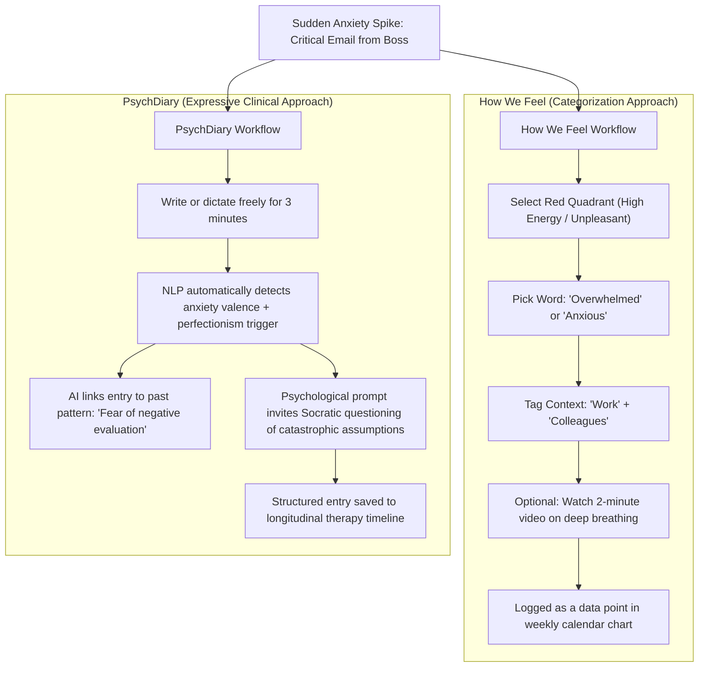
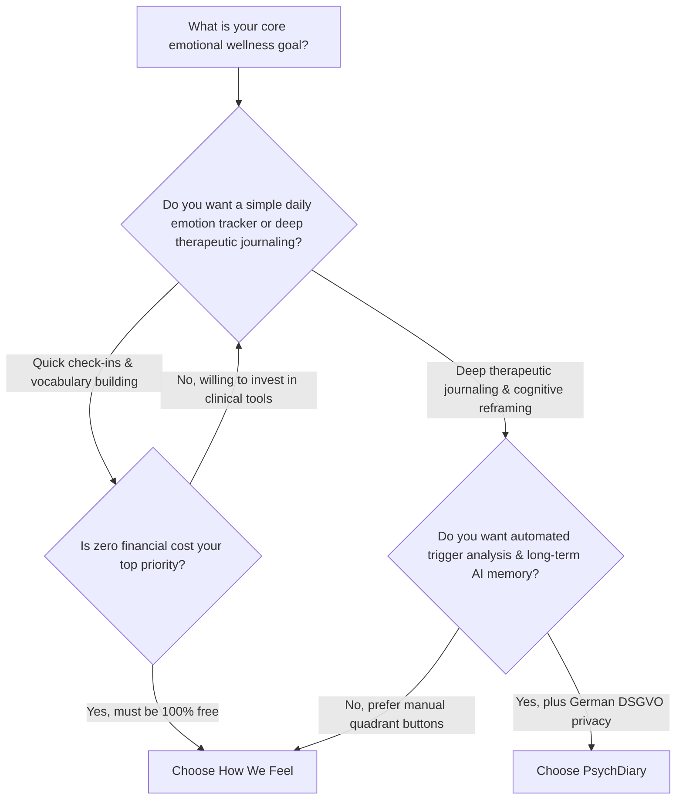

Emotional literacy has become one of the most vital self-care skills of our era. As modern life grows faster and more cognitively demanding, understanding what we actually feel—and why we feel it—is the difference between chronic burnout and psychological resilience.

In the digital mental wellness landscape, two standout platforms approach this challenge from distinct perspectives: **How We Feel** and **PsychDiary**.

**How We Feel**, developed in collaboration with Marc Brackett and the Yale Center for Emotional Intelligence, is an acclaimed non-profit emotion tracking app built around the RULER methodology and a 144-word quadrant mood meter. It excels at helping users identify nuanced emotional vocabulary with zero subscription cost.

**PsychDiary**, by contrast, is engineered as a clinical-grade digital psychologist journal. Rather than requiring users to manually navigate color-coded grids and tag discrete emotions, PsychDiary uses advanced Natural Language Processing to **automatically detect emotional valence, underlying life triggers, and cognitive distortions** directly from unconstrained expressive writing—backed by a **4-tier multi-layered AI memory architecture** and **strict German DSGVO/GDPR privacy compliance**.

If you are deciding between these two powerful self-awareness platforms, this detailed, objective guide breaks down their core features, clinical philosophies, data privacy standards, and ideal use cases.

---

  <h4 class="text-dark font-weight-bold mb-2">⚡ TL;DR Verdict: Which Tool Should You Choose?</h4>
  
<strong>Choose How We Feel</strong> if you want a 100% free, non-profit emotion check-in app focused on expanding your emotional vocabulary through Yale’s 144-word quadrant grid, quick video exercises, and casual emotional sharing with close friends or family.

  
<strong>Choose PsychDiary</strong> if you want a comprehensive, therapeutic journaling experience that automatically detects your emotional patterns and triggers without tedious manual tagging, remembers your complete narrative across years via multi-layered memory, bridges the 167-hour weekly therapy gap, and guarantees maximum confidentiality through German DSGVO cloud hosting.

---

## Side-by-Side Comparison: How We Feel vs. PsychDiary

Here is an architectural and functional overview of how How We Feel and PsychDiary compare across critical dimensions:

| Dimension / Feature | How We Feel | PsychDiary |
| :--- | :--- | :--- |
| **Primary Category** | Emotion tracker & emotional literacy tool | Clinical-grade digital psychologist journal |
| **Scientific Origin** | Yale Center for Emotional Intelligence (RULER) | Cognitive Behavioral Therapy (CBT), ACT & Pennebaker expressive writing |
| **Data Input Method** | Structured quadrant tapping & multi-select tags | Free-form expressive writing & speech-to-text voice journaling |
| **Mood & Trigger Detection** | Manual selection (User picks from 144 emotion words) | **Automatic real-time sentiment, distortion, & trigger extraction** |
| **AI Memory System** | None (Static numerical logs & tag aggregations) | **4-Layered Memory** (Working context, auto-summaries, facts, semantic search) |
| **Expressive Journaling Depth** | Secondary / Short optional text notes | **Primary Core** (Long-form entries, guided Socratic dialogue, reframing) |
| **Privacy & Hosting Architecture** | US-based non-profit cloud infrastructure | **100% German DSGVO / GDPR Compliant** (Hosted in Germany, zero AI training) |
| **Therapy Gap Support** | General emotional check-in | **Structured 167-hour therapy bridge** with therapist-ready synthesis |
| **Platform Availability** | iOS and Android (Mobile only) | **Cross-platform parity: Web (Desktop), iOS, and Android** |
| **Social / Sharing Features** | Shared check-ins with friends ("Circles") | Zero social sharing (100% private psychological sanctuary) |
| **Cost & Business Model** | Free (Non-profit foundation funded) | Accessible freemium with premium cognitive tier |

---

## Where How We Feel Wins: Fair Concessions

To adhere to objective review standards, we highlight the clear strengths and unique value propositions of How We Feel:

### 1. 100% Free and Non-Profit Backed
How We Feel was created by Pinterest co-founder Ben Silbermann in partnership with the Yale Center for Emotional Intelligence and operates as a 501(c)(3) non-profit project. The app is completely free, contains no ads, and charges no subscription fees. For individuals, students, or families on strict budgets seeking basic emotional self-awareness, this open accessibility is exceptional.

### 2. Yale's RULER Framework & The 144-Word Emotion Grid
Many people can only describe their feelings using broad terms: *"good," "bad," "fine,"* or *"stressed."* How We Feel addresses this alexithymic tendency using Marc Brackett's RULER framework (Recognizing, Understanding, Labeling, Expressing, Regulating). The app plots emotions across two axes:
- **Pleasantness** (horizontal axis)
- **Energy** (vertical axis)

Divided into four color quadrants—High Energy Unpleasant (Red, e.g., *panicked, infuriated*), High Energy Pleasant (Yellow, e.g., *inspired, ecstatic*), Low Energy Unpleasant (Blue, e.g., *despondent, drained*), and Low Energy Pleasant (Green, e.g., *serene, grounded*)—the app exposes users to 144 granular emotional descriptors. This builds emotional vocabulary faster than almost any other consumer app.

### 3. Bite-Sized Psychological Video Strategies
When you log an unpleasant emotion in How We Feel, the app can serve short 1-to-3 minute video exercises led by clinical psychologists and researchers. These mini-modules offer practical coping strategies such as box breathing, physiological sighs, cognitive reappraisals, or quick movement routines.

### 4. "Circles": Shared Emotional Accountability
How We Feel allows users to connect with family members, close friends, or partners in private "Circles." You can view your partner's current emotional state and send supportive emoji reactions. For couples or families working on mutual emotional awareness, this feature provides lightweight social connection.

---

## Where PsychDiary Wins: The Structural & Clinical Differentiators

While How We Feel is an outstanding emotion *tracker*, it was not designed as an interactive psychological *journal*. When emotional distress arises, simply tapping "anxious" or "fatigued" on a screen does not unpack the deeper cognitive narratives driving those emotions.

Here is where PsychDiary delivers superior therapeutic depth:

### 1. Automatic Mood and Trigger Detection vs. Manual Data Entry
In How We Feel, logging how you feel requires cognitive friction:
1. You select a quadrant (Red, Yellow, Blue, Green).
2. You scroll through a list of emotions to pick an exact label.
3. You select who you are with (Family, Friends, Coworkers, Alone).
4. You select what you are doing (Commuting, Working, Relaxing, Eating).
5. You select your location and sleep duration.

When you are overwhelmed, grieving, or in the middle of a panic attack, this multi-step survey feels burdensome.

**PsychDiary eliminates manual friction entirely.** You simply type or speak your raw thoughts into the app:
> *"I felt an intense knot in my stomach during the quarterly review today. When Mark criticized the slide deck formatting in front of the VP, I immediately assumed my promotion was dead and that I’m incompetent."*

PsychDiary's NLP engine automatically:
- Identifies the emotional valence and core feelings (*humiliation, dread, imposter anxiety*).
- Extracts the external trigger (*quarterly presentation criticism by colleague*).
- Detects the cognitive distortions (*catastrophizing: assuming promotion is dead; black-and-white thinking: labeling self as incompetent*).
- Surfaces positive buffers if present.

You do not need to categorize yourself; you express yourself, and the intelligence engine builds your psychological profile automatically.

### 2. Multi-Layered Permanent AI Memory (No Digital Amnesia)
How We Feel treats each check-in as an isolated data row in a chart. It does not understand the relational or historical context of your life.

PsychDiary utilizes a proprietary [4-tier multi-layered AI memory architecture](/blog/ai-memory-explained-mental-health/):
1. **Short-Term Context**: Retains immediate conversational nuance during an active writing session.
2. **Session Summaries**: Condenses every journal entry into an executive summary capturing core behavioral takeaways.
3. **Permanent Knowledge Graph**: Safely catalogs key individuals, past trauma, therapy goals, career milestones, and physical health conditions.
4. **Semantic Vector Search**: When you write about feeling disrespected at work three months later, PsychDiary remembers: *"This feels very similar to the interaction you documented on October 14th with Mark. Last time, using the 'Check the Facts' technique helped you de-escalate. Would you like to review how you reframed it then?"*

This persistent memory makes PsychDiary an evolving, empathetic companion rather than a cold metric dashboard.

### 3. German DSGVO / GDPR Privacy: Sovereign Mental Health Protection
How We Feel is an American non-profit operating on US-based cloud servers subject to American jurisdiction and US privacy statutes.

PsychDiary was built specifically for privacy-conscious individuals who recognize that mental health disclosures represent the most sensitive personal data that exists. **PsychDiary is 100% compliant with the European General Data Protection Regulation (DSGVO / GDPR) and is hosted in Germany** (read more about our [strict privacy infrastructure and EU hosting](/blog/therapy-notes-privacy-gdpr-mental-health/)):
- **Zero AI Model Training**: Your private thoughts, relationship issues, and vulnerabilities are never used to train machine learning models.
- **Strict Data Sovereignty**: All databases reside within Germany under EU data protection law.
- **Military-Grade Encryption**: AES-256 at rest and TLS 1.3 in transit.
- **Immediate Portability & Deletion**: Complete control over your archive with single-click export or permanent zero-trace deletion.

### 4. Bridging the 167-Hour Gap Between Therapy Sessions
If you see a therapist for 50 minutes once a week, you live **167 hours outside the therapy room**. Emotional dysregulation, interpersonal conflicts, and self-doubt rarely happen while sitting on the therapist's couch—they happen on a Thursday night at 11:00 PM.

While How We Feel logs that you were "sad" at 11:00 PM, **PsychDiary helps you actively process the moment in real time** through guided cognitive reframing (learn how [PsychDiary acts as an AI psychologist between therapy sessions](/blog/ai-psychologist-between-therapy-sessions/)). When your next therapy appointment arrives, you can bring structured, insightful summaries of the week’s triggers rather than trying to reconstruct what happened from memory.

### 5. Web Desktop Keyboard Parity
How We Feel is exclusively available on smartphones (iOS and Android). Typing long, therapeutic journal entries on a small glass touch screen is physically exhausting.

PsychDiary is built with **full cross-platform parity across Desktop Web, iPhone, and Android**. You can type 2,000 words on your mechanical desktop keyboard late at night and seamlessly read your AI psychologist’s insights or voice-journal a quick update from your phone the next morning.

---

## Comparative Scenario: How Each App Handles an Anxiety Spike

To visualize the practical difference between these two tools, imagine you experience a sudden wave of workplace anxiety on a Tuesday afternoon.

### Scenario: The Imposter Syndrome Spiral

In How We Feel, you record that you were anxious at 2:15 PM while working.  
In PsychDiary, you unburden your raw emotional narrative, identify the specific cognitive distortion that triggered the panic, examine alternative interpretations, and archive a searchable lesson for future challenges.

---

## Who Should Choose Which?

### Choose How We Feel If:
- You want a beautifully designed, completely free app with zero ads or subscriptions.
- Your primary goal is learning to identify what you are feeling using the Yale RULER 144-word emotion grid.
- You prefer quick 30-second check-ins over writing multi-paragraph journal entries.
- You want to share your emotional status with a partner or family member via shared Circles.
- You only use a smartphone and do not need a desktop web interface.

### Choose PsychDiary If:
- You want to practice deep, cathartic expressive writing without being forced into rigid multiple-choice surveys.
- You want **automatic sentiment and trigger detection** that identifies why your mood shifted.
- You value a companion that **remembers your history, relationships, and progress across months and years** using multi-layered memory.
- You are in active psychotherapy and need a structured tool to bridge the 167 hours between weekly sessions.
- You require absolute confidentiality, EU server hosting, and strict German DSGVO compliance.
- You prefer the flexibility of writing on a full desktop computer as well as your phone.

---

## Final Thoughts

How We Feel and PsychDiary both serve noble purposes in the modern mental health ecosystem. How We Feel provides an invaluable public service by making emotional literacy and Yale's RULER framework freely available to everyone.

However, when emotional check-ins need to evolve into meaningful psychological breakthroughs, **PsychDiary provides the clinical depth, intelligent memory, and automated analytical power required for true long-term healing**.

Take control of your mental health journey today. **[Start your free PsychDiary experience](https://psychdiaryapp.com/)** and discover journaling powered by genuine psychological intelligence.

---

## Scientific Foundations & Clinical Citations

- **Brackett, M. A. (2019)**: *Permission to Feel: Unlocking the power of emotions to help our kids, ourselves, and our society thrive*. Celadon Books.
- **Pennebaker, J. W. (1997)**: *Writing about emotional experiences as a therapeutic process*. Psychological Science, 8(3), 162-166.
- **Beck, A. T. (1979)**: *Cognitive Therapy of Depression*. The Guilford Press.
- **Emmons, R. A., & McCullough, M. E. (2003)**: *Counting blessings versus burdens: An experimental investigation of gratitude and subjective well-being in daily life*. Journal of Personality and Social Psychology, 84(2), 377-389.
- **Kross, E., & Ayduk, O. (2017)**: *Self-distancing: Theory, research, and current directions*. Advances in Experimental Social Psychology, 55, 81-136.

---

## Medical Disclaimer

> *Medical Disclaimer: PsychDiary is an AI-powered emotional reflection companion and mental wellness tool designed to foster self-awareness and emotional regulation. It is not a licensed medical provider, diagnostic instrument, or replacement for clinical psychotherapy. If you are experiencing a mental health crisis, suicidal thoughts, or severe psychiatric distress, please contact your local emergency services or call/text 988 (US/Canada) or 112/116 123 (Europe).*

---

## Frequently Asked Questions

### What is the main difference between How We Feel and PsychDiary?
How We Feel is an emotion tracking app developed with Yale researchers that focuses on logging discrete emotions from a 144-word quadrant mood meter. PsychDiary is an AI-powered digital psychologist journal that allows free-form expressive writing and automatically analyzes your emotional valence, triggers, and cognitive distortions while maintaining a permanent 4-tier memory across your life.

### Is PsychDiary free like How We Feel?
How We Feel is funded by a non-profit foundation and is completely free. PsychDiary offers a comprehensive free tier allowing you to journal and experience AI reflections, alongside an accessible premium subscription that unlocks advanced longitudinal analytics, unlimited multi-layered memory queries, and extended cognitive exercises.

### Can PsychDiary automatically detect my mood without me picking tags?
Yes. Unlike How We Feel, which requires you to manually select emotions, activities, and locations, PsychDiary's natural language processing engine analyzes your natural writing or voice notes to extract positive drivers, negative triggers, and emotional intensity automatically.

### How does PsychDiary protect my private mental health data?
PsychDiary is hosted on secure servers in Germany and complies strictly with the European Union General Data Protection Regulation (DSGVO / GDPR). Your entries are encrypted using AES-256, are never sold, and are never used to train public AI models.

### Does PsychDiary work on laptops and desktop computers?
Yes. While How We Feel is only available on iOS and Android smartphones, PsychDiary offers full cross-platform parity across Desktop Web browsers, iOS, and Android, enabling you to type comfortable, in-depth reflections on a full physical keyboard.

