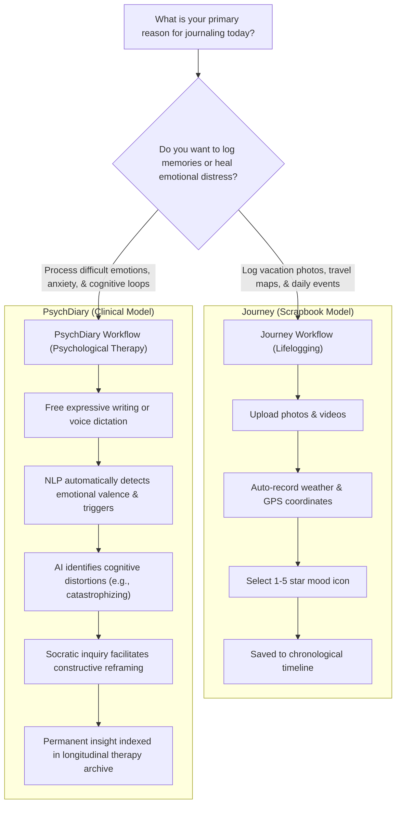
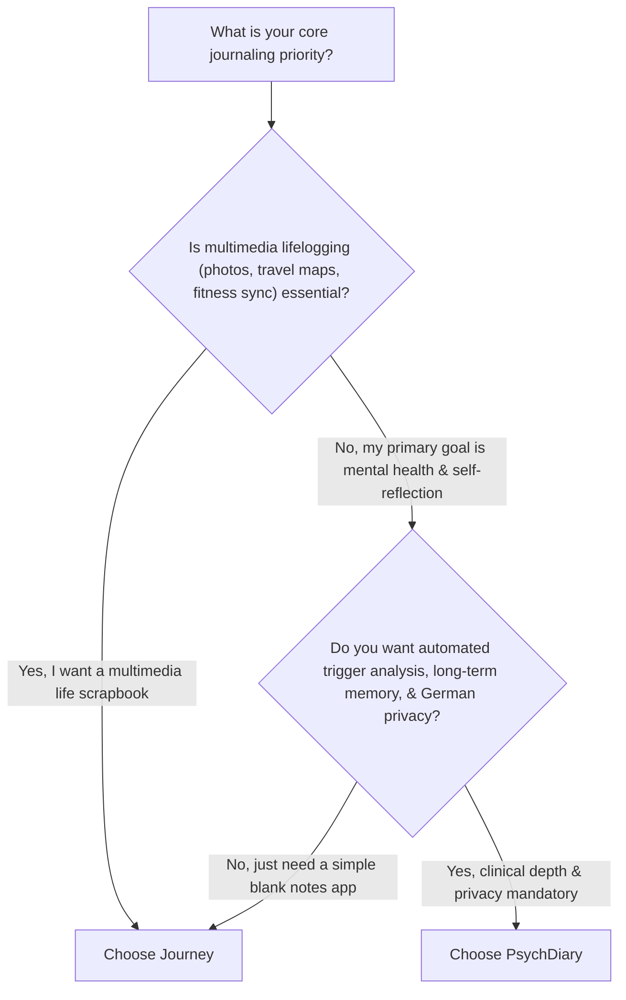

Digital journaling has evolved from simple text documents into sophisticated ecosystems designed to capture life's moments. Yet, people journal for vastly different reasons.

Some journal to preserve a **lifelog**—a multimedia scrapbook of family vacations, photos, weather conditions, geotagged travels, and daily happenings. Others journal for **psychological healing and personal growth**—an intimate space to untangle anxiety, confront emotional triggers, dismantle cognitive distortions, and practice evidence-based self-reflection.

These two approaches are embodied by **Journey** and **PsychDiary**.

**Journey** (by Two App Studio) is one of the most established cross-platform digital diary apps in the world. With support for photos, video clips, location maps, fitness data, and cloud synchronization, Journey excels as a rich multimedia archive of your life experiences.

**PsychDiary**, on the other hand, is engineered as a clinical-grade digital psychologist journal. Rather than functioning as a passive digital scrapbook, PsychDiary provides active psychological intelligence: **automatically detecting emotional valence, underlying life triggers, and cognitive distortions** from your writing, backed by a **4-tier multi-layered AI memory architecture** and **strict German DSGVO/GDPR privacy compliance**.

If you are deciding between a multimedia life-logging app and an intelligent mental health journal, this detailed comparison outlines their core differences, clinical efficacy, privacy architecture, and user workflows.

---

  <h4 class="text-dark font-weight-bold mb-2">⚡ TL;DR Verdict: Multimedia Scrapbook vs. Psychological Intelligence</h4>
  
<strong>Choose Journey</strong> if your primary objective is multimedia life-logging: attaching photos, videos, travel maps, weather, and fitness steps to daily diary entries across desktop and mobile operating systems.

  
<strong>Choose PsychDiary</strong> if you want deep emotional healing and psychological insight, automated trigger and mood analysis without tedious manual tagging, an AI that remembers your complete life story across months and years via multi-layered memory, and uncompromised German DSGVO privacy protection for your most sensitive thoughts.

---

## Side-by-Side Comparison: Journey vs. PsychDiary

Here is an architectural comparison of Journey and PsychDiary across essential functional and clinical dimensions:

| Feature / Dimension | Journey (Journey.cloud) | PsychDiary |
| :--- | :--- | :--- |
| **Primary Category** | Multimedia digital diary & lifelogging scrapbook | Clinical-grade digital psychologist journal |
| **Core Value Proposition** | Preserving life memories, photos, travel, & milestones | Emotional regulation, cognitive reframing, & trigger tracking |
| **Psychological Engine** | Passive templates (Journey Coach programs) | **Active clinical NLP (CBT, ACT, & Pennebaker expressive writing)** |
| **Mood & Trigger Tracking** | Manual 5-point mood rating & activity tags | **Automatic real-time sentiment, distortion, & life-trigger extraction** |
| **AI Memory Architecture** | Basic keyword search across past text | **4-Tier Memory** (Working context, auto-summaries, facts, semantic vector search) |
| **Multimedia Support** | Photos, videos, audio, geotags, weather, step counts | Clean, focused text & voice dictation designed for deep psychological reflection |
| **Privacy & Data Hosting** | Google Drive / Journey Cloud Sync (US/Singapore servers) | **100% German DSGVO / GDPR Compliant** (Hosted in Germany, zero AI training) |
| **Therapy Gap Support** | Generic personal diary | **Dedicated 167-hour weekly therapy bridge** with structured clinician summaries |
| **Platform Availability** | Android, iOS, Windows, Mac, Linux, Web | **Cross-platform parity: Web (Desktop), iOS, and Android** |
| **AI Interaction Model** | Basic AI writing prompts / auto-suggestions | **Empathetic digital psychologist guiding Socratic reframing** |

---

## Where Journey Wins: Fair Concessions

To ensure an objective, high-standard review, we recognize the clear advantages and features where Journey shines:

### 1. Rich Multimedia Lifelogging (Photos, Videos, and Audio)
If your vision of journaling resembles a modern digital scrapbook, Journey is second to none. Each entry can contain multiple high-resolution photos, short video clips, voice memos, and document attachments. You can look back on a family holiday from three years ago and see the photos, the exact weather that afternoon, and the geographic coordinates plotted on an interactive world map.

### 2. Massive Multi-Platform Coverage (Including Linux & Windows Native)
Journey boasts one of the widest platform footprints in the software industry. It offers native desktop clients for Windows, macOS, and Linux, alongside apps for Android, iOS, and Web. If you operate in a specialized desktop environment (such as Linux) and require a native install, Journey accommodates that requirement.

### 3. Geotagging and Travel "Atlas" View
For avid travelers, Journey automatically tags your geographic coordinates and aggregates your entries into an interactive "Atlas" map. Browsing your past entries by clicking on cities and pins across a globe is a delightful way to explore historical vacations and travel milestones.

### 4. Health and Fitness Data Synchronization
Journey integrates with Apple Health and Google Fit, automatically appending daily step counts and activity metrics to your journal entries. If you want to correlate your daily diary with physical movement data, Journey creates that unified log seamlessly.

---

## Where PsychDiary Wins: The Structural & Clinical Differentiators

While Journey is an exceptional multimedia scrapbook, a digital archive of photos and weather data does not solve mental health challenges. When you are grappling with chronic burnout, marital conflict, or self-doubt, what you need is not a photo album—you need psychological insight, cognitive restructuring, and emotional clarity.

Here is where PsychDiary delivers superior therapeutic depth:

### 1. Automatic Clinical Mood and Trigger Detection
In Journey, tracking your mental state requires manual intervention:
- You must remember to select a mood rating (from 1 to 5 stars or smiley faces).
- You must manually add tags like #Anxiety or #Work.
- If you forget to rate your mood, no emotional data is recorded.

**PsychDiary completely automates emotional and trigger detection.** As you write freely—or record your voice notes—PsychDiary's clinical NLP engine analyzes your text in real time:
- It scores your emotional valence from deep distress to grounded serenity.
- It automatically isolates the specific **external triggers** (e.g., micromanagement from a supervisor, boundary issues with family members, disrupted sleep).
- It highlights cognitive distortions such as catastrophizing, mind-reading, and black-and-white thinking.
- It compiles longitudinal sentiment and trigger frequency graphs without requiring you to fill out surveys or tag categories.

### 2. 4-Tier Multi-Layered AI Memory vs. Static Keyword Search
In Journey, past entries remain passive text records. If you search for "anxiety," Journey simply shows you a chronological list of every entry containing that word. It cannot connect themes, analyze behavioral patterns, or remember the key figures in your life.

PsychDiary is built with a proprietary [4-tier multi-layered AI memory architecture](/blog/ai-memory-explained-mental-health/):
1. **Short-Term Context**: Retains full conversational coherence during an active reflective session.
2. **Session Summaries**: Synthesizes every entry into high-density psychological takeaways.
3. **Permanent Knowledge Graph (User Facts)**: Safely archives recurring personal themes, core relationships, trauma triggers, and long-term therapeutic goals.
4. **Semantic Vector Search**: When you write about feeling overwhelmed by perfectionism today, PsychDiary searches your multi-year diary archive: *"You navigated this exact pattern six months ago when launching the new product line. Here is the cognitive reframe that helped you then."*

This transforms PsychDiary from a static notebook into an evolving, intelligent companion that knows your life story.

### 3. German DSGVO / GDPR Privacy: The Gold Standard for Vulnerable Disclosures
When you journal about your mental health, you are documenting your most vulnerable, guarded secrets: relationship conflicts, depressive thoughts, imposter syndrome, and psychological struggles.

Journey typically syncs data via Google Drive or its proprietary Journey Cloud Sync, utilizing cloud servers in the United States and Singapore. 

In contrast, **PsychDiary is strictly engineered and hosted on servers located in Germany**, under the stringent legal framework of the **European General Data Protection Regulation (DSGVO / GDPR)** (learn more about our [strict privacy infrastructure and EU hosting](/blog/therapy-notes-privacy-gdpr-mental-health/)):
- **Zero AI Model Training**: Your private thoughts and emotional disclosures are never ingested to train public AI models.
- **Server Sovereignty**: All databases reside within Germany under EU data protection law.
- **Military-Grade Encryption**: AES-256 encryption at rest and TLS 1.3 in transit.
- **Full Legal Ownership**: One-click data export and permanent zero-trace deletion.

For anyone who values mental health confidentiality as highly as medical doctor-patient privilege, PsychDiary is the definitive choice.

### 4. Bridging the 167-Hour Gap Between Therapy Sessions
If you attend weekly psychotherapy, you spend 50 minutes in session and **167 hours living your everyday life**. Most emotional crises, interpersonal disputes, and cognitive spirals occur between sessions—and by the time you sit on your therapist's couch next week, you have forgotten the specifics of what triggered your Tuesday afternoon breakdown.

PsychDiary is specifically tailored as a [companion to bridge the 167-hour weekly therapy gap](/blog/ai-psychologist-between-therapy-sessions/). It allows you to document acute moments as they happen, analyze the cognitive distortions involved, and generate clean, structured summaries that you can review with your licensed therapist to maximize every minute of clinical care.

### 5. Active Psychological Reframing vs. Passive Writing
When you write an entry in Journey expressing despair or cognitive distortions (*"I will never find love again; I'm fundamentally broken"*), Journey simply records the text. The negative rumination sits on the page, unexamined.

In PsychDiary, the AI psychologist steps in with empathetic, evidence-based Socratic questioning:
> *"I hear how painful this breakup is. However, notice the thought: 'I'm fundamentally broken.' In cognitive therapy, this is known as global labeling. Is there evidence from your past relationships that demonstrates your capacity for deep connection?"*

PsychDiary doesn't just store your pain—it actively helps you heal and reframe it.

---

## Comparison of Use Cases: Lifelogging vs. Cognitive Therapy

---

## Who Should Choose Which?

### Choose Journey If:
- You want a digital multimedia scrapbook with photos, videos, audio recordings, and document attachments.
- You want your entries plotted on an interactive travel atlas map with automatic geotagging and weather recording.
- You want to sync daily fitness metrics like Apple Health or Google Fit step counts.
- You require a native desktop client for Linux or Windows.

### Choose PsychDiary If:
- You want an evidence-based self-reflection tool grounded in Cognitive Behavioral Therapy and ACT.
- You want **automatic sentiment and trigger detection** without having to manually select star ratings and activity tags.
- You demand the world's most rigorous privacy standard (100% German DSGVO/GDPR compliance with zero AI model training).
- You want an AI companion that **remembers your relationships, emotional breakthroughs, and life themes across years** using a 4-tier memory architecture.
- You are in active psychotherapy and need a structured tool to bridge the 167 hours between weekly sessions.
- You want active Socratic guidance that challenges cognitive distortions rather than passive rumination.

---

## Final Thoughts

Journey and PsychDiary address personal writing from fundamentally different angles. Journey is a premier multimedia lifelogging scrapbook, built to preserve the sights, sounds, and locations of your life journey.

However, if your primary reason for journaling is psychological well-being—seeking to conquer anxiety, understand emotional triggers, dismantle cognitive distortions, and ensure absolute confidentiality under German law—**PsychDiary is in an entirely different class of therapeutic intelligence**.

Begin your journey to emotional clarity today. **[Start your free PsychDiary experience](https://psychdiaryapp.com/)** and discover journaling powered by genuine psychological intelligence.

---

## Scientific Foundations & Clinical Citations

- **Beck, A. T. (1979)**: *Cognitive Therapy of Depression*. The Guilford Press.
- **Pennebaker, J. W. (1997)**: *Writing about emotional experiences as a therapeutic process*. Psychological Science, 8(3), 162-166.
- **Kross, E., & Ayduk, O. (2017)**: *Self-distancing: Theory, research, and current directions*. Advances in Experimental Social Psychology, 55, 81-136.
- **Emmons, R. A., & McCullough, M. E. (2003)**: *Counting blessings versus burdens: An experimental investigation of gratitude and subjective well-being in daily life*. Journal of Personality and Social Psychology, 84(2), 377-389.
- **Linehan, M. M. (1993)**: *Cognitive-Behavioral Treatment of Borderline Personality Disorder*. Guilford Press.

---

## Medical Disclaimer

> *Medical Disclaimer: PsychDiary is an AI-powered emotional reflection companion and mental wellness tool designed to foster self-awareness, cognitive reframing, and emotional regulation. It is not a licensed medical provider, diagnostic instrument, or replacement for clinical psychotherapy. If you are experiencing a mental health crisis, suicidal thoughts, or severe psychiatric distress, please contact your local emergency services or call/text 988 (US/Canada) or 112/116 123 (Europe).*

---

## Frequently Asked Questions

### Can I attach photos and videos to PsychDiary like in Journey?
PsychDiary is specifically optimized for deep, distraction-free psychological reflection and text/voice journaling. While Journey focuses heavily on multimedia lifelogging (photos, video clips, and geotags), PsychDiary focuses on therapeutic natural language processing, automated trigger detection, and cognitive reframing.

### How does PsychDiary track my mood compared to Journey's 5-star rating?
In Journey, you manually assign a 1-to-5 star rating or an emoji to each entry. PsychDiary's clinical NLP engine automatically analyzes your natural writing or voice dictation in real time, detecting your emotional valence, external triggers, and cognitive distortions without requiring any manual tagging.

### What makes PsychDiary's data privacy superior to Journey?
Journey typically stores data via Google Drive or its proprietary cloud sync hosted on US and Singapore servers. PsychDiary is 100% compliant with the European Union General Data Protection Regulation (DSGVO / GDPR) and is hosted on secure servers located in Germany. Your data is encrypted using AES-256 and is never used to train public AI models.

### Does PsychDiary work across multiple devices?
Yes. PsychDiary provides full cross-platform parity across Desktop Web browsers, iOS, and Android. You can write extensive journal entries on your desktop computer and seamlessly review insights or record voice reflections on your mobile phone.

### Can PsychDiary help me with my weekly therapy sessions?
Yes. PsychDiary is engineered to bridge the 167-hour gap between weekly therapy sessions. It allows you to document acute emotional moments as they occur, analyzes the cognitive patterns involved, and generates high-density executive summaries that you can review directly with your licensed therapist.

