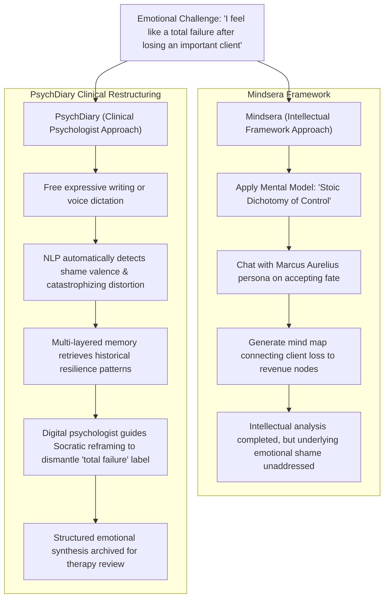
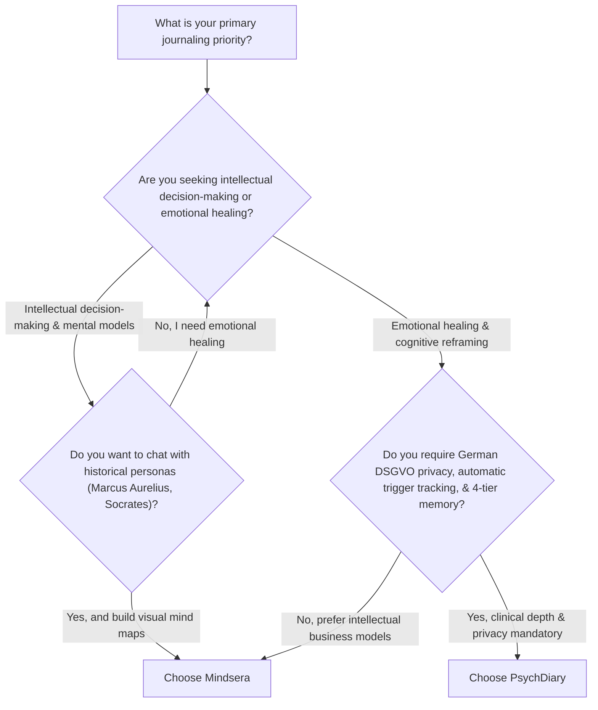

Artificial intelligence has unlocked a new era of reflective writing. Yet, depending on your goals, journaling can serve two vastly different cognitive functions.

For founders, executives, and intellectual thinkers, journaling is often used as a **strategic decision-making lab**—a place to apply mental models like First Principles, Inversion, or Hanlon’s Razor to solve business problems and optimize performance.

For individuals navigating emotional distress, relationship friction, burnout, anxiety, or therapy homework, journaling is a **therapeutic sanctuary**—a space to process painful feelings, identify subconscious emotional triggers, dismantle cognitive distortions, and cultivate psychological resilience.

These two approaches are exemplified by **Mindsera** and **PsychDiary**.

**Mindsera** positions itself as a mental model journal for high performers, offering framework-based prompts, automated mind mapping, and conversational roleplay with historical mentors like Marcus Aurelius, Seneca, and Carl Jung.

**PsychDiary**, by contrast, is engineered as a clinical-grade digital psychologist journal. Rooted in Cognitive Behavioral Therapy (CBT), Acceptance and Commitment Therapy (ACT), and expressive writing, PsychDiary focuses on emotional healing and psychological autonomy: **automatically detecting emotional valence, life triggers, and cognitive distortions** from your raw thoughts, supported by a **4-tier multi-layered AI memory architecture** and **strict German DSGVO/GDPR privacy compliance**.

If you are evaluating whether an intellectual mental models journal or a clinical digital psychologist best supports your growth, this comprehensive analysis breaks down their core features, underlying methodologies, data ethics, and clinical value.

---

  <h4 class="text-dark font-weight-bold mb-2">⚡ TL;DR Verdict: Intellectual Modeling vs. Psychological Healing</h4>
  
<strong>Choose Mindsera</strong> if you want an intellectual, framework-driven journal for strategic thinking, business problem-solving, and chatting with simulated historical mentors (like Marcus Aurelius or Steve Jobs) using mental models and automated mind maps.

  
<strong>Choose PsychDiary</strong> if you want real psychological healing, structured CBT reframing, automated trigger and mood detection from free-form writing, a companion with 4-tier memory that remembers your emotional history across years, and uncompromised German DSGVO privacy hosted in the EU.

---

## Side-by-Side Comparison: Mindsera vs. PsychDiary

Here is an architectural comparison of Mindsera and PsychDiary across essential functional and clinical dimensions:

| Feature / Dimension | Mindsera | PsychDiary |
| :--- | :--- | :--- |
| **Primary Category** | Mental models journal & strategic thinking lab | Clinical-grade digital psychologist journal |
| **Target Audience** | Founders, strategists, writers, & intellectual thinkers | Individuals seeking emotional healing, anxiety relief, & therapy support |
| **Core Methodological Engine** | 50+ Mental Models (First Principles, Stoicism, Inversion) | Evidence-based CBT, ACT, & Pennebaker expressive writing |
| **Mood & Trigger Detection** | Vocabulary analysis, sentiment score, & cognitive bias labels | **Automatic real-time sentiment, distortion, & life-trigger extraction** |
| **AI Memory Architecture** | Basic entry summaries & visual mind map connections | **4-Tier Memory** (Working context, auto-summaries, facts, semantic vector search) |
| **Simulated Mentors** | Conversational personas (Marcus Aurelius, Socrates, Jung) | Objective clinical digital psychologist (fosters self-reliance) |
| **Privacy & Data Hosting** | US cloud infrastructure (Supabase / US servers) | **100% German DSGVO / GDPR Compliant** (Hosted in Germany, zero AI training) |
| **Therapy Gap Support** | Intellectual self-coaching | **Dedicated 167-hour weekly therapy bridge** with structured clinician summaries |
| **Visual Tools** | Interactive mind mapping & concept visualization | Longitudinal emotional graphs, trigger frequency, & distortion trends |
| **Platform Availability** | Web-first (responsive mobile browser) | **Cross-platform parity: Web (Desktop), iOS, and Android** |
| **Pricing Model** | High-tier premium ($19/mo or $144/year) | Accessible freemium with affordable clinical premium tier |

---

## Where Mindsera Wins: Fair Concessions

To adhere to objective, high-standard evaluation guidelines, we acknowledge the distinct features where Mindsera excels:

### 1. 50+ Integrated Mental Models for Strategic Problem-Solving
Mindsera is specifically built for intellectual problem-solving. It provides a library of over 50 structured frameworks from decision science and philosophy, including:
- **First Principles Thinking** (breaking problems down to fundamental truths)
- **Second-Order Thinking** (evaluating downstream consequences)
- **Inversion** (solving problems by considering how to cause the opposite outcome)
- **Dichotomy of Control** (identifying what is within vs. outside your power)

If you are a founder deciding whether to pivot your company or an executive evaluating a contract, Mindsera's framework templates guide rigorous strategic analysis.

### 2. Conversational Historical and Philosophical Mentors
Mindsera allows users to chat with AI personas simulating historical figures such as Marcus Aurelius, Seneca, Socrates, Carl Jung, Friedrich Nietzsche, and Alan Watts. While these are prompt-engineered simulations rather than clinical agents, bouncing philosophical dilemmas off a simulated Stoic emperor is intellectually stimulating and entertaining for philosophy enthusiasts.

### 3. Automated Visual Mind Mapping
As you write in Mindsera, the platform can automatically extract core concepts, themes, and entities, plotting them into an interactive visual mind map. For visual thinkers and conceptual learners who want to see how disparate thoughts interconnect geographically on a digital canvas, this feature provides unique value.

### 4. Writing Style and Cognitive Bias Analysis
Mindsera analyzes your prose for readability, vocabulary complexity, emotional sentiment, and cognitive biases (such as confirmation bias or sunk cost fallacy). For writers and essayists looking to sharpen their intellectual clarity, this prose analysis acts as a helpful editorial companion.

---

## Where PsychDiary Wins: The Structural & Clinical Differentiators

While Mindsera is a compelling tool for intellectual exercises, high-performance mental models cannot replace clinical psychotherapy. When you are processing a painful divorce, waking up with a racing heart from a panic attack, or struggling with depressive paralysis, analyzing "Hanlon’s Razor" or chatting with a simulated Socrates does not resolve the somatic and emotional roots of distress.

Here is where PsychDiary delivers superior clinical value, safety, and psychological intelligence:

### 1. Clinical Psychology vs. Intellectualized Avoidance
In psychology, **intellectualization** is a well-known defense mechanism where a person deals with painful emotions by analyzing them purely as abstract concepts, thereby avoiding the actual feelings.

Mindsera's framework-heavy approach can inadvertently enable intellectualization: instead of feeling and processing grief or fear, the user analyzes it through a business matrix or Stoic maxim.

**PsychDiary is rooted in clinical psychology (CBT, ACT, and Pennebaker expressive writing):**
- It guides you to sit with, acknowledge, and understand your raw emotional state.
- It identifies harmful **cognitive distortions** (e.g., catastrophizing, emotional reasoning, black-and-white thinking) in real time.
- It facilitates evidence-based Socratic questioning that leads to genuine emotional regulation rather than cerebral detachment.

### 2. Automatic Sentiment and Real-World Trigger Extraction
In Mindsera, you must intentionally select a framework or prompt to evaluate a problem.

**PsychDiary automates emotional and trigger detection entirely.** You simply open the journal and write freely—or record a voice note:
- PsychDiary's clinical NLP automatically calculates emotional valence.
- It extracts specific, tangible **external triggers** (e.g., confrontation with an in-law, unmanageable workload, sleep deprivation, health anxiety).
- It tracks how frequently specific triggers appear across weeks and months, compiling longitudinal graphs that reveal your subconscious behavioral patterns.

You don't need to choose a mental model; you simply express what hurts, and PsychDiary organizes the clinical insights automatically.

### 3. 4-Tier Multi-Layered AI Memory (No Digital Amnesia)
Mindsera generates mind maps and entry summaries, but it lacks a deep, relational memory architecture that tracks your personal life narrative over years.

PsychDiary is built on a proprietary [4-tier multi-layered AI memory architecture](/blog/ai-memory-explained-mental-health/):
1. **Short-Term Context**: Manages immediate conversation state during an active reflective session.
2. **Session Summaries**: Synthesizes every journal entry into an executive summary capturing core behavioral takeaways.
3. **Permanent Knowledge Graph (User Facts)**: Safely catalogs key individuals, past trauma, therapy goals, career milestones, and physical health conditions.
4. **Semantic Vector Search**: When you write about feeling paralyzed by imposter syndrome, PsychDiary searches your multi-year diary archive: *"You experienced this exact emotional paralysis nine months ago before your previous promotion. Here is how you dismantled that fear then."*

This long-term memory allows PsychDiary to act as a consistent, lifelong psychological companion.

### 4. German DSGVO / GDPR Privacy: The Gold Standard for Confidentiality
Mindsera is an intellectual app hosted primarily on US cloud infrastructure (Supabase / US cloud services). Like many US-based platforms, its data handling operates under American jurisdictional standards.

When you journal about your mental health, you are recording your most intimate vulnerabilities, therapy notes, relationship crises, and medical anxieties. **PsychDiary is 100% compliant with the European General Data Protection Regulation (DSGVO / GDPR) and is hosted in Germany** (learn more about our [strict privacy infrastructure and EU hosting](/blog/therapy-notes-privacy-gdpr-mental-health/)):
- **Zero AI Model Training**: Your private thoughts and emotional disclosures are never ingested to train public AI models.
- **Server Sovereignty**: All databases reside within Germany under EU data protection law.
- **Military-Grade Encryption**: AES-256 encryption at rest and TLS 1.3 in transit.
- **Complete Data Ownership**: One-click export or permanent zero-trace deletion at any time.

### 5. Bridging the 167-Hour Gap Between Therapy Sessions
If you attend weekly psychotherapy, you spend 50 minutes in session and **167 hours living your everyday life**. Mental health struggles do not pause between appointments.

Mindsera is an intellectual self-coaching tool, not a clinical therapy bridge. PsychDiary is specifically engineered as an [AI companion to bridge the 167-hour weekly therapy gap](/blog/ai-psychologist-between-therapy-sessions/). It helps you capture distress at the moment it strikes, unpack the cognitive distortions, and generate clean, structured summaries that you can review with your licensed therapist to maximize every minute of clinical care.

### 6. Accessibility & Fair Pricing
Mindsera positions itself as a luxury SaaS tool for founders and executives, charging a steep subscription of $19 per month ($144 per year) with no functional free tier.

PsychDiary believes mental well-being should be universally accessible. It offers a **comprehensive free exploration tier** that allows anyone to experience AI-guided psychological reflection, alongside an affordable premium plan for advanced longitudinal analytics and unlimited multi-layered memory queries.

---

## Comparison of Methodological Approaches

---

## Who Should Choose Which?

### Choose Mindsera If:
- You are a founder, executive, or strategist looking to use mental models (First Principles, Inversion, Eisenhower Matrix) for business problem-solving.
- You enjoy chatting with simulated historical personas like Marcus Aurelius, Seneca, or Carl Jung.
- You want automated visual mind mapping to visualize how your ideas connect.
- You want writing prose analysis (readability, vocabulary, cognitive bias detection).
- You are comfortable paying a high subscription fee ($19/month).

### Choose PsychDiary If:
- You want an evidence-based self-reflection tool grounded in Cognitive Behavioral Therapy and ACT.
- You want **automatic sentiment and trigger detection** that identifies the root causes of anxiety or low mood without manual surveys.
- You demand the world's most rigorous privacy standard (100% German DSGVO/GDPR compliance with zero AI model training).
- You want an AI companion that **remembers your relationships, emotional breakthroughs, and life themes across years** using a 4-tier memory architecture.
- You are in active psychotherapy and need a structured tool to bridge the 167 hours between weekly sessions.
- You prefer an accessible platform with a generous free tier and fair pricing.

---

## Final Thoughts

Mindsera and PsychDiary represent two distinct philosophies in the AI journaling revolution. Mindsera is an impressive intellectual workshop for founders and thinkers who want to structure their ideas through philosophical frameworks and mental models.

However, when life presents genuine emotional crises, grief, anxiety, or relational conflict, intellectual frameworks are rarely enough. **PsychDiary provides the clinical rigor, empathetic memory, automated trigger tracking, and ironclad German privacy needed to transform your emotional well-being from the inside out**.

Experience true psychological self-reflection. **[Start your free PsychDiary journey today](https://psychdiaryapp.com/)** and discover journaling powered by genuine psychological intelligence.

---

## Scientific Foundations & Clinical Citations

- **Beck, A. T. (1979)**: *Cognitive Therapy of Depression*. The Guilford Press.
- **Pennebaker, J. W. (1997)**: *Writing about emotional experiences as a therapeutic process*. Psychological Science, 8(3), 162-166.
- **Kahneman, D. (2011)**: *Thinking, Fast and Slow*. Farrar, Straus and Giroux.
- **Kross, E., & Ayduk, O. (2017)**: *Self-distancing: Theory, research, and current directions*. Advances in Experimental Social Psychology, 55, 81-136.
- **Emmons, R. A., & McCullough, M. E. (2003)**: *Counting blessings versus burdens: An experimental investigation of gratitude and subjective well-being in daily life*. Journal of Personality and Social Psychology, 84(2), 377-389.

---

## Medical Disclaimer

> *Medical Disclaimer: PsychDiary is an AI-powered emotional reflection companion and mental wellness tool designed to foster self-awareness, cognitive reframing, and emotional regulation. It is not a licensed medical provider, diagnostic instrument, or replacement for clinical psychotherapy. If you are experiencing a mental health crisis, suicidal thoughts, or severe psychiatric distress, please contact your local emergency services or call/text 988 (US/Canada) or 112/116 123 (Europe).*

---

## Frequently Asked Questions

### What is the core difference between Mindsera and PsychDiary?
Mindsera is an intellectual mental models journal designed for strategic thinking, business problem-solving, and roleplaying with historical personas like Marcus Aurelius. PsychDiary is a clinical-grade digital psychologist journal grounded in Cognitive Behavioral Therapy (CBT), designed to foster emotional healing, automatically extract mood triggers and cognitive distortions, and maintain a permanent 4-tier memory of your life.

### Can Mindsera help with emotional health and therapy?
While Mindsera provides Stoic prompts and cognitive bias labels, it is primarily designed as an intellectual self-coaching and decision-making tool. PsychDiary is specifically engineered for clinical mental health, offering automated trigger detection, cognitive restructuring, and tools to bridge the 167-hour weekly therapy gap.

### How does PsychDiary's privacy compare to Mindsera?
Mindsera is hosted on US-based cloud infrastructure under standard American commercial terms. PsychDiary is 100% compliant with the European Union General Data Protection Regulation (DSGVO / GDPR) and is hosted on secure servers located in Germany. Your data is encrypted using AES-256, is never sold, and is never used to train public AI models.

### Does PsychDiary support chatting with historical personas?
PsychDiary intentionally focuses on an objective, clinical digital psychologist persona rather than historical roleplay. In clinical psychology, healthy self-distancing and evidence-based CBT questioning produce superior emotional regulation compared to fictional conversational avatars.

### Is PsychDiary more affordable than Mindsera?
Yes. Mindsera is priced at $19 per month ($144 per year) with no functional free tier. PsychDiary offers a comprehensive free exploration tier so anyone can experience AI-guided self-reflection, alongside an accessible premium plan for advanced analytics and unlimited memory.

