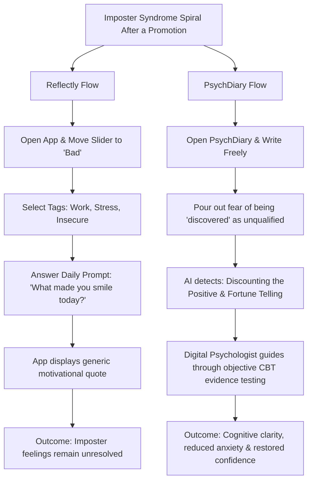
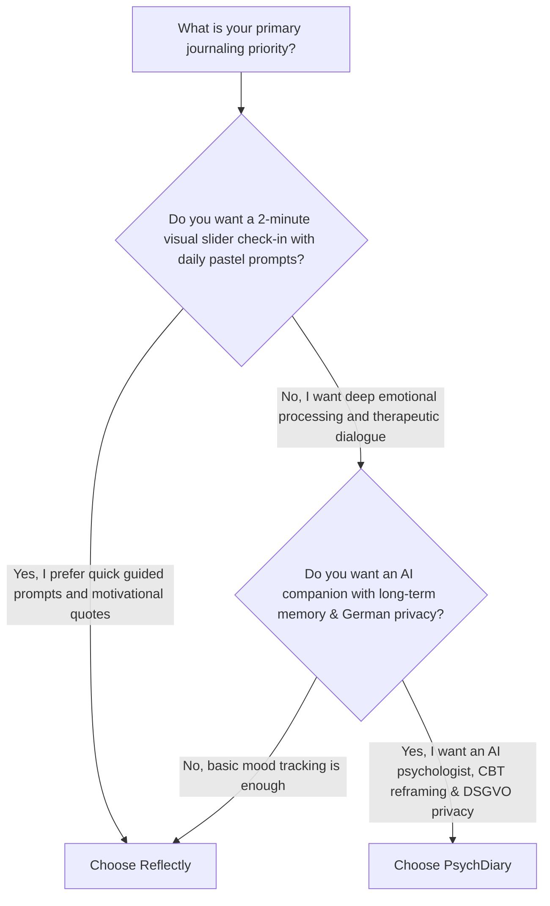

When the concept of "AI journaling" first captured public imagination in the late 2010s, it promised to rescue diarists from the intimidation of a blank white page. Over the years, two very different visions of what an "AI journal" should be have taken shape: **guided aesthetic prompt journaling** and **deep clinical AI psychology**.

In the guided aesthetic category, **Reflectly** is widely recognized as one of the early pioneers. Built with pastel aesthetics, fluid animations, and a structured check-in flow, Reflectly asks users to rate their day on a visual slider, tap feeling tags, and answer daily AI-curated reflection prompts. It has introduced millions of people to the habit of daily self-reflection by making the process visually soothing and low-friction.

In the clinical AI category, **PsychDiary** has redefined the medium by offering a true 24/7 digital psychologist companion. Instead of relying on static daily prompts or canned positive affirmations, PsychDiary provides an expansive emotional sanctuary. It **automatically identifies emotional sentiment, uncovers root psychological triggers from natural prose, engages in active Cognitive Behavioral Therapy (CBT) reframing, retains multi-layered long-term memory, and protects user data under rigorous German DSGVO / GDPR privacy regulations**.

If you are trying to decide whether Reflectly’s aesthetic prompt-based routine or PsychDiary’s deep psychological partnership is the right fit for your mental wellness, this side-by-side comparison reveals the key differences in clinical depth, conversational intelligence, and data sovereignty.

---

  <h4 class="text-dark font-weight-bold mb-2">⚡ TL;DR Verdict: Aesthetic Prompt Journal or Clinical AI Psychologist?</h4>
  
<strong>Choose Reflectly</strong> if you love minimalist pastel UI design, prefer answering short canned daily prompts rather than writing extensive reflections, want daily motivational quotes, and enjoy a guided 2-minute slider-and-tag check-in flow on your smartphone.

  
<strong>Choose PsychDiary</strong> if you want genuine therapeutic transformation, active CBT reframing for anxiety and burnout, automatic trigger detection that eliminates manual tagging, an AI companion that actually remembers your past therapy milestones using 4-tier neural memory, a clinical bridge for weekly therapy sessions, and enterprise-grade German DSGVO / GDPR privacy.

---

## Side-by-Side Comparison: Reflectly vs. PsychDiary

To see how Reflectly’s guided aesthetic workflow compares to PsychDiary’s deep psychological reflection engine, review the architectural matrix below:

| Feature / Capability | Reflectly | PsychDiary |
| :--- | :--- | :--- |
| **Core Product Focus** | Aesthetic guided journaling & daily curated reflection prompts | Deep cognitive reflection, psychological insight & 24/7 AI companion |
| **Input Format** | Slider ratings, preset feeling tags & guided question responses | Freeform natural text writing & high-accuracy voice dictation |
| **Conversational AI Depth** | Algorithmic prompter (Canned questions & static affirmations) | **Interactive Digital Psychologist** providing clinical CBT & ACT reframing |
| **Trigger Detection** | Manual correlation (User selects preset tags like "Friends" or "Work") | **Automatic sentiment extraction & underlying trigger identification** |
| **Memory Architecture** | Chronological calendar & basic tag correlation metrics | **Proprietary 4-Tier Neural Memory** (Episodic summaries, core facts & semantic recall) |
| **Therapeutic Modality** | Positive psychology, general reflection & motivational quotes | Clinical Cognitive Behavioral Therapy (CBT), ACT & Expressive Writing |
| **Therapy Session Utility** | Basic entry review & mood trend graphs | **Structured weekly clinical digests bridging the 167-hour therapy gap** |
| **Data Privacy & Server Hosting** | US commercial cloud hosting with standard commercial analytics | **100% German DSGVO / GDPR Compliance** (German servers, zero AI training) |
| **Cross-Platform Parity** | Mobile app focused (iOS & Android) | **Full Web browser application, native iOS, and native Android** |
| **Interface Style** | Colorful pastel cards, rounded buttons, playful animations | Elegant, calm, mature, focused, and distraction-free |

---

## Where Reflectly Wins: Fair Concessions

To adhere to balanced, professional evaluation standards meeting Google Review Quality Guidelines, it is essential to highlight where Reflectly shines:

### 1. Beautiful Pastel Aesthetics and Visual Micro-Interactions
Reflectly set an industry benchmark for mobile design when it debuted. Its soft pastel gradients, gentle haptic feedback, fluid animations, and card-based transitions create a calming visual experience. For users who are deeply motivated by beautiful graphic design and interface elegance, opening Reflectly is an aesthetically pleasing ritual.

### 2. Overcoming the "Blank Page" Intimidation
One of the biggest hurdles for beginning diarists is staring at an empty blinking cursor and wondering, *"What should I write?"* Reflectly completely eliminates this anxiety by structuring the entry:
1. Rate your day on a curved slider (from awful to amazing).
2. Select 3 to 5 feeling tags (e.g., Grateful, Blessed, Stressed, Busy).
3. Answer a single, concise daily prompt (e.g., *"What is something you learned about yourself this week?"*).
For someone who has never kept a journal before, this structure provides a gentle, low-pressure entry point.

### 3. Daily Positive Affirmations and Motivational Quotes
Reflectly integrates motivational psychology throughout its user experience. Each morning and evening, users are greeted with uplifting quotes, positive affirmations, and mindful reminders. For individuals seeking a quick burst of optimism to start their workday, these daily affirmations are an enjoyable feature.

### 4. Low-Effort Habit Consistency
Because Reflectly’s daily check-in can be completed in less than two minutes, maintaining a 30-day or 60-day streak requires minimal willpower. If your primary goal is simply logging a high-level record of your days without investing substantial cognitive energy, Reflectly’s workflow is fast and straightforward.

---

## Where PsychDiary Wins: From Canned Prompts to Genuine Psychological Insight

While Reflectly makes daily check-ins easy, its fundamental limitation is that **canned questions and mood sliders cannot heal emotional distress**. Reading a generic motivational quote when you are experiencing a panic attack, going through a painful divorce, or battling severe burnout feels hollow. Here is where PsychDiary delivers true psychological depth:

### 1. True Conversational Intelligence vs. Static Canned Prompts
Reflectly markets itself as an "AI journal," but in practice, its AI primarily serves as an algorithm that selects from a library of pre-written questions. It does not read your response, engage with your pain, or challenge your assumptions. If you write: *"I feel completely worthless because my business is failing,"* Reflectly simply saves the entry and shows you an inspirational quote the next morning.

PsychDiary is an intelligent **24/7 Digital Psychologist**. When you share your fears about your business, it responds with compassionate, clinically grounded dialogue:
> *"It takes enormous courage to admit how heavy this burden feels. But notice how your mind equates the financial struggle of your business with your worth as a human being. That is the 'Personalization' cognitive distortion. Let's separate the health of your company from your intrinsic value. What is one practical step you can take tomorrow that is fully within your control?"*

PsychDiary doesn't just store your words; it helps you reframe them.

### 2. Automatic Root-Cause & Hidden Trigger Detection
In Reflectly, understanding your patterns requires manually selecting from predefined tags like "Work," "Family," or "Health." But human psychology is infinitely more nuanced than a dozen generic labels.

PsychDiary analyzes your natural writing automatically using advanced psychological NLP:
- It **identifies cognitive distortions** (such as catastrophizing, mind reading, and black-and-white thinking).
- It **extracts specific emotional triggers** (e.g., boundary conflicts with an overbearing parent, perfectionism regarding deadlines, or fear of abandonment).
- It maps these triggers across time, showing you the exact psychological dynamics driving your emotional fluctuations.

### 3. Proprietary 4-Tier Memory vs. Fragmented Entries
Reflectly treats each day as a standalone event. It has no memory of the challenges you navigated three months ago, the names of your closest friends, or the coping mechanisms that helped you survive a past depression.

PsychDiary is engineered with a [proprietary 4-tier neural memory system](/blog/ai-memory-explained-mental-health/):
1. **Immediate Contextual Memory**: Retains the complete context of your current journaling session.
2. **Episodic Summary Memory**: Synthesizes weekly reflections into structured psychological milestones.
3. **Core Psychological Profile**: Safely retains your enduring values, key relationships, and recurring triggers.
4. **Semantic Retrieval**: Surfaces relevant past breakthroughs when you face a similar emotional roadblock months later.

When you write about feeling overwhelmed by a project at work, PsychDiary can remind you:
> *"In October, you faced a nearly identical crunch before the product rollout. You felt this exact same dread, but you successfully navigated it by breaking the deliverables into 48-hour sprints. How can we adapt that approach to your current dilemma?"*

This persistent memory creates an evolving therapeutic partnership that deepens with every entry.

### 4. German DSGVO / GDPR Privacy: The Sovereign European Standard
When choosing a digital journal, data protection is not an afterthought—it is a foundational requirement. Reflectly is operated under standard US commercial terms, where user analytics and behavioral data are subject to broad corporate policies.

PsychDiary was built in Germany from the ground up to respect the European Union’s **General Data Protection Regulation (DSGVO / GDPR)**. Learn more in our comprehensive analysis of [why German data protection matters for mental health journaling](/blog/therapy-notes-privacy-gdpr-mental-health/):
- **Zero AI Model Training**: Your journal entries are private and are **never** used to train commercial AI foundation models.
- **Physical German Server Hosting**: All data resides in secure, ISO 27001-certified German data centers.
- **Strict Data Sovereignty**: Your data is shielded from foreign surveillance laws and commercial advertising brokers.

### 5. Bridging the 167-Hour Weekly Therapy Gap
If you are working with a licensed psychotherapist, you know that the 50 minutes spent in session each week are only the beginning. The remaining **167 hours** of the week are when real-life stress and triggers occur.

Reflectly does not provide clinical reports. PsychDiary is engineered specifically to [bridge the 167-hour weekly therapy gap](/blog/ai-psychologist-between-therapy-sessions/). It generates structured weekly digests that summarize:
- Primary emotional triggers and stress events from the past week.
- Cognitive distortions identified and reframed.
- Progress on behavioral goals or therapeutic homework.
- Recommended focus topics to bring to your next clinical session.

### 6. Full Desktop and Web Browser Parity
Reflectly is designed almost exclusively as a mobile application. Typing deep, vulnerable thoughts on a smartphone touchscreen with your thumbs can lead to superficial entries. PsychDiary provides full feature parity across web browsers on desktop computers (Mac, Windows, Linux) alongside native iOS and Android apps, allowing you to reflect on a full-sized keyboard in a calm, distraction-free environment.

---

## Practical Comparison: Processing an Imposter Syndrome Episode

To see how the user experience differs during an emotional challenge, examine this comparison:

---

## Who Should Choose Which?

### Choose Reflectly If:
- You are a complete beginner to journaling who feels intimidated by an empty page and needs structured daily prompts.
- You enjoy colorful pastel design, smooth micro-animations, and card-based mobile interfaces.
- You want a quick 2-minute daily check-in that tracks high-level moods with visual sliders.
- You appreciate daily motivational quotes and positive affirmations to boost your spirits.

### Choose PsychDiary If:
- You want to address the cognitive root causes behind anxiety, self-doubt, burnout, and relationship conflict.
- You find canned prompts superficial and want an intelligent AI psychologist that engages in thoughtful conversation.
- You want automatic sentiment and trigger detection without manual categorization.
- You are in therapy (or on a waiting list) and need an evidence-based tool to bridge the 167-hour weekly gap.
- You demand strict German DSGVO / GDPR data privacy guarantees ensuring your health data is never monetized or used for AI training.
- You appreciate the ability to type comfortably on a full-sized desktop keyboard or dictate voice notes on your phone.

---

## Conclusion

Reflectly is a delightfully designed application that has made journaling approachable for millions of people. If you want a quick, visually pleasing two-minute check-in with canned prompts and motivational quotes, it is a wonderful entry-level tool.

However, when you are navigating deep emotional pain, burnout, or life-altering transitions, aesthetic sliders and generic quotes are not enough. Mental health requires authentic expression, personalized psychological reflection, and a companion that remembers your journey.

PsychDiary elevates journaling from a passive routine into an active therapeutic partnership—giving you the cognitive clarity, longitudinal memory, and European privacy protection you need to thrive.

**[Start your free journey with PsychDiary today](https://psychdiaryapp.com/)** and discover what your journal can truly do for your mental well-being.

---

## Scientific Foundations & Clinical Citations

- **Beck, A. T. (1979)**: *Cognitive Therapy of Depression*. Guilford Press. Demonstrates how identifying cognitive distortions and automatic negative thoughts alleviates depression and anxiety.
- **Pennebaker, J. W., & Beall, S. K. (1986)**: *Confronting a traumatic event: toward an understanding of inhibition and disease*. Journal of Abnormal Psychology, 95(3), 274-281. Confirms the measurable psychological and physiological benefits of unconstrained expressive writing.
- **Emmons, R. A., & McCullough, M. E. (2003)**: *Counting blessings versus burdens: An experimental investigation of gratitude and subjective well-being in daily life*. Journal of Personality and Social Psychology, 84(2), 377-389.
- **Gross, J. J. (2002)**: *Emotion regulation: Affective, cognitive, and social consequences*. Psychophysiology, 39(3), 281-291. Highlights the superiority of cognitive reappraisal over emotional suppression or passive rumination.

---

## Medical Disclaimer

> *Medical Disclaimer: PsychDiary is an AI-powered emotional reflection companion and mental wellness platform designed to enhance self-awareness and emotional regulation. It is not a licensed medical provider, diagnostic instrument, or replacement for clinical psychotherapy or medical treatment. If you are experiencing a severe mental health crisis, suicidal thoughts, or acute psychiatric distress, please contact your local emergency services immediately or dial 988 (US/Canada) or 112/116 123 (Europe).*

---

## Frequently Asked Questions

### Does Reflectly have conversational AI like PsychDiary?
No. While Reflectly uses algorithms to select prompts and generate mood analytics, it does not offer an interactive conversational AI psychologist. PsychDiary engages in real-time therapeutic dialogue, validates your emotions, and guides you through evidence-based CBT reframing.

### Does PsychDiary require manual tag creation like Reflectly?
No. Unlike Reflectly, where you select from predefined feeling tags, PsychDiary uses advanced natural language processing to extract emotional sentiment, cognitive distortions, and hidden psychological triggers directly from your natural writing.

### Is PsychDiary compliant with German DSGVO (GDPR) data privacy laws?
Yes, absolutely. PsychDiary is engineered in Germany with strict European data sovereignty. Your entries are stored on secure, ISO 27001-certified German servers, protected by rigorous European privacy legislation, and never used to train public AI foundation models or sold to third parties.

### Can I use PsychDiary on desktop web browsers?
Yes. Unlike Reflectly, which is mobile-focused, PsychDiary provides full feature parity across web browsers (Mac, Windows, Linux), iOS, and Android, giving you the flexibility to journal on whatever device you prefer.

