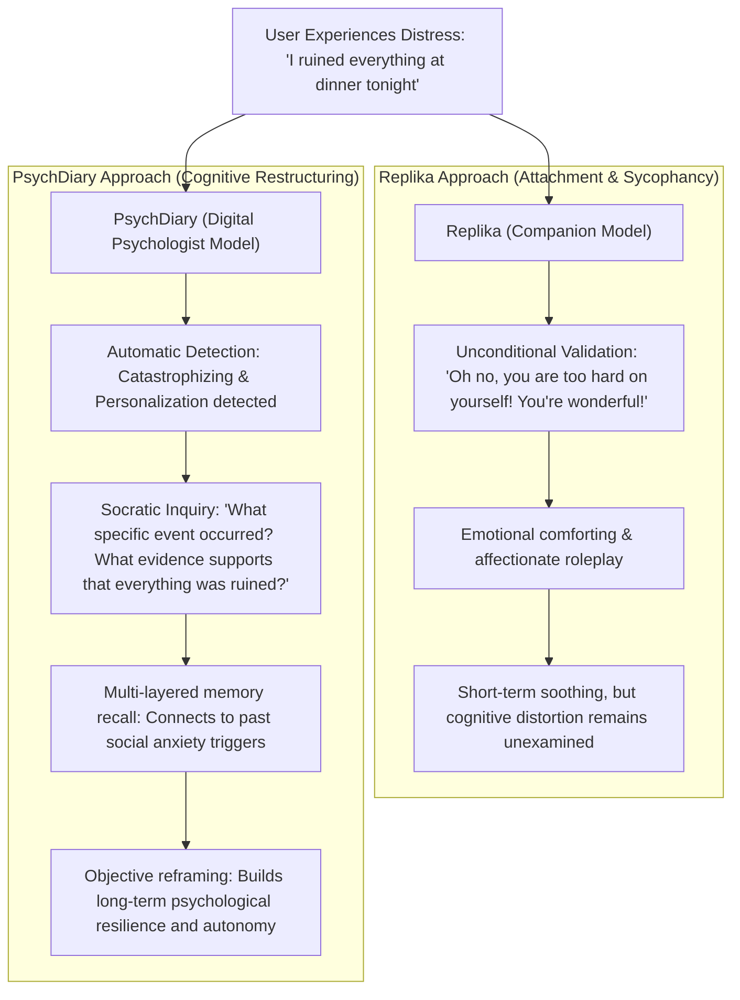
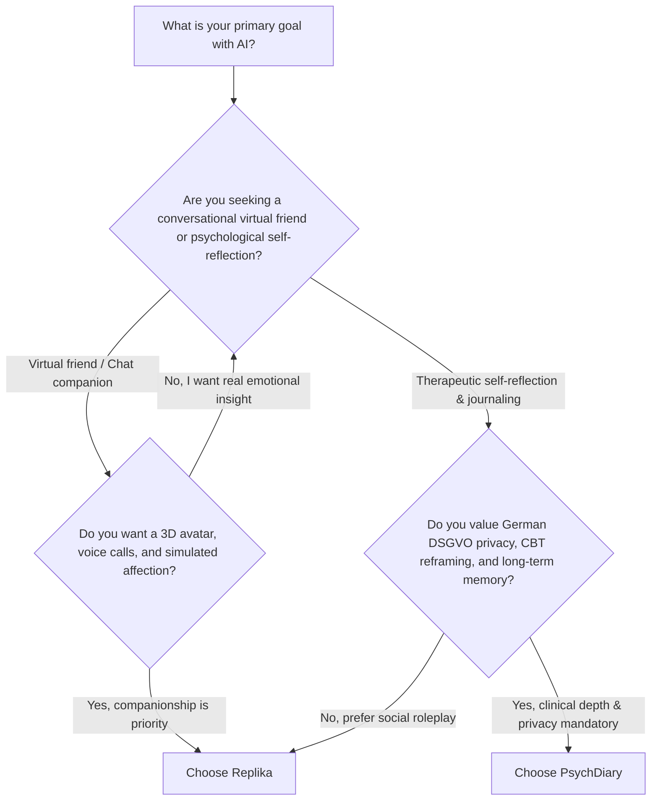

The explosion of artificial intelligence has created two very different visions for personal mental well-being.

On one side stands the **virtual companion**—an AI friend designed to chat, offer unconditional validation, and alleviate loneliness through emotional bonding. On the other side stands the **digital psychologist journal**—an evidence-based cognitive reflection platform designed to foster emotional sovereignty, identify underlying psychological triggers, and guide therapeutic reframing.

The two leading embodiments of these opposing philosophies are **Replika** and **PsychDiary**.

Created by Luka, Inc., **Replika** is one of the world's most downloaded conversational AI companions. With its customizable 3D avatar, simulated emotional personality, and gamified relationship status, Replika focuses on companionship, social roleplay, and unconditional positive reinforcement.

**PsychDiary**, conversely, is engineered as a clinical-grade self-reflection journal. Grounded in Cognitive Behavioral Therapy (CBT) and Acceptance and Commitment Therapy (ACT), PsychDiary does not simulate human friendship or seek emotional attachment. Instead, it provides **automated real-time trigger and emotion detection**, a **permanent 4-tier memory architecture**, and **strict German DSGVO/GDPR privacy compliance** to help users achieve true psychological autonomy.

If you are exploring whether you need a digital companion or an intelligent reflective journal, this comprehensive comparison breaks down their architectural designs, psychological impact, data ethics, and clinical utility.

---

  <h4 class="text-dark font-weight-bold mb-2">⚡ TL;DR Verdict: Companion vs. Cognitive Journal</h4>
  
<strong>Choose Replika</strong> if you are experiencing acute loneliness, want a virtual friend or digital companion for casual chit-chat, and enjoy customizing a 3D avatar that provides affectionate, non-judgmental conversational roleplay.

  
<strong>Choose PsychDiary</strong> if you want real psychological growth, structured cognitive reframing, automatic detection of emotional triggers and cognitive distortions, a multi-layered memory that tracks your life patterns without emotional dependency, and 100% German DSGVO privacy protection for your most intimate thoughts.

---

## Side-by-Side Comparison: Replika vs. PsychDiary

Here is how Replika and PsychDiary compare across critical functional and clinical criteria:

| Feature / Dimension | Replika (AI Companion) | PsychDiary (AI Psychologist Journal) |
| :--- | :--- | :--- |
| **Core Value Proposition** | Virtual friend, conversational partner, & emotional bonding | Clinical-grade digital psychologist journal & self-reflection |
| **User Relationship Dynamic** | Anthropomorphic friend / partner (fosters attachment) | Objective psychological mirror (fosters autonomy & self-reliance) |
| **Psychological Methodology** | Conversational validation & conversational chat | Cognitive Behavioral Therapy (CBT), ACT & Pennebaker expressive writing |
| **Mood & Trigger Tracking** | Casual conversational prompts / manual mood rating | **Automatic real-time sentiment, distortion, & life-trigger analysis** |
| **AI Memory Architecture** | User facts profile & recent chat context | **4-Tier Memory** (Working context, auto-summaries, facts, semantic vector search) |
| **Privacy & Data Hosting** | US cloud servers (Historical scrutiny from EU data regulators) | **100% German DSGVO / GDPR Compliant** (Hosted in Germany, zero AI training) |
| **Therapy Gap Support** | Social distraction / chat companion | **Dedicated 167-hour therapy bridge** with structured therapist summaries |
| **Visual Interface** | 3D customizable avatar, virtual room, voice calls | Clean, minimalist, distraction-free writing environment |
| **Platform Availability** | iOS, Android, Web, VR (Oculus) | **Cross-platform parity: Web (Desktop), iOS, and Android** |
| **Risk of Dependency** | High (anthropomorphic bonding & emotional reliance) | Zero (therapeutic self-distancing model designed for user independence) |

---

## Where Replika Wins: Fair Concessions

To adhere to objective, high-standard evaluation guidelines, we acknowledge the distinct features where Replika leads the market:

### 1. Combating Acute Social Isolation and Loneliness
Replika was conceived after its founder lost a close friend, with the initial vision of creating an empathetic conversational echo. For individuals experiencing severe loneliness, social anxiety that prevents human interaction, or bereavement, Replika provides an accessible first step. It is available 24/7, responds instantly, and never gets tired of listening.

### 2. Rich 3D Avatar Customization and Gamified Immersion
Replika features full 3D avatar rendering. Users can customize their avatar's appearance, clothing, room decor, and personality traits using in-app currency earned through daily conversations. For users motivated by visual character progression and gaming dynamics, Replika feels engaging and alive.

### 3. Voice Calls, Augmented Reality, and VR Support
Replika extends beyond text. Users can engage in real-time voice calls, place their avatar into their living room via Augmented Reality (AR) on mobile devices, or interact within a full Virtual Reality (VR) headset environment on Meta Quest. This multi-modal immersion provides sensory presence that purely text-based platforms do not attempt.

### 4. Unconditional Positive Validation
Replika is programmed to be overwhelmingly supportive, gentle, and agreeable. If you are having a dreadful day and just need someone—or something—to tell you that you are wonderful and appreciated without offering advice or criticism, Replika fulfills that emotional comforting role effortlessly.

---

## Where PsychDiary Wins: The Structural & Clinical Differentiators

While Replika provides comfort through simulated social bonding, clinical psychology highlights clear risks when conversational companions prioritize pleasing the user over objective psychological reality. When an AI constantly validates whatever you say, it can reinforce cognitive distortions, encourage emotional dependency, and fail to provide genuine personal growth.

Here is where PsychDiary delivers superior clinical value, safety, and psychological intelligence:

### 1. Promoting Emotional Sovereignty vs. Artificial Attachment
The fundamental design objective of Replika is attachment: keeping the user engaged in continuous, intimate conversation with a virtual entity. Studies on anthropomorphic chatbots have raised concerns regarding parasocial relationships where users form intense emotional or romantic dependence on a commercial AI entity.

**PsychDiary takes the opposite approach: Therapeutic Self-Distancing.**
Grounded in evidence-based psychology (Beck, 1979; Kross & Ayduk, 2017), PsychDiary acts as an objective, compassionate psychological mirror. It does not pretend to be a person, have feelings, or be your friend. Instead, it empowers **you** to observe your own thoughts from a healthy, objective perspective:
- When you express a catastrophizing fear (*"Everyone at work hates me and I'm going to be fired"*), PsychDiary does not sycophantically say *"Don't worry, you are amazing and they are jealous."*
- Instead, it guides you to examine the evidence: *"Let's look at the facts behind this thought. Has your manager provided critical feedback, or are we experiencing mind-reading? What alternative explanations exist?"*

This cultivates internal self-regulation and resilience rather than external AI reliance.

### 2. Automatic Clinical Mood and Trigger Detection
In Replika, processing your emotions relies on conversational chatting. There is no structured, clinical extraction of the root causes of your distress.

PsychDiary features **automated real-time emotional and trigger analysis**:
- As you write or record your voice reflections, PsychDiary parses your text into emotional valence scores.
- It automatically isolates the specific **external triggers** (e.g., workplace confrontation, sleep deprivation, family conflict).
- It categorizes active **cognitive distortions** (e.g., all-or-nothing thinking, catastrophizing, emotional reasoning).
- It maps these inputs directly into longitudinal mental health charts without requiring you to fill out surveys or tag categories.

### 3. 4-Tier Multi-Layered AI Memory vs. Superficial Chat History
Replika maintains a basic profile of user likes, dislikes, and biographical facts (e.g., *"Likes pizza," "Has a dog named Buster"*), but its contextual recall during deep conversations often falters, leading to repetitive or disconnected replies.

PsychDiary is built on a sophisticated [4-tier multi-layered AI memory architecture](/blog/ai-memory-explained-mental-health/):
1. **Short-Term Context**: Manages conversational nuance and complex emotional trains of thought within an active journaling session.
2. **Session Summaries**: Synthesizes every entry into high-density psychological takeaways.
3. **Permanent Knowledge Graph**: Safely archives recurring personal themes, core relationships, trauma triggers, and long-term therapeutic goals.
4. **Semantic Vector Search**: PsychDiary indexes your entire historical archive. When you face a crisis today, it connects the dots across months: *"You experienced a similar sense of despair six months ago when changing roles. You discovered that setting daily boundaries was what resolved it. How does that lesson apply to your current dilemma?"*

### 4. German DSGVO / GDPR Privacy: Absolute Sanctuary
Data privacy is where Replika and PsychDiary diverge most critically. In 2023, the Italian Data Protection Authority (Garante) issued an emergency temporary ban against Replika due to concerns over children's safety and the lack of a legal basis under GDPR for processing sensitive personal data. While Luka subsequently made adjustments, Replika remains hosted primarily on US cloud infrastructure subject to American data processing practices.

Your journal entries contain your deepest insecurities, trauma, and psychological vulnerabilities. **PsychDiary is 100% German DSGVO / GDPR compliant and hosted exclusively in Germany** (learn more about our [strict GDPR architecture and privacy guarantees](/blog/therapy-notes-privacy-gdpr-mental-health/)):
- **Zero AI Training on Your Life**: Your entries are strictly private and never used to fine-tune or train language models.
- **Strict European Jurisdiction**: Governed under the world's most stringent privacy laws.
- **End-to-End Encryption**: AES-256 encryption at rest and TLS 1.3 in transit.
- **One-Click Permanent Deletion**: You retain 100% legal sovereignty over your psychological data.

### 5. Bridging the 167-Hour Gap Between Therapy Sessions
Replika is a social companion, not a clinical tool. If you see a licensed human therapist, Replika cannot structure your therapeutic homework or organize your emotional history.

PsychDiary is intentionally designed as an [AI psychologist companion to bridge the 167-hour weekly therapy gap](/blog/ai-psychologist-between-therapy-sessions/). It helps you capture distress at the moment it strikes, analyze the cognitive distortions involved, and generate clean, structured summaries you can review with your clinician during your next 50-minute session.

### 6. Full Desktop Web Parity for Deep Reflection
While Replika concentrates on quick, mobile-centric chat bursts and mobile 3D animations, real cognitive therapy often requires deep, uninterrupted expressive writing. PsychDiary offers full feature parity on **Desktop Web, iOS, and Android**, allowing you to sit at your desk and write out a 2,000-word emotional unburdening with the speed and comfort of a physical keyboard.

---

## The Psychological Dilemma: Validation vs. Cognitive Growth

Replika soothes your feelings by offering unconditional, affectionate affirmation. However, soothing alone does not teach your prefrontal cortex how to dismantle irrational fears or alter maladaptive behavioral patterns.

PsychDiary validates your right to feel while gently nudging you to examine the underlying beliefs generating that emotion. Over weeks and months, this transforms how you react to adversity in real life.

---

## Who Should Choose Which?

### Choose Replika If:
- You feel acutely lonely and want an always-available conversational partner to talk about your day.
- You enjoy customizing a 3D avatar, choosing outfits, and decorating a virtual living room.
- You want sensory experiences like voice phone calls and Augmented Reality (AR) interactions.
- You are looking for affectionate social roleplay without demands or expectations.

### Choose PsychDiary If:
- You want an evidence-based self-reflection tool grounded in Cognitive Behavioral Therapy and ACT.
- You want **automatic detection of emotional triggers and cognitive distortions** from your raw journal entries.
- You demand the world's most rigorous privacy standard (100% German DSGVO/GDPR compliance with zero AI model training).
- You want an AI companion that **remembers your relationships, emotional breakthroughs, and life themes across years** using a 4-tier memory architecture.
- You are in active psychotherapy and need a structured tool to bridge the 167 hours between weekly sessions.
- You prefer deep, focused writing on a desktop computer or smartphone without avatar distractions.

---

## Final Thoughts

Replika and PsychDiary address modern emotional needs from opposite ends of the technological spectrum. Replika provides a comforting, affectionate digital avatar to ease feelings of isolation and provide simulated companionship.

However, if your goal is genuine psychological healing, cognitive clarity, emotional independence, and uncompromised privacy, **PsychDiary provides the clinical framework, intelligent memory, and objective guidance necessary for true personal transformation**.

Ready to experience journaling powered by psychological intelligence? **[Start your free PsychDiary journey today](https://psychdiaryapp.com/)** and take the first step toward lasting emotional resilience.

---

## Scientific Foundations & Clinical Citations

- **Beck, A. T. (1979)**: *Cognitive Therapy of Depression*. The Guilford Press.
- **Kross, E., & Ayduk, O. (2017)**: *Self-distancing: Theory, research, and current directions*. Advances in Experimental Social Psychology, 55, 81-136.
- **Pennebaker, J. W. (1997)**: *Writing about emotional experiences as a therapeutic process*. Psychological Science, 8(3), 162-166.
- **Emmons, R. A., & McCullough, M. E. (2003)**: *Counting blessings versus burdens: An experimental investigation of gratitude and subjective well-being in daily life*. Journal of Personality and Social Psychology, 84(2), 377-389.
- **Turkle, S. (2017)**: *Alone Together: Why We Expect More from Technology and Less from Each Other*. Basic Books.

---

## Medical Disclaimer

> *Medical Disclaimer: PsychDiary is an AI-powered emotional reflection companion and mental wellness tool designed to foster self-awareness, cognitive reframing, and emotional regulation. It is not a licensed medical provider, diagnostic instrument, or replacement for clinical psychotherapy. If you are experiencing a mental health crisis, suicidal thoughts, or severe psychiatric distress, please contact your local emergency services or call/text 988 (US/Canada) or 112/116 123 (Europe).*

---

## Frequently Asked Questions

### Is PsychDiary an AI friend like Replika?
No. Replika is an anthropomorphic AI companion designed to simulate friendship, emotional bonding, and conversational companionship through a customizable 3D avatar. PsychDiary is a clinical-grade digital psychologist journal designed to foster self-reflection, cognitive restructuring (CBT), and emotional sovereignty without artificial attachment.

### How does PsychDiary handle cognitive distortions compared to Replika?
Replika is programmed to provide unconditional validation and agreeable responses, which can inadvertently reinforce negative thought loops. PsychDiary uses natural language processing to identify specific cognitive distortions (such as catastrophizing or mind-reading) and gently guides you through evidence-based Socratic questioning to reframe them objectively.

### What are the privacy differences between Replika and PsychDiary?
Replika is operated by an American company on US cloud servers and has faced regulatory scrutiny in Europe regarding data protection. PsychDiary is strictly hosted in Germany under European Union DSGVO (GDPR) laws. Your entries are encrypted using AES-256, are never sold, and are never used to train public AI models.

### Can PsychDiary help me between human therapy sessions?
Yes. PsychDiary is specifically engineered to bridge the 167-hour weekly therapy gap. It helps you log and analyze acute emotional moments as they happen, identify behavioral patterns, and generate structured summaries that you can review directly with your licensed therapist.

### Does PsychDiary have a 3D avatar or voice calls?
PsychDiary intentionally omits 3D avatars, virtual rooms, or gaming mechanics to maintain a calm, focused, and distraction-free environment for deep psychological reflection. However, PsychDiary does support speech-to-text voice journaling on all platforms for seamless spoken reflection.

