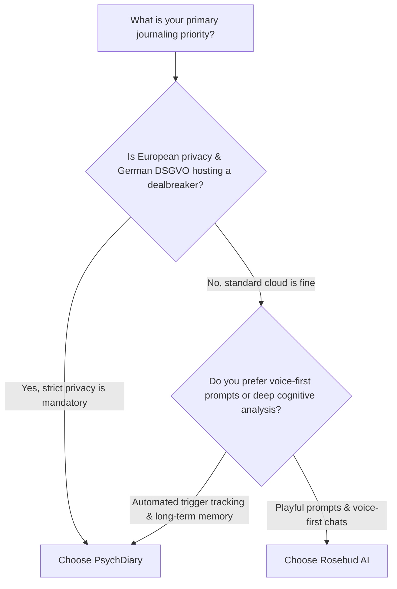

Artificial intelligence has fundamentally disrupted the traditional blank-page journal. Instead of staring at an empty lined notebook wondering where to begin, millions of people now turn to interactive AI companions to process complex emotions, unpack stressful workdays, and practice cognitive reflection.

Two of the most prominent contenders in the intelligent journaling space are **Rosebud AI Journal** and **PsychDiary**. While both leverage modern Large Language Models (LLMs) to guide your reflective writing, their architectural philosophies, privacy guarantees, and analytical engines diverge dramatically.

Rosebud positions itself primarily as an interactive, voice-first companion with engaging conversational prompts. PsychDiary, on the other hand, is built from the ground up as a clinical-grade digital psychologist journal—featuring **automatic mood and trigger detection**, a **multi-layered permanent AI memory architecture**, and **strict German DSGVO/GDPR privacy compliance**.

In this comprehensive guide, we compare Rosebud and PsychDiary side-by-side to help you decide which tool best supports your mental health journey.

---

  <h4 class="text-dark font-weight-bold mb-2">⚡ TL;DR Verdict: Which App Should You Pick?</h4>
  
<strong>Choose Rosebud</strong> if you want a playful, conversational journaling companion with polished voice-to-text input, gamified prompt journeys ("Bloom"), and a community-centric experience designed for daily habit formation.

  
<strong>Choose PsychDiary</strong> if you want deep psychological insight, automatic trigger and sentiment analysis without manual tagging, a companion that remembers your full life story across months and years via multi-layered memory, and uncompromised European privacy hosted on secure German servers (DSGVO-compliant).

---

## Side-by-Side Comparison: Rosebud vs. PsychDiary

To give you an immediate snapshot of how these two AI journaling platforms compare, here is a detailed breakdown of core capabilities:

| Feature / Dimension | Rosebud AI Journal | PsychDiary |
| :--- | :--- | :--- |
| **Primary Focus** | Interactive conversational journaling & guided prompts | Clinical-grade digital psychologist, trigger tracking & deep self-reflection |
| **Mood Tracking** | User-selected / prompt-based reflections | **Automatic real-time sentiment & trigger detection** (No manual tagging needed) |
| **AI Memory Architecture** | Recent session recall & prompt history | **4-Layered Memory** (Short-term context, auto-summaries, permanent facts, semantic vector search) |
| **Data Privacy & Hosting** | US-based cloud infrastructure | **100% German DSGVO / GDPR Compliant** (Hosted in Germany, zero AI training on user entries) |
| **Therapy Integration** | General wellness & personal growth | Evidence-based CBT/ACT framework bridging the **167-hour weekly therapy gap** |
| **Platform Availability** | iOS, Android, Web (Mobile-first) | **Native Web, iOS, and Android** with real-time cross-device synchronization |
| **Voice Journaling** | Yes (Integrated Whisper transcription) | Yes (Speech-to-text input support) |
| **Visual Analytics** | Basic entry streaks & reflection summaries | **Longitudinal emotional graphs, trigger frequency analysis, & growth milestones** |
| **Free Tier / Trial** | Limited free credits / Subscription required | Free exploration tier with accessible premium upgrade |

---

## Where Rosebud AI Wins: Fair Concessions

To provide an objective review in accordance with Google's Quality Rater Guidelines, we readily highlight the areas where Rosebud excels:

### 1. Polished Conversational Flow & Voice-First Journaling
Rosebud was built with voice-first users in mind. Its speech-to-text integration (powered by OpenAI’s Whisper) is smooth and responsive. If your primary style of reflection is pacing around your living room while dictating an unedited stream of consciousness, Rosebud’s conversational interface handles verbal rambling exceptionally well and turns it into clean conversational threads.

### 2. The "Bloom" Guided Prompt Ecosystem
For beginners who freeze when asked *"How are you feeling today?"*, Rosebud provides a rich library of interactive templates called "Bloom." These prompts guide users through specialized situations—such as preparing for a difficult conversation with a boss, dealing with imposter syndrome, or processing a breakup. The guided back-and-forth feels natural and accessible for journaling novices.

### 3. Active Community & Social Reinforcement
Rosebud has cultivated an active Discord and social community around its product. If you enjoy sharing personal growth milestones with other journaling enthusiasts, Rosebud’s ecosystem offers a welcoming, communal environment.

---

## Where PsychDiary Wins: The Structural Differentiators

While Rosebud provides an engaging conversational chat, PsychDiary was engineered for individuals who take their psychological health, privacy, and long-term personal growth seriously. Here is where PsychDiary establishes clear dominance:

### 1. Automatic Clinical Mood and Trigger Detection
In most journaling apps, tracking your emotional state requires manual effort: picking a smiley face, selecting tags like "Work" or "Fatigue," and categorizing your distress.

PsychDiary eliminates all friction through **automated emotional analysis**. As you write naturally—or talk to your digital psychologist—the platform's natural language processing engine analyzes your text in real time:
- It scores your emotional valence from deeply positive to distressing.
- It automatically extracts **positive drivers** (e.g., morning run, deep work session, supportive partner conversation).
- It isolates **underlying negative triggers** (e.g., micromanagement from a supervisor, boundary issues with family members, disrupted sleep).
- It highlights cognitive distortions such as catastrophizing, mind-reading, and black-and-white thinking.

You don't need to categorize yourself; you simply write, and PsychDiary builds your longitudinal emotional profile automatically.

### 2. German DSGVO / GDPR Privacy: The Gold Standard for Vulnerable Data
Your journal contains your most intimate secrets: your marital anxieties, panic attacks, depressive thoughts, and career fears. 

Many US-based AI apps operate under data protection regimes that allow data transfers, third-party sub-processors, or ambiguous data retention policies. In contrast, **PsychDiary is strictly engineered and hosted on servers located in Germany**, under the stringent legal framework of the **European General Data Protection Regulation (DSGVO / GDPR)** (learn more in our deep dive on [why German DSGVO hosting matters for mental health journaling](/blog/therapy-notes-privacy-gdpr-mental-health/)):
- **Zero Model Training**: Your private thoughts are never ingested to train public AI models.
- **Server Sovereignty**: Data is processed within the European Union under strict German privacy law.
- **End-to-End Encryption**: Data is encrypted at rest and in transit using industry-standard AES-256 protocols.
- **Total Ownership**: You can export or permanently delete your entire psychological archive with a single click.

For anyone who values mental health confidentiality as highly as medical doctor-patient privilege, PsychDiary is the definitive choice.

### 3. Four-Tier Multi-Layered AI Memory
The biggest frustration with generic AI companions is their "digital amnesia." After a few weeks or a dozen entries, standard chatbots forget what you told them about your partner, your childhood, or the job interview you prepared for last Tuesday.

PsychDiary solves this through a proprietary [multi-layered AI memory architecture](/blog/ai-memory-explained-mental-health/):
1. **Short-Term Context**: Manages immediate conversation state during an active journaling session.
2. **Automatic Session Summaries**: Generates high-density executive summaries of every entry, preserving core emotional breakthroughs.
3. **Permanent Knowledge Graph (User Facts)**: Extracts and stores enduring facts (e.g., "User’s sister is Sarah," "User has been in therapy for panic disorder since 2023," "User feels overwhelmed by public speaking").
4. **Semantic Vector Search**: When you write about feeling anxious today, PsychDiary instantly searches your entire historical diary to identify: *"You felt this exact physical tightness six months ago when starting your previous contract. Here is how you navigated it then."*

This long-term memory transforms PsychDiary from a disposable chatbot into a continuous, life-long mental health companion.

### 4. Bridging the 167-Hour Gap Between Therapy Sessions
If you attend weekly psychotherapy, you spend 1 hour in session and **167 hours living your everyday life**. Most emotional crises, interpersonal disputes, and cognitive spirals occur between sessions—and by the time you sit on your therapist's couch next week, you have forgotten the specifics of what triggered your Tuesday afternoon breakdown.

PsychDiary is specifically tailored as a [companion to bridge the 167-hour weekly therapy gap](/blog/ai-psychologist-between-therapy-sessions/). It allows you to document acute moments as they happen, analyze the cognitive distortions involved, and generate clean, structured summaries that you can review with your licensed therapist.

### 5. Full Web and Cross-Platform Parity
While many modern journaling apps prioritize a mobile-only experience, deep personal reflection often demands a physical keyboard. PsychDiary offers full, seamless synchronization across **desktop web browsers, iOS, and Android**. You can type a long, cathartic reflection on your laptop at night and review your insights on your smartphone during your morning commute.

---

## Detailed Comparison Breakdown

### Conversational Experience vs. Analytical Rigor
Rosebud's conversational model acts like a friendly, supportive conversational partner asking open-ended questions. While comforting, it can occasionally feel like small talk.

PsychDiary balances warmth with clinical substance. Rooted in evidence-based frameworks such as **Cognitive Behavioral Therapy (CBT)** and **Acceptance and Commitment Therapy (ACT)**, the AI gently challenges cognitive distortions, encourages objective self-distancing, and provides actionable psychological reframing.

### Longitudinal Progress Tracking
Over three to six months, how does your journaling reflect your personal growth?
- In **Rosebud**, you review past entries by scrolling back through your chat stream or viewing streak counts.
- In **PsychDiary**, you access an interactive analytics dashboard displaying your emotional trajectory over weeks and months, correlation graphs between specific life triggers and depressive spikes, and milestone summaries that celebrate your emotional resilience.

---

## Who Should Choose Which?

### Choose Rosebud If:
- You want an easy, voice-dictated daily check-in that feels like a friendly texting conversation.
- You struggle with the "blank canvas" syndrome and need pre-structured, gamified prompt journeys.
- You enjoy mobile-centric journaling and participating in an active social community.

### Choose PsychDiary If:
- You demand the world's most rigorous data privacy (100% German DSGVO/GDPR compliance with zero model training).
- You want an AI companion that actually remembers your life, relationships, and history across months and years.
- You want **automatic sentiment and trigger detection** without having to manually select tags and mood ratings.
- You are in active psychotherapy and need an evidence-based tool to bridge the 167 hours between weekly sessions.
- You prefer writing on a full desktop keyboard as comfortably as on your phone.

---

## Final Thoughts

Both Rosebud and PsychDiary demonstrate how transformative artificial intelligence can be for mental well-being. If you are seeking a lighthearted, prompt-driven daily habit builder, Rosebud is an enjoyable option.

However, if you view journaling as a vital pillar of your psychological health—requiring clinical depth, multi-layered memory, automated trigger tracking, and ironclad German privacy protection—**PsychDiary is in a class of its own**.

Ready to transform your mental reflection? **[Start your free PsychDiary journey today](https://psychdiaryapp.com/)** and experience journaling powered by true psychological intelligence.

---

## Scientific Foundations & Clinical Citations

- **Emmons, R. A., & McCullough, M. E. (2003)**: *Counting blessings versus burdens: An experimental investigation of gratitude and subjective well-being in daily life*. Journal of Personality and Social Psychology, 84(2), 377-389.
- **Da Jiang et al. (2022)**: *Gratitude and daily stress: A 14-day longitudinal intervention predicting positive affect and stress buffering*. Stress and Health, 38(4), 712-723.
- **Beck, A. T. (1979)**: *Cognitive Therapy of Depression*. The Guilford Press.

---

## Medical Disclaimer

> *Medical Disclaimer: PsychDiary is an AI-powered emotional reflection companion and mental wellness tool designed to foster self-awareness and emotional regulation. It is not a licensed medical provider, diagnostic instrument, or replacement for clinical psychotherapy. If you are experiencing a mental health crisis, suicidal thoughts, or severe psychiatric distress, please contact your local emergency services or call/text 988 (US/Canada) or 112/116 123 (Europe).*

---

## Frequently Asked Questions

### Is my journaling data safe and private with PsychDiary?
Yes. PsychDiary operates under strict European Union DSGVO (GDPR) standards, with all data hosted on secure servers located in Germany. Your personal entries and psychological analyses are encrypted, never sold, and never utilized to train public AI models.

### How does PsychDiary's memory differ from Rosebud?
Rosebud remembers immediate conversational context and prompt history within active sessions. PsychDiary employs a 4-layered memory architecture comprising short-term context, automatic session summaries, a permanent knowledge graph of user facts, and semantic vector search across your entire journal history, allowing it to connect patterns across months or years.

### Can PsychDiary replace a human licensed therapist?
No. PsychDiary is an AI-powered self-reflection and mental well-being tool designed to foster self-awareness, track mood patterns, and bridge the 167-hour gap between professional therapy sessions. It does not provide medical diagnosis, clinical treatment, or crisis intervention.

### Does PsychDiary support speech-to-text voice journaling?
Yes. PsychDiary supports voice input across all platforms, allowing you to speak your thoughts freely while our AI automatically transcribes, summarizes, and extracts emotional triggers from your recording.

