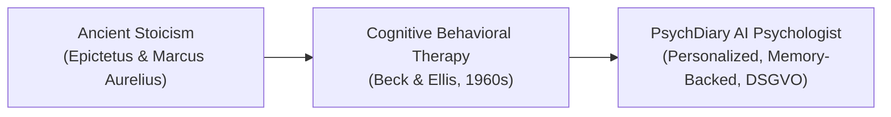
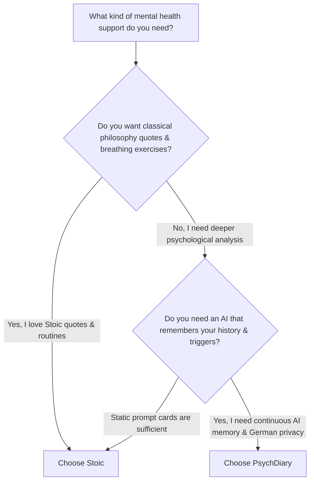

When Emperor Marcus Aurelius wrote his private notes almost two thousand years ago—a text later published as *Meditations*—he was practicing what modern psychologists call cognitive reframing. Today, ancient philosophy has experienced a massive digital renaissance, spearheading popular apps like **Stoic**.

Stoic blends classical philosophical prompts, morning preparation rituals, evening retrospectives, and breathing exercises into a beautifully designed, minimalist interface.

Yet, while ancient quotes provide timeless wisdom, modern mental health challenges often demand more than general philosophical aphorisms. That is where **PsychDiary** comes in: an evidence-based digital psychologist journal powered by advanced artificial intelligence, **multi-layered long-term memory**, and **automatic trigger and cognitive distortion detection**, all protected by **strict German DSGVO/GDPR privacy compliance**.

In this guide, we evaluate how Stoic and PsychDiary compare across clinical efficacy, user interaction, memory capabilities, and data security.

---

  <h4 class="text-dark font-weight-bold mb-2">⚡ TL;DR Verdict: Ancient Philosophy or Active AI Psychologist?</h4>
  
<strong>Choose Stoic</strong> if you love minimalist Roman and Greek philosophy, curated quotes from Seneca and Marcus Aurelius, pre-set morning/evening reflection templates, and built-in box breathing exercises wrapped in an elegant Apple-centric design.

  
<strong>Choose PsychDiary</strong> if you need an active, intelligent companion that deeply analyzes your personal thoughts, automatically detects emotional triggers and cognitive distortions, remembers your life story across months via 4-layered memory, and protects your intimate therapy data on secure German servers under DSGVO/GDPR law.

---

## Side-by-Side Comparison: Stoic vs. PsychDiary

Here is how Stoic’s philosophy-guided routine compares with PsychDiary’s psychological AI intelligence:

| Feature / Dimension | Stoic App | PsychDiary |
| :--- | :--- | :--- |
| **Guiding Philosophy** | Ancient Stoicism (Epictetus, Seneca, Marcus Aurelius) | Evidence-Based Clinical Psychology (CBT, ACT, Expressive Writing) |
| **Interaction Model** | Static prompts, quotes, & daily check-in templates | **Interactive 24/7 Digital Psychologist** with real-time empathetic dialogue |
| **Emotional Analysis** | Manual mood selection & predefined tag selection | **Automatic sentiment, emotion valence, & trigger detection** from freeform text |
| **AI Memory System** | Limited to entry log history (No cross-entry memory) | **4-Layered Persistent Memory** (Session context, auto-summaries, user facts, semantic search) |
| **Cognitive Distortion Detection** | Not supported (Static reflection guides) | **Automatic identification of catastrophizing, mind reading, & black-and-white thinking** |
| **Mindfulness Utilities** | Box breathing, visual meditation, habit trackers | Integrated grounding exercises & psychological reframing |
| **Data Privacy & Hosting** | Cloud storage (US servers / Apple CloudKit) | **100% German DSGVO / GDPR Compliance** (German servers, zero model training) |
| **Supported Platforms** | iOS (Primary), macOS, Android (Limited) | **Seamless parity across Web, iOS, and Android** |
| **Therapy Bridging** | Self-contained daily personal routine | **Engineered to bridge the 167-hour weekly psychotherapy gap** with structured clinician exports |

---

## Where Stoic Wins: Fair Concessions

Stoic is widely praised for its exceptional design and thoughtful curation. In accordance with Google's Quality Guidelines, here are the areas where Stoic truly shines:

### 1. Masterclass in Minimalist Aesthetics & Typography
Stoic features one of the most visually stunning, calm interfaces in the digital wellness category. Its monochromatic color schemes, high-contrast serif typography, and tactile haptic feedback make opening the app a soothing ritual. For design purists who appreciate Apple Design Award-level polish, Stoic is a pleasure to look at.

### 2. Timeless Classical Wisdom
If you find solace in classical philosophy, Stoic delivers a daily dose of perspective. Waking up to a curated passage from Epictetus on the dichotomy of control (*"Some things are in our control and others not"*) can set an intentional tone for your morning.

### 3. Built-In Somatic & Mindfulness Exercises
Stoic does not stop at journaling; it integrates practical somatic tools directly into daily routines:
- **Box Breathing & 4-7-8 Breathing**: Visual timers that guide relaxation before bed or during acute work stress.
- **Visual Meditation & Cold Shower Timers**: Niche tools tailored for people adopting holistic Stoic lifestyle regimens.

---

## Where PsychDiary Wins: Beyond Static Quotes

Stoic philosophy provided the historical foundation for modern **Rational Emotive Behavior Therapy (REBT)** and **Cognitive Behavioral Therapy (CBT)**, founded by Albert Ellis and Aaron Beck. However, while Stoic offers generalized ancient wisdom, PsychDiary applies personalized modern psychology.

Here is why PsychDiary is significantly more potent for deep mental well-being:

### 1. Dynamic Psychological Dialogue vs. Static Questionnaires
Stoic asks you predetermined questions: *"What is one thing you can control today?"* While helpful, a static prompt cannot respond when your answer is messy, anxious, or contradictory.

**PsychDiary provides an active, empathetic digital psychologist**:
- If you write: *"I know my presentation is out of my control, but I still feel like throwing up and everyone is going to laugh at me,"* Stoic simply saves the entry.
- PsychDiary responds directly to your fear: it validates your physical distress, detects the cognitive distortion of *mind reading* and *catastrophizing*, and helps you deconstruct the specific evidence behind your catastrophic assumption.

### 2. Four-Tier Multi-Layered AI Memory
The human psyche does not exist in isolated 24-hour silos. Your stress today is intrinsically tied to your childhood patterns, your recurring workplace conflicts, and your past relationship traumas.

Stoic stores your entries as isolated chronological logs. **PsychDiary builds a permanent psychological knowledge base** using our [multi-layered AI memory architecture](/blog/ai-memory-explained-mental-health/):
1. **Short-Term Context**: Tracks active journaling discussions.
2. **Automatic Session Summaries**: Synthesizes the core emotional takeaways of each entry.
3. **User Facts & Permanent Memory**: Remembers key individuals, past diagnoses, chronic anxieties, and personal values.
4. **Semantic Vector Search**: Instantly connects today's dilemma to similar emotional patterns from months or years ago, illustrating your resilience over time.

### 3. Automatic Trigger and Distortion Detection
In Stoic, you must manually log moods and tags. In PsychDiary, the AI reads your unfiltered words and automatically surfaces:
- **Emotional Valence**: Precise sentiment scoring across nuanced emotional states (e.g., melancholic, apprehensive, resentful, optimistic).
- **Underlying Triggers**: Isolates environmental, relational, and physiological drivers without requiring manual tagging.
- **Cognitive Distortions**: Automatically highlights when you are engaging in emotional reasoning, overgeneralization, or personalization.

### 4. German DSGVO / GDPR Compliance: Absolute Confidentiality
The thoughts you write in a journal are intensely private. Most consumers are unaware that many US-based lifestyle apps operate under loose privacy policies that permit data sharing with third-party advertising trackers or fail to guarantee protection against AI model ingestion.

**PsychDiary is built on German data sovereignty** (read our guide on [why German DSGVO hosting matters for mental health journaling](/blog/therapy-notes-privacy-gdpr-mental-health/)):
- 100% compliant with the European Union’s strict General Data Protection Regulation (**DSGVO / GDPR**).
- Hosted exclusively on hardened, secure servers inside Germany.
- **Zero AI Training**: Your personal journals are never fed into training sets for public language models.
- Complete data portability and one-click permanent account deletion.

### 5. Bridging the 167-Hour Weekly Therapy Gap
If you attend weekly therapy, you spend 1 hour with your psychologist and **167 hours navigating real life**. 

Stoic provides a self-contained daily diary. PsychDiary, by contrast, acts as an active [bridge for the 167-hour weekly therapy gap](/blog/ai-psychologist-between-therapy-sessions/). It automatically organizes your weekly emotional spikes, recurring triggers, and cognitive reframings into clear, structured summaries that you can review with your therapist—making your clinical sessions twice as effective.

### 6. Full Desktop Web + Mobile Parity
While Stoic is predominantly optimized for iOS handsets, real cognitive work often requires sitting down with a full keyboard. PsychDiary offers complete, responsive parity across **native web browsers, iOS, and Android**, allowing you to write extensive reflections on your computer and access your AI companion on your phone.

---

## From Marcus Aurelius to Modern Cognitive Science

The core insight of Stoicism is famously stated by Epictetus: *"People are disturbed not by things, but by the view which they take of them."*

In the 1960s, Dr. Aaron Beck and Dr. Albert Ellis took this ancient philosophical maxim and empirically proved that identifying distorted thoughts relieves clinical depression and anxiety.

Stoic delivers the ancient inspiration. **PsychDiary provides the modern clinical engine**. It operationalizes the core principle of Stoicism through real-time AI memory, helping you actively spot and correct cognitive distortions as they occur in your everyday life.

---

## Who Should Choose Which?

### Choose Stoic If:
- You are fascinated by Greco-Roman Stoicism and want daily quotes from Marcus Aurelius and Seneca.
- You love high-end minimalist Apple design, haptics, and integrated box breathing timers.
- You prefer quick, self-guided morning and evening check-in templates over conversational dialogue.

### Choose PsychDiary If:
- You want an active, intelligent digital psychologist that challenges your negative thoughts and validates your emotions.
- You want an AI companion that remembers your personal life history and therapy milestones across months and years.
- You want **automatic trigger detection and emotional pattern recognition** without tedious manual tag selection.
- You demand the world's most rigorous data privacy: **German DSGVO / GDPR hosting with zero AI model training**.
- You want to write comfortably on your laptop keyboard via a full-featured web app, as well as on your phone.

---

## Conclusion

Stoic is a triumph of design and classical philosophy. If reading a quote by Seneca and performing three minutes of box breathing centers your mind, it is a delightful companion.

However, if you are struggling with complex emotional conflicts, persistent anxiety, cognitive spirals, or relationship stress, ancient quotes alone are rarely enough. **PsychDiary provides the personalized clinical intelligence, persistent memory, and ironclad German privacy needed to foster true, lasting psychological resilience.**

**[Begin your PsychDiary journey today](https://psychdiaryapp.com/)** and experience the power of modern psychological intelligence.

---

## Scientific Foundations & Clinical Citations

- **Beck, A. T. (1979)**: *Cognitive Therapy of Depression*. The Guilford Press.
- **Ellis, A. (1962)**: *Reason and Emotion in Psychotherapy*. Lyle Stuart.
- **Emmons, R. A., & McCullough, M. E. (2003)**: *Counting blessings versus burdens: An experimental investigation of gratitude and subjective well-being in daily life*. Journal of Personality and Social Psychology, 84(2), 377-389.
- **Robertson, D. (2010)**: *The Philosophy of Cognitive-Behavioural Therapy (CBT): Stoic Philosophy as Rational and Cognitive Psychotherapy*. Karnac Books.

---

## Medical Disclaimer

> *Medical Disclaimer: PsychDiary is an AI-powered emotional reflection companion and mental wellness tool designed to foster self-awareness and emotional regulation. It is not a licensed medical provider, diagnostic instrument, or replacement for clinical psychotherapy. If you are experiencing a mental health crisis, suicidal thoughts, or severe psychiatric distress, please contact your local emergency services or call/text 988 (US/Canada) or 112/116 123 (Europe).*

---

## Frequently Asked Questions

### Is PsychDiary based on Stoic philosophy?
PsychDiary is grounded in modern evidence-based clinical psychology, specifically Cognitive Behavioral Therapy (CBT) and Acceptance and Commitment Therapy (ACT). Because CBT historically evolved from Stoic philosophy, PsychDiary shares Stoicism's fundamental focus on cognitive reframing, but enhances it with automated pattern recognition and modern psychological science.

### How does PsychDiary protect my private reflections compared to Stoic?
PsychDiary is engineered from the ground up to comply with the European Union's DSGVO (GDPR) standards. All data is hosted on secure servers located in Germany, encrypted with AES-256 protocols, and is strictly never used to train public AI models.

### Can I write on a laptop or desktop computer with PsychDiary?
Yes. Unlike Stoic, which is primarily focused on mobile devices, PsychDiary offers full cross-platform parity across native web browsers, iOS, and Android, allowing you to type detailed entries using your physical keyboard.

### How does PsychDiary's long-term memory work?
PsychDiary uses a 4-layered memory architecture: short-term context during active journaling, automatic session summaries of every entry, a permanent knowledge graph of user facts, and semantic vector search across your historical diary entries. This ensures the AI remembers past relationships, recurring stressors, and previous coping strategies over time.

