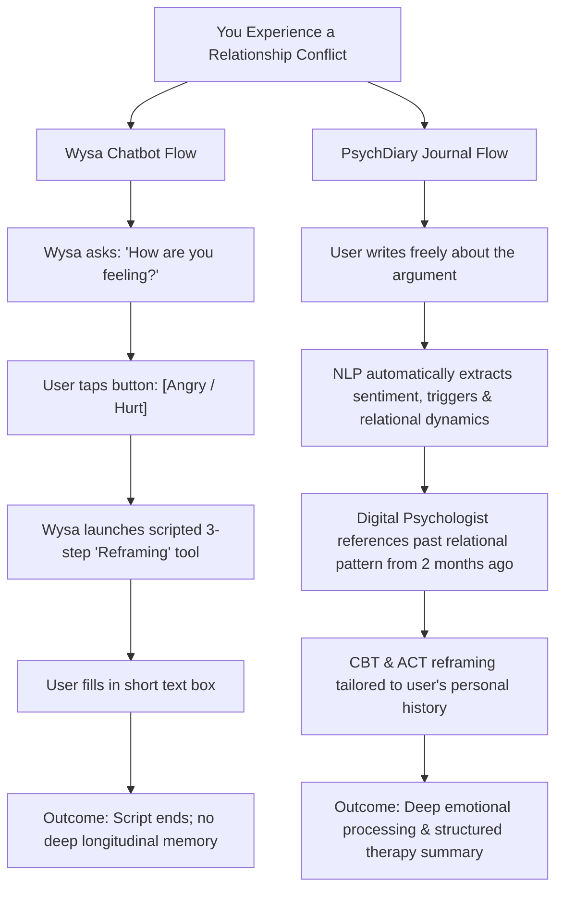
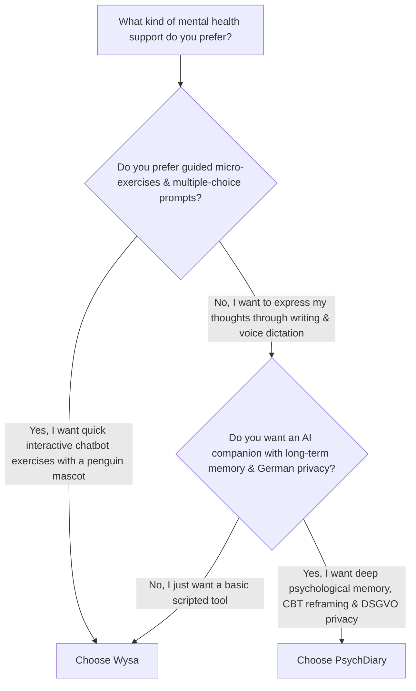

The emergence of artificial intelligence in mental health has sparked two fundamentally divergent design philosophies: **scripted conversational chatbots** and **deep reflective AI journaling**.

In the conversational chatbot category, **Wysa** has established itself as one of the most prominent names. Featuring a friendly penguin avatar, Wysa offers interactive, chat-based micro-interventions grounded in Cognitive Behavioral Therapy (CBT), guided breathing exercises, and optional human coach support, earning clinical recognition in NHS pilot trials and an FDA breakthrough device designation for chronic pain.

In the reflective journaling category, **PsychDiary** has pioneered a sophisticated new approach: an intelligent, 24/7 digital psychologist built for authentic, expressive writing. Rather than corralling users into rigid decision trees or multiple-choice button prompts, PsychDiary provides an expansive emotional canvas. It **automatically decodes emotional sentiment, diagnoses hidden psychological triggers, retains long-term memory across months of entries, and adheres to strict German DSGVO / GDPR privacy standards**.

If you are trying to determine whether Wysa’s interactive chat exercises or PsychDiary’s deep reflective journal provides the most effective support for your mental health, this comprehensive guide compares both platforms across clinical depth, memory retention, privacy sovereignty, and user autonomy.

---

  <h4 class="text-dark font-weight-bold mb-2">⚡ TL;DR Verdict: Scripted Chat Exercises or Deep Reflective AI Memory?</h4>
  
<strong>Choose Wysa</strong> if you want structured, step-by-step CBT psychoeducation, prefer tapping multiple-choice prompt buttons rather than writing long reflections, want an approachable cartoon penguin mascot, and are interested in optional paid 1-on-1 human coaching alongside automated exercises.

  
<strong>Choose PsychDiary</strong> if you want the therapeutic power of expressive writing, an AI companion that actually remembers your past breakthroughs and therapy history using a 4-tier memory architecture, automatic trigger detection that eliminates manual tagging, a weekly clinical digest to bridge the 167-hour therapy gap, and ironclad German DSGVO / GDPR data protection.

---

## Side-by-Side Comparison: Wysa vs. PsychDiary

Here is an architectural comparison of how Wysa’s guided chatbot workflow compares to PsychDiary’s deep reflective journaling engine:

| Feature / Capability | Wysa | PsychDiary |
| :--- | :--- | :--- |
| **Primary Interaction Model** | Scripted conversational chatbot with guided CBT micro-exercises | Deep expressive journaling with an interactive 24/7 AI psychologist |
| **Input Flexibility** | Guided chat with predefined response buttons & brief text | Freeform natural language writing & high-accuracy voice dictation |
| **Memory & Context Continuity** | Session-oriented (Limited long-term contextual continuity) | **Proprietary 4-Tier Neural Memory** (Episodic summaries, core facts & semantic recall) |
| **Trigger & Sentiment Analysis** | Rule-based triage questions & self-reported mood scales | **Automatic sentiment extraction & underlying trigger identification** |
| **Therapeutic Modalities** | Scripted CBT, dialectical tools, mindfulness & psychoeducation | Integrated CBT, ACT, Expressive Writing & Schema Therapy reframing |
| **Human Coaching Integration** | Optional paid human wellness coach messaging | Pure focus on sovereign AI psychological partnership & clinical therapy prep |
| **Therapy Bridging Capabilities** | Static mood trend graphs and safety screening logs | **Structured weekly clinical digests bridging the 167-hour therapy gap** |
| **Data Privacy & Jurisdiction** | US/India corporate structure, standard cloud hosting | **100% German DSGVO / GDPR Compliance** (German servers, zero AI training) |
| **Cross-Platform Parity** | Mobile app focused (iOS & Android) | **Full Web browser application, native iOS, and native Android** |
| **User Agency & Expression** | Structured, guided choices to prevent conversational drift | Unconstrained emotional expression with active clinical guidance |

---

## Where Wysa Wins: Fair Concessions

To adhere to rigorous, objective evaluation standards meeting Google Review Quality Guidelines, it is important to recognize the distinct clinical and product strengths that have made Wysa a valuable tool for millions:

### 1. Clinically Validated Micro-Interventions and NHS Trials
Wysa has invested heavily in peer-reviewed clinical research. It has been evaluated in multiple clinical trials, partnered with the UK's National Health Service (NHS), and received FDA breakthrough device designation for an AI-based digital therapeutic targeting chronic musculoskeletal pain and depression. For users seeking an app backed by specific formal clinical trial publications, Wysa’s academic track record is impressive.

### 2. Guardrailed, Low-Risk Interaction for Acute Distress
Because Wysa relies heavily on rule-based conversational pathways and scripted decision trees, it offers tightly guardrailed interactions. If a user is extremely overwhelmed and cannot articulate sentences, Wysa gently guides them through simple button taps (e.g., "Take a deep breath," "Reframe a thought," "Help me sleep"). This scripted structure prevents the chatbot from hallucinating or going off-script during sensitive moments.

### 3. Optional Human Wellness Coaching
Unlike completely autonomous AI platforms, Wysa offers a hybrid tier that includes access to human mental health coaches via asynchronous messaging. While these coaches are not licensed psychotherapists or psychiatrists, they provide human accountability, check-ins, and personalized encouragement for users who need a human presence.

### 4. Approachable, Stigma-Free Mascot
Wysa’s friendly cartoon penguin creates an inviting, non-intimidating environment. For teenagers, young adults, or anyone hesitant to seek traditional mental health support due to cultural stigma, confiding in an animated penguin can make the initial step toward self-care feel safe and accessible.

---

## Where PsychDiary Wins: Beyond Scripted Decision Trees to Deep Healing

While Wysa is effective for quick psychoeducational exercises, many users find its rigid chatbot scripts frustrating over time. Tapping predetermined buttons can feel impersonal, and the lack of deep memory often makes conversations feel repetitive. Here is where PsychDiary delivers an unmatched psychological experience:

### 1. The Healing Power of Expressive Writing vs. Button Clicking
Psychological research—most notably the foundational work of Dr. James Pennebaker—proves that the therapeutic benefit of self-reflection comes from **narrative meaning-making**. Putting complex, painful, and messy emotions into your own authentic words engages executive brain regions, down-regulates amygdala reactivity, and helps resolve trauma.

When you use Wysa, you are frequently asked to choose from predefined options:
- *"How are you feeling today?"* -> [Anxious] [Sad] [Tired]
- *"Would you like to try a breathing exercise or reframe a thought?"* -> [Breathing] [Reframing]

This multiple-choice format restricts deep emotional processing. In contrast, PsychDiary invites you to pour out your thoughts without constraint:
> *"I had lunch with my sister today, and the entire conversation felt like walking on eggshells. She criticized my career choices, and I froze up just like I used to when we were teenagers. I'm 34 years old, and I still feel like a defenseless kid around her."*

PsychDiary provides the psychological safety and open space needed to express the full texture of human emotion.

### 2. True 4-Tier Memory vs. Scripted Session Amnesia
The most common frustration with mental health chatbots like Wysa is their **lack of deep longitudinal memory**. Because Wysa operates primarily on scripted decision trees, it often treats each session as an isolated interaction. It does not remember the relational dynamics you described two months ago or how you resolved a similar crisis last winter.

PsychDiary is built on a [proprietary 4-tier neural memory system](/blog/ai-memory-explained-mental-health/):
1. **Immediate Contextual Memory**: Tracks the evolving nuances within your current entry.
2. **Episodic Summary Memory**: Synthesizes weekly journal themes into coherent emotional arcs.
3. **Core Psychological Profile**: Safely retains your core life values, key relationships (e.g., your sister, your partner, your manager), and recurring triggers.
4. **Semantic Retrieval**: Surfaces relevant past breakthroughs when you face a similar emotional roadblock.

When you tell PsychDiary about an argument with your sister, it can gently connect the dots:
> *"Notice how this mirrors what you wrote in November after Thanksgiving—that tendency to freeze and slip into childhood compliance when your sister questions your choices. Last time, you realized that taking a five-minute physical break helped you regain your adult perspective. How might we apply that boundary today?"*

This persistent memory transforms the app from a simple exercise prompter into a true developmental companion.

### 3. Automatic Sentiment and Hidden Trigger Detection
In Wysa, tracking triggers requires answering specific survey prompts or manually categorizing your feelings.

PsychDiary utilizes sophisticated psychological NLP to analyze your natural prose automatically:
- It **identifies cognitive distortions** (such as emotional reasoning, catastrophizing, or personalization) within your narrative.
- It **extracts underlying emotional triggers** without requiring you to manually check boxes.
- It highlights subtle emotional trends across weeks and months, showing you patterns you may have overlooked.

### 4. German DSGVO / GDPR Privacy: The Sovereign Security Standard
Mental health reflections are among the most sensitive personal data in existence. Many commercial wellness apps are operated by companies in jurisdictions with lenient data protection laws, where conversational logs may be processed through third-party analytics pipelines or used to optimize commercial algorithms.

PsychDiary was built from the ground up in Germany to comply with the European Union’s **General Data Protection Regulation (DSGVO / GDPR)**. Learn more in our detailed analysis of [why German data protection matters for mental health journaling](/blog/therapy-notes-privacy-gdpr-mental-health/):
- **Zero AI Model Training**: Your journal entries are strictly confidential and are **never** used to train commercial AI foundation models.
- **Physical German Server Hosting**: All data is stored in high-security, ISO 27001-certified German data centers.
- **Sovereign European Legal Protection**: Your data is shielded from foreign surveillance laws and commercial data broker monetization.

### 5. Bridging the 167-Hour Weekly Therapy Gap
If you see a licensed human therapist, you spend roughly one hour in session each week. The remaining **167 hours** are when real-life stress, triggers, and relational friction actually occur.

Wysa does not integrate seamlessly into clinical therapy; it operates primarily as a standalone consumer app or employer benefit. PsychDiary is specifically designed to [bridge the 167-hour therapy gap](/blog/ai-psychologist-between-therapy-sessions/), generating **structured weekly clinical digests** that summarize:
- Primary emotional triggers and stress events from the past week.
- Cognitive distortions identified and reframed.
- Progress on behavioral goals or therapeutic homework.
- Recommended focus topics to bring to your next clinical session.

### 6. True Cross-Platform Parity on Desktop & Web
Wysa is primarily designed for mobile screens. Typing long, emotionally complex thoughts on a smartphone keyboard can be exhausting. PsychDiary provides complete feature parity across native web browsers, iOS, and Android, allowing you to reflect comfortably on your desktop or laptop during evening journaling sessions.

---

## Detailed Comparison: Scripted Chatbot vs. AI Journal Companion

---

## Who Should Choose Which?

### Choose Wysa If:
- You feel overwhelmed by the thought of writing full paragraphs and prefer tapping buttons in a guided chat.
- You are looking for quick, 3-minute psychoeducational exercises for acute anxiety or sleep difficulties.
- You want an approachable, friendly cartoon penguin to make mental wellness feel light and accessible.
- You are interested in paying for an optional human coach to message you on weekdays.

### Choose PsychDiary If:
- You believe in the therapeutic power of expressive journaling and want the freedom to write or speak without constraint.
- You are tired of chatbots that forget who you are from one session to the next and want an AI that retains longitudinal psychological context.
- You want automatic sentiment and trigger detection without manual categorization.
- You are working with a therapist and need a tool that bridges the 167-hour weekly gap with structured clinical summaries.
- You demand strict German DSGVO / GDPR privacy guarantees that ensure your innermost thoughts are never used for AI training.
- You want the convenience of journaling from your desktop web browser or your mobile phone with full synchronization.

---

## Conclusion

Wysa has done pioneering work in making CBT-based psychoeducation accessible through an approachable chatbot interface. If you are looking for guided micro-exercises or quick breathing tools, it serves as an excellent digital first-aid kit.

However, genuine psychological healing requires more than tapping multiple-choice buttons. It requires the space to tell your story, express nuanced emotions, and receive compassionate cognitive guidance from a companion that remembers your journey.

PsychDiary bridges the gap between deep expressive writing and cutting-edge artificial intelligence—empowering you with automated trigger detection, four-tier neural memory, and uncompromising European privacy.

**[Start your free journey with PsychDiary today](https://psychdiaryapp.com/)** and experience the clarity of a journal that truly listens.

---

## Scientific Foundations & Clinical Citations

- **Beck, A. T. (1979)**: *Cognitive Therapy of Depression*. Guilford Press. Establishes the clinical efficacy of identifying and reframing automatic thoughts and cognitive distortions.
- **Pennebaker, J. W., & Beall, S. K. (1986)**: *Confronting a traumatic event: toward an understanding of inhibition and disease*. Journal of Abnormal Psychology, 95(3), 274-281. Confirms the measurable psychological and physiological benefits of unconstrained expressive writing.
- **Emmons, R. A., & McCullough, M. E. (2003)**: *Counting blessings versus burdens: An experimental investigation of gratitude and subjective well-being in daily life*. Journal of Personality and Social Psychology, 84(2), 377-389.
- **Insel, T. R. (2017)**: *Digital phenotyping: Technology for a new science of behavior*. JAMA, 318(13), 1215-1216. Explores how natural language patterns capture psychological states more accurately than static self-report scales.

---

## Medical Disclaimer

> *Medical Disclaimer: PsychDiary is an AI-powered emotional reflection companion and mental wellness platform designed to enhance self-awareness and emotional regulation. It is not a licensed medical provider, diagnostic instrument, or replacement for clinical psychotherapy or medical treatment. If you are experiencing a severe mental health crisis, suicidal thoughts, or acute psychiatric distress, please contact your local emergency services immediately or dial 988 (US/Canada) or 112/116 123 (Europe).*

---

## Frequently Asked Questions

### Is PsychDiary another scripted chatbot like Wysa?
No. PsychDiary is not a scripted decision-tree chatbot. It is an intelligent reflective journal powered by natural language processing and a 24/7 digital psychologist companion. You can write or dictate freely, and the AI responds with empathetic, evidence-based cognitive reframing tailored to your specific life story.

### Does Wysa remember my past entries better than PsychDiary?
No. Wysa operates primarily on session-based decision trees with limited long-term contextual continuity. PsychDiary features a proprietary 4-tier neural memory architecture that securely retains your recurring triggers, core values, and past breakthroughs across months and years.

### How does PsychDiary ensure German DSGVO (GDPR) compliance?
PsychDiary is engineered in Germany with strict European data sovereignty. Your reflections are stored on ISO 27001-certified German servers, protected by rigorous European privacy regulations, and never used to train public foundation models or shared with third-party advertisers.

### Can I use PsychDiary on my computer keyboard?
Yes. Unlike Wysa, which is designed almost exclusively as a mobile application, PsychDiary provides full feature parity across web browsers (Chrome, Safari, Firefox, Edge), iOS, and Android.

