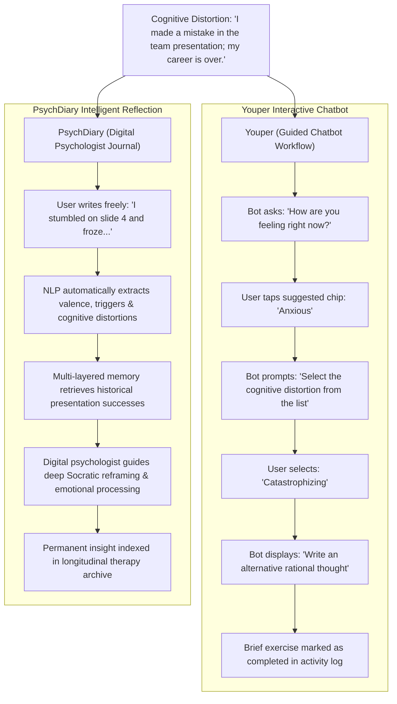
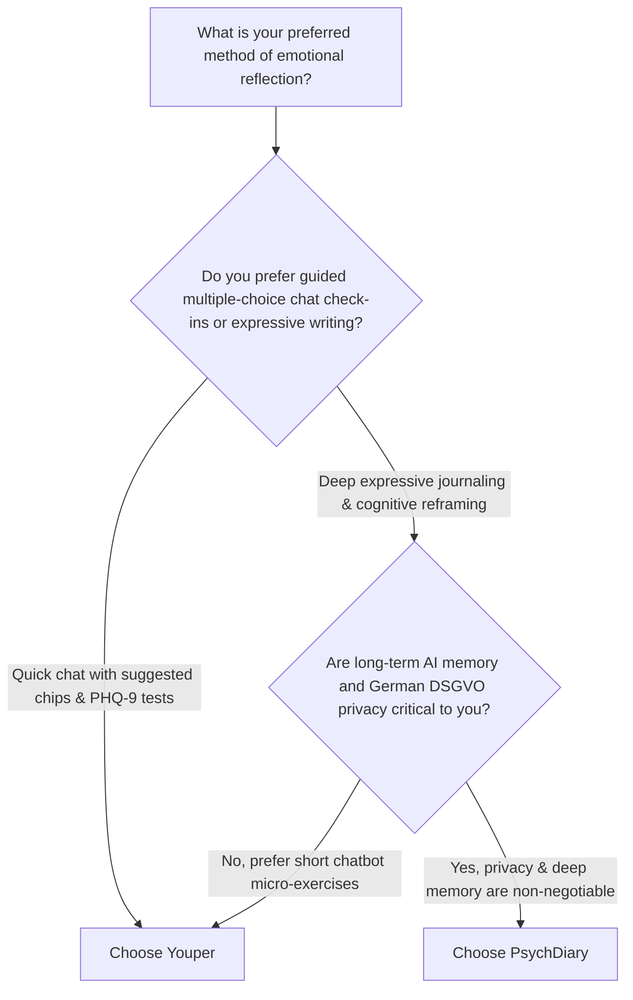

The application of artificial intelligence to evidence-based psychotherapy is transforming digital mental health. Instead of waiting weeks or months for an appointment, anyone with a smartphone can now access therapeutic support at any hour of the day.

Within this space, two prominent platforms offer distinct methodologies: **Youper** and **PsychDiary**.

Founded by psychiatrists, **Youper** is a conversational AI agent designed to deliver bite-sized Cognitive Behavioral Therapy (CBT) and Acceptance and Commitment Therapy (ACT) exercises through interactive, scripted chat dialogues and clinical assessment questionnaires (such as PHQ-9 and GAD-7).

**PsychDiary**, by contrast, approaches emotional health through deep, unconstrained expressive journaling combined with clinical intelligence. Instead of forcing users into multiple-choice chat scripts, PsychDiary provides an intelligent digital psychologist canvas that **automatically detects emotional valence, life triggers, and cognitive distortions** from your natural writing—empowered by a **4-tier multi-layered AI memory architecture** and **uncompromising German DSGVO/GDPR privacy compliance**.

If you are evaluating whether an interactive CBT chatbot or a clinical-grade AI journaling platform best fits your emotional wellness routine, this in-depth comparison provides an objective, side-by-side analysis.

---

  <h4 class="text-dark font-weight-bold mb-2">⚡ TL;DR Verdict: Chatbot Micro-Sessions vs. Deep Journaling</h4>
  
<strong>Choose Youper</strong> if you prefer quick, 3-to-5-minute guided chat check-ins with suggested response chips, enjoy taking standardized clinical symptom scales (PHQ-9 / GAD-7), and want structured CBT micro-exercises without having to write long journal entries.

  
<strong>Choose PsychDiary</strong> if you want deep, expressive self-reflection without scripted conversational rails, automatic trigger and sentiment analysis from your natural thoughts, a companion with multi-layered memory that recalls your life across months and years, and ironclad German DSGVO privacy hosted in the EU.

---

## Side-by-Side Comparison: Youper vs. PsychDiary

Here is an architectural comparison of Youper and PsychDiary across essential clinical and technical dimensions:

| Dimension / Feature | Youper | PsychDiary |
| :--- | :--- | :--- |
| **Primary Category** | AI CBT chatbot & symptom screening tool | Clinical-grade digital psychologist journal |
| **Core Interaction Model** | Scripted conversational dialogue with suggested reply chips | Free-form expressive writing & speech-to-text dictation |
| **Underlying Therapy Model** | CBT, ACT, Mindfulness micro-interventions | Cognitive Behavioral Therapy (CBT), ACT & Pennebaker expressive writing |
| **Mood & Trigger Detection** | Guided multi-step conversational survey | **Automatic real-time sentiment, distortion, & trigger extraction** |
| **AI Memory Architecture** | Recent session state & screening score history | **4-Layered Memory** (Working context, auto-summaries, facts, semantic vector search) |
| **Journaling Freedom** | Constrained chat bubbles / short text replies | **Unconstrained long-form writing canvas with AI Socratic reframing** |
| **Clinical Assessments** | Integrated PHQ-9 (depression) & GAD-7 (anxiety) tests | Longitudinal emotional valence tracking & distortion prevalence |
| **Privacy & Data Hosting** | US cloud infrastructure (HIPAA compliant in US) | **100% German DSGVO / GDPR Compliant** (Hosted in Germany, zero AI training) |
| **Therapy Gap Support** | Standalone self-guided micro-interventions | **Dedicated 167-hour weekly therapy bridge** with therapist-ready synthesis |
| **Platform Availability** | iOS and Android (Mobile focused) | **Cross-platform parity: Web (Desktop), iOS, and Android** |
| **Free Access / Pricing** | Brief trial, subscription required for full access | Comprehensive free exploration tier with accessible premium upgrade |

---

## Where Youper Wins: Fair Concessions

To adhere to Google's Quality Rater Guidelines, we highlight the clear strengths where Youper excels:

### 1. Guided Conversational Rails for Low Energy & High Fatigue
When severe depression or acute anxiety strikes, formulating coherent paragraphs in a blank journal can feel insurmountable. Youper minimizes cognitive load by offering clickable suggested reply chips (e.g., *"I'm overwhelmed," "Work," "Yes," "Show me an exercise"*). Users can navigate an entire therapeutic intervention simply by tapping pre-formulated options.

### 2. Standardized Clinical Assessments (PHQ-9 & GAD-7)
Youper integrates validated clinical screening questionnaires directly into its flow. Users can regularly take the Patient Health Questionnaire-9 (PHQ-9 for depressive symptoms) and Generalized Anxiety Disorder-7 (GAD-7 for anxiety severity). For individuals who value tracking clinical symptom severity through standardized scores over time, Youper provides familiar medical metrics.

### 3. Structured CBT Thought-Challenging Worksheets
Youper excels at converting traditional Cognitive Behavioral Therapy worksheets into conversational steps. It guides users through identifying an automatic thought, labeling the distortion from a predefined menu, and generating an alternative rational response. This gamified, step-by-step structure teaches basic CBT mechanics effectively.

### 4. Telehealth & Insurance Provider Alignments
In select healthcare systems (particularly within the United States), Youper has forged integrations with health plans and employer assistance programs. In some circumstances, users can access covered care or connect their chatbot progress directly with human telehealth providers in the Youper network.

---

## Where PsychDiary Wins: The Structural & Clinical Differentiators

While Youper's scripted chatbot interface is convenient for quick symptom screening, it can quickly feel mechanical, repetitive, and constraining for individuals who want deep self-discovery and emotional processing.

Here is where PsychDiary delivers unmatched therapeutic freedom, memory depth, and privacy:

### 1. Deep Expressive Writing vs. Scripted Chatbot Rails
Psychological research dating back to James Pennebaker's landmark 1997 studies demonstrates that the deepest cognitive and emotional breakthroughs happen through **unconstrained expressive writing**—the act of translating raw, tangled thoughts into coherent personal narratives.

In Youper, you are boxed into short chat bubbles and guided prompts. The chatbot controls the conversation, dictating where the dialogue goes next.

**PsychDiary provides an open, intelligent reflection space.** You write or dictate as much as you need—from a quick 3-sentence realization to a 2,500-word deep dive into childhood patterns. PsychDiary's AI acts as a sophisticated, empathetic sounding board:
- It respects your voice and flow.
- It asks penetrating Socratic questions tailored to your exact emotional state.
- It challenges subtle rationalizations without breaking your reflective momentum.

### 2. Automatic Sentiment and Trigger Extraction Without Rigid Surveys
In Youper, identifying why you feel bad requires walking through a structured decision tree: selecting feelings, picking life areas, and answering bot prompts.

**PsychDiary automates analytical extraction completely.** As you write freely, its clinical NLP engine works silently in the background:
- It scores your emotional valence from deep distress to grounded serenity.
- It automatically isolates the specific **external triggers** (e.g., parental boundary conflict, workplace re-organization, social exhaustion).
- It identifies subtle **cognitive distortions** (e.g., magnification, mental filtering, "should" statements).
- It organizes these insights into visual, longitudinal growth charts without you ever having to fill out an intake form.

### 3. 4-Tier Multi-Layered AI Memory (Ending Chatbot Amnesia)
The single biggest flaw of standard therapy chatbots is their lack of genuine long-term memory. A chatbot might remember your last GAD-7 score, but it rarely understands the nuanced narrative of your life: who your partner is, the chronic dispute with your business partner, or the trauma you worked through last autumn.

PsychDiary features a proprietary [4-tier multi-layered AI memory architecture](/blog/ai-memory-explained-mental-health/):
1. **Short-Term Context**: Retains full conversational coherence during your active journaling session.
2. **Session Summaries**: Condenses every entry into a dense, high-utility psychological synthesis.
3. **Permanent Knowledge Graph (User Facts)**: Safely archives your enduring life pillars (relationships, medical history, career trajectory, core values).
4. **Semantic Vector Search**: When you write about feeling paralyzed by imposter syndrome, PsychDiary searches your multi-year diary archive: *"You experienced this exact paralysis in March before the board presentation. Here is the cognitive shift that unlocked your confidence then."*

This turns PsychDiary into a lifelong intellectual and psychological companion that grows more perceptive the longer you use it.

### 4. German DSGVO / GDPR Privacy: Sovereign Sanctuary for Vulnerable Thoughts
Youper is based in the United States and operates under US commercial and HIPAA frameworks. While HIPAA protects specific healthcare provider communications in the US, it does not offer the sweeping data sovereignty guarantees of European privacy law.

Your diary contains your most private, vulnerable admissions. **PsychDiary is 100% compliant with the European General Data Protection Regulation (DSGVO / GDPR) and is hosted in Germany** (learn more about our [strict privacy infrastructure and EU hosting](/blog/therapy-notes-privacy-gdpr-mental-health/)):
- **Zero AI Model Training**: Your reflections and emotional crises are never used to train or refine public AI models.
- **Hosted Strictly in Germany**: Governed by the world's most protective digital privacy statutes.
- **End-to-End Encryption**: AES-256 at rest and TLS 1.3 in transit.
- **Full Data Ownership**: One-click export or permanent zero-trace deletion at any time.

### 5. Bridging the 167-Hour Gap Between Human Therapy Sessions
If you work with a licensed therapist, you see them for 50 minutes each week, leaving **167 hours of real-life emotional challenges unmonitored**. 

Youper functions largely as a self-contained micro-app. In contrast, PsychDiary was intentionally engineered as an [AI companion to bridge the 167-hour weekly therapy gap](/blog/ai-psychologist-between-therapy-sessions/). It helps you capture distress in real time, unpack the cognitive distortions, and export structured, high-density executive summaries that you can review with your clinician to maximize every minute of your paid human sessions.

### 6. Full Desktop Web Parity for Serious Reflection
Youper is primarily designed for mobile smartphones. Attempting to unpack complex life transitions or childhood patterns through mobile chat bubbles on a glass touch screen is physically limiting.

PsychDiary offers **complete cross-platform parity across Desktop Web, iPhone, and Android**. You can type comfortably on your mechanical desktop keyboard in the quiet of your home office, then reference insights on your phone while on the go.

---

## Comparison of Clinical Workflows

---

## Who Should Choose Which?

### Choose Youper If:
- You have low energy or severe fatigue and prefer tapping suggested response chips over writing paragraphs.
- You want regular clinical symptom screenings (such as PHQ-9 for depression and GAD-7 for anxiety).
- You want bite-sized, 3-minute guided CBT micro-exercises on your phone.
- You are looking for an app that may integrate with specific US telehealth or insurance plans.

### Choose PsychDiary If:
- You believe in the therapeutic power of unconstrained expressive journaling and narrative self-reflection.
- You want **automatic sentiment and trigger detection** without having to fill out multiple-choice forms.
- You demand an AI companion that **remembers your relationships, emotional breakthroughs, and life themes across years** using 4-tier memory.
- You require absolute confidentiality, EU server hosting, and strict German DSGVO / GDPR privacy compliance.
- You are in active psychotherapy and need a structured tool to bridge the 167 hours between weekly sessions.
- You prefer writing on a full desktop computer keyboard alongside your smartphone.

---

## Final Thoughts

Both Youper and PsychDiary demonstrate the incredible potential of artificial intelligence to support mental well-being. If you are seeking a fast, guided CBT chat with clinical symptom rating scales, Youper is a well-designed mobile companion.

However, if you want to move beyond superficial chat bubbles into deep, transformative self-awareness—backed by automated clinical trigger detection, lifelong multi-layered memory, and uncompromised German privacy—**PsychDiary is the premier digital psychologist journal**.

Experience the future of mental health journaling. **[Start your free PsychDiary journey today](https://psychdiaryapp.com/)** and discover self-reflection powered by true psychological intelligence.

---

## Scientific Foundations & Clinical Citations

- **Beck, A. T. (1979)**: *Cognitive Therapy of Depression*. The Guilford Press.
- **Pennebaker, J. W. (1997)**: *Writing about emotional experiences as a therapeutic process*. Psychological Science, 8(3), 162-166.
- **Mehta, S., et al. (2021)**: *Evaluating the efficacy of artificial intelligence conversational agents in mental health: A systematic review*. Journal of Medical Internet Research, 23(4), e26548.
- **Emmons, R. A., & McCullough, M. E. (2003)**: *Counting blessings versus burdens: An experimental investigation of gratitude and subjective well-being in daily life*. Journal of Personality and Social Psychology, 84(2), 377-389.
- **Kross, E., & Ayduk, O. (2017)**: *Self-distancing: Theory, research, and current directions*. Advances in Experimental Social Psychology, 55, 81-136.

---

## Medical Disclaimer

> *Medical Disclaimer: PsychDiary is an AI-powered emotional reflection companion and mental wellness tool designed to foster self-awareness, cognitive reframing, and emotional regulation. It is not a licensed medical provider, diagnostic instrument, or replacement for clinical psychotherapy. If you are experiencing a mental health crisis, suicidal thoughts, or severe psychiatric distress, please contact your local emergency services or call/text 988 (US/Canada) or 112/116 123 (Europe).*

---

## Frequently Asked Questions

### What is the primary difference between Youper and PsychDiary?
Youper is an interactive AI chatbot that guides you through scripted conversational turns and symptom rating scales (PHQ-9 / GAD-7) using clickable suggested replies. PsychDiary is an AI-powered digital psychologist journal that allows free-form expressive writing, automatically extracting emotional triggers and cognitive distortions while maintaining a permanent 4-tier memory across your life.

### Does PsychDiary include clinical scales like PHQ-9 or GAD-7?
While Youper focuses on standardized self-report multiple-choice clinical scales, PsychDiary focuses on continuous, naturalistic emotional valence tracking and cognitive distortion detection derived directly from your daily journal entries. This provides qualitative psychological insight alongside longitudinal sentiment graphs without clinical test fatigue.

### How does PsychDiary's memory differ from Youper?
Youper's memory is primarily focused on your screening scores and immediate chatbot session progress. PsychDiary features a 4-layered memory architecture (working context, automated session summaries, permanent user knowledge graph, and semantic vector search) that allows the AI to connect patterns, themes, and past breakthroughs across months and years.

### How does PsychDiary ensure my personal thoughts remain private?
PsychDiary is hosted exclusively on servers located in Germany and adheres to the European Union General Data Protection Regulation (DSGVO / GDPR). Your journal entries are encrypted using AES-256, are never sold, and are never used to train public machine learning models.

### Can I use PsychDiary on a laptop or desktop computer?
Yes. Unlike Youper, which is primarily a smartphone application, PsychDiary provides full feature parity across Desktop Web browsers, iOS, and Android. This allows you to write comfortably on a full physical keyboard or voice-journal on the go.

