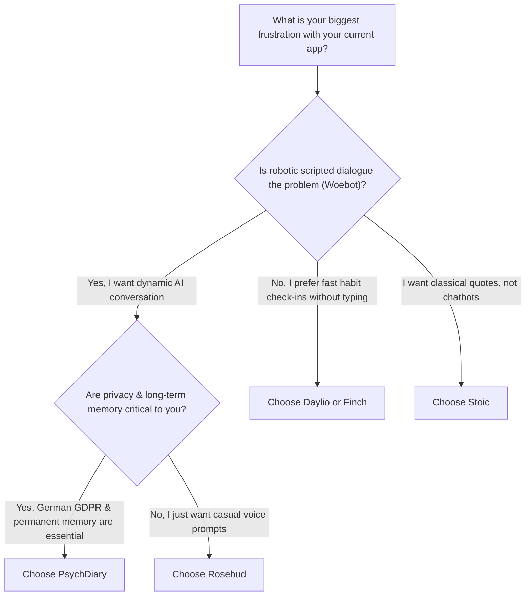

The landscape of digital mental health has experienced a seismic transformation. For years, apps like **Woebot** and **Rosebud AI Journal** dominated conversations around automated emotional support. Woebot introduced millions to automated Cognitive Behavioral Therapy (CBT) check-ins, while Rosebud brought conversational Large Language Models (LLMs) and voice transcription into daily diary writing.

However, as users mature, widespread frustrations have emerged:
- **Woebot's Rigidity & Enterprise Pivot**: Woebot’s pre-programmed, branching decision trees feel increasingly robotic and repetitive compared to modern generative AI. Furthermore, Woebot’s strategic shift toward clinical prescription healthcare and enterprise B2B providers has left everyday consumer journalers feeling neglected.
- **Rosebud's Privacy & Memory Limits**: While Rosebud offers delightful voice-first prompts, many users express unease storing their deepest emotional trauma on US-based cloud servers without stringent European data sovereignty. Furthermore, Rosebud’s conversational memory remains largely session-bound, struggling to connect life events across multi-month arcs.

Whether you are frustrated by robotic scripts or anxious about who owns your private therapy notes, this definitive guide analyzes the **best Rosebud and Woebot alternatives in 2026**, ranking them on therapeutic depth, memory architecture, privacy standards, and ease of use.

---

  <h4 class="text-dark font-weight-bold mb-2">⚡ TL;DR Verdict: The #1 Overall Alternative in 2026</h4>
  
<strong>The Best Alternative is PsychDiary</strong>. It combines the empathetic conversational agility of Rosebud with the clinical CBT foundation of Woebot—while fixing the biggest flaws of both.

  
PsychDiary offers <strong>automatic sentiment and trigger detection</strong> from natural writing, a <strong>4-tier persistent memory</strong> that remembers your therapy breakthroughs across years, and uncompromised <strong>100% German DSGVO / GDPR privacy compliance</strong> hosted on secure EU servers with zero model training on user entries.

---

## 2026 AI Mental Health & Journaling App Comparison Matrix

To help you quickly evaluate the top alternatives, here is how the leading platforms compare across core architectural dimensions:

| App Name | Core Modality | AI Memory Depth | Data Privacy & Hosting | Trigger Detection | Best For |
| :--- | :--- | :--- | :--- | :--- | :--- |
| **PsychDiary** | AI Psychologist Journal & CBT Companion | **4-Layered Persistent Memory** (Session, summary, facts, semantic recall) | **100% German DSGVO / GDPR** (EU servers, zero model training) | **Automatic real-time extraction** (No manual tagging needed) | **Deep self-reflection, therapy bridging, & privacy-conscious users** |
| **Rosebud** | Interactive voice-first AI diary | Short-term context & prompt history | US Cloud infrastructure | Prompt-based reflection | Fast voice dictation & gamified prompt journeys |
| **Woebot** | Rule-based CBT chatbot | Scripted state machine (No LLM memory) | US Cloud infrastructure | Pre-programmed check-ins | Highly structured, scripted CBT exercises |
| **Wysa** | Anonymous CBT chatbot & coach | Session-based state memory | UK/US Cloud | Interactive symptom checks | Anonymous anxiety exercises & human coach add-ons |
| **Finch** | Gamified self-care virtual pet | Habit check-in logs | Device-first local storage | Manual tag selection | Neurodivergent users & ADHD habit maintenance |
| **Daylio** | Micro-mood icon tracker | Statistical correlation only | Local device / CloudKit backup | Manual activity icon selection | 5-second check-ins without writing |
| **Stoic** | Classical philosophy journal | Chronological entry archive | CloudKit / US servers | Manual mood ratings | Minimalist morning/evening routines & breathing |

---

## Why Users Are Leaving Woebot in 2026

Woebot was a clinical trailblazer when launched by Dr. Alison Darcy at Stanford University in 2017. However, digital health expectations have fundamentally shifted:

### 1. The Frustration of Scripted Decision Trees
Woebot relies predominantly on pre-written conversational trees rather than dynamic neural language models. When you tell Woebot about a nuanced interpersonal conflict at work, it frequently forces you to click predetermined multiple-choice buttons like *"Tell me more"* or *"Do a breathing exercise."* When you attempt to speak freely, the bot regularly responds with *"I don't quite understand that yet."* In an era of fluid AI comprehension, this feels sterile and frustrating.

### 2. The B2B Enterprise Pivot
Woebot has increasingly pivoted its resources toward clinical trials for FDA clearance, prescription digital therapeutics (PDTs), and hospital healthcare partnerships. As a result, the standalone consumer experience has seen stagnant feature innovation, lacking true long-term diary memory, voice dictation, or advanced longitudinal analytics.

---

## Why Rosebud Users Are Seeking Alternatives

Rosebud brought conversational LLMs into journaling, but serious power-user bottlenecks have surfaced:

### 1. Privacy Concerns Over Intimate Disclosures
Journal entries often contain disclosures of suicidal ideation, sexual trauma, substance use, or marital breakdowns. Rosebud operates under standard US cloud jurisdiction. For European users, mental health professionals, and privacy-conscious writers, the lack of **strict German DSGVO/GDPR server sovereignty** and explicit guarantees against AI model ingestion is a major sticking point.

### 2. Conversational Amnesia
While Rosebud is great at chatting about today's entry, its ability to connect your current grief back to a conversation you had four months ago is limited. Users frequently report having to re-explain their background, family members, and core diagnoses repeatedly.

### 3. Lack of Objective Cognitive Reframing
Rosebud is designed to be an encouraging sounding board. However, it can lean into "sycophancy"—agreeing with your self-critical narrative rather than helping you identify cognitive distortions like catastrophizing, mind reading, or black-and-white thinking.

---

## The Best Alternatives to Rosebud and Woebot Reviewed

### 1. PsychDiary: The Ultimate Hybrid of Clinical Depth & Intelligent Memory

**PsychDiary** was engineered specifically to solve the shortcomings of both Woebot and Rosebud. It delivers the dynamic conversational intelligence of modern AI while maintaining strict clinical CBT rigor and ironclad German privacy standards.

#### Why PsychDiary Is the #1 Alternative:
- **Automatic Mood & Trigger Detection**: Unlike apps that force you to manually tap 15 mood icons or answer rigid surveys, PsychDiary analyzes your natural writing or voice dictation. It automatically calculates your emotional valence, isolates hidden stressors (e.g., sleep deprivation, boundary conflicts), and identifies positive happiness drivers.
- **Proprietary 4-Tier Memory Architecture**: PsychDiary never suffers from conversational amnesia. It maintains short-term session context, automatic entry summaries, a permanent knowledge graph of user facts (family members, medical history, career goals), and semantic vector search across your historical diary. It connects your thoughts across years of personal growth.
- **100% German DSGVO / GDPR Compliance**: PsychDiary is hosted exclusively on hardened servers in Germany under the world's most stringent data privacy laws. Your private reflections are cryptographically protected and **never used to train public AI models**.
- **Bridging the 167-Hour Therapy Gap**: For those in psychotherapy, PsychDiary generates structured, clinician-ready weekly summaries that highlight emotional spikes and recurring cognitive distortions, turning the 167 hours between weekly sessions into actionable therapeutic progress.
- **Full Cross-Platform Parity**: Available across desktop Web, iOS, and Android with instant cloud sync.

---

### 2. Wysa: Best for Anonymous CBT Crisis Exercises

If you appreciated Woebot's structured CBT grounding but want something with a friendlier penguin mascot and accredited human coaching options, **Wysa** is a solid contender.

#### Strengths:
- Well-researched, clinically validated CBT, DBT, and mindfulness micro-exercises.
- High degree of anonymity (no email required for basic usage).
- Option to upgrade to message-based human wellness coaches.

#### Limitations:
- Acts more like an exercise coach than a true expressive journal; freeform writing features are secondary to pre-set exercises.
- Limited multi-layered memory across disparate life events.

---

### 3. Daylio: Best for Fast Micro-Mood Tracking

If you find writing entries in Rosebud too time-consuming, **Daylio** represents the opposite philosophical extreme: zero-writing micro-tracking.

#### Strengths:
- Complete check-ins in under 5 seconds by tapping emojis and activity icons.
- Fully offline capable with high habit retention.
- Extensive icon customization and monthly mood calendar heatmaps.

#### Limitations:
- No natural language comprehension or AI reflection companion.
- Cannot process root causes, relational conflicts, or cognitive distortions.

---

### 4. Finch: Best Gamified Self-Care for ADHD & Neurodivergence

For users who struggle with depression paralysis or ADHD executive dysfunction, traditional journaling can feel overwhelming. **Finch** turns self-care into a charming Tamagotchi-style game.

#### Strengths:
- Taking care of your virtual pet baby bird motivates daily check-ins, water drinking, and basic hygiene tasks.
- Gentle, guilt-free habit tracking with rewarding visual feedback.
- Highly supportive community.

#### Limitations:
- Lacks deep psychological analysis, cognitive reframing, and long-term narrative reflection.
- Gamification can occasionally feel juvenile for adults seeking serious psychological processing.

---

### 5. Stoic: Best for Classical Philosophy & Mindfulness

If you love the reflective nature of journaling but want a calm, philosophical framework rather than a conversational AI chatbot, **Stoic** is an exceptional alternative.

#### Strengths:
- Stunning minimalist Apple typography and design aesthetics.
- Curated daily quotes and prompts from Marcus Aurelius, Seneca, and Epictetus.
- Integrated box breathing and somatic relaxation timers.

#### Limitations:
- Static prompts cannot converse back or adapt to unexpected life crises.
- Lacks continuous AI memory and automated trigger analysis.

---

## How to Choose the Right Alternative in 2026

---

## Scientific Foundations & Clinical Citations

- **Emmons, R. A., & McCullough, M. E. (2003)**: *Counting blessings versus burdens: An experimental investigation of gratitude and subjective well-being in daily life*. Journal of Personality and Social Psychology, 84(2), 377-389.
- **Pennebaker, J. W. (1997)**: *Writing about emotional experiences as a therapeutic process*. Psychological Science, 8(3), 162-166.
- **Beck, A. T. (1979)**: *Cognitive Therapy of Depression*. The Guilford Press.
- **Da Jiang et al. (2022)**: *Gratitude and daily stress: A 14-day longitudinal intervention predicting positive affect and stress buffering*. Stress and Health, 38(4), 712-723.

---

## Medical Disclaimer

> *Medical Disclaimer: PsychDiary is an AI-powered emotional reflection companion and mental wellness tool designed to foster self-awareness and emotional regulation. It is not a licensed medical provider, diagnostic instrument, or replacement for clinical psychotherapy. If you are experiencing a mental health crisis, suicidal thoughts, or severe psychiatric distress, please contact your local emergency services or call/text 988 (US/Canada) or 112/116 123 (Europe).*

---

## Frequently Asked Questions

### What is the best privacy-focused alternative to Rosebud AI?
The leading privacy-first alternative to Rosebud is PsychDiary. Unlike US-hosted journaling apps, PsychDiary is engineered strictly under European Union DSGVO (GDPR) standards, hosted on secure servers in Germany, and guarantees that user journal entries are never utilized to train commercial AI foundation models.

### Why are people switching away from Woebot?
Users are increasingly moving away from Woebot due to its rigid, scripted decision-tree dialogues that fail to understand complex freeform writing. Additionally, Woebot’s shift toward enterprise B2B healthcare partnerships has slowed innovation for everyday consumers seeking dynamic AI memory and expressive journaling.

### Can PsychDiary help me between therapy sessions?
Yes. PsychDiary is specifically designed to bridge the 167-hour weekly gap between therapy sessions. It tracks acute emotional spikes in real time, automatically isolates negative triggers and cognitive distortions, and provides structured weekly summaries that you can review with your licensed therapist.

### Is PsychDiary available on both iPhone and Android?
Yes. PsychDiary offers full cross-platform synchronization across native iOS, Android, and web browser applications, allowing you to journal seamlessly on your desktop computer or mobile device.

